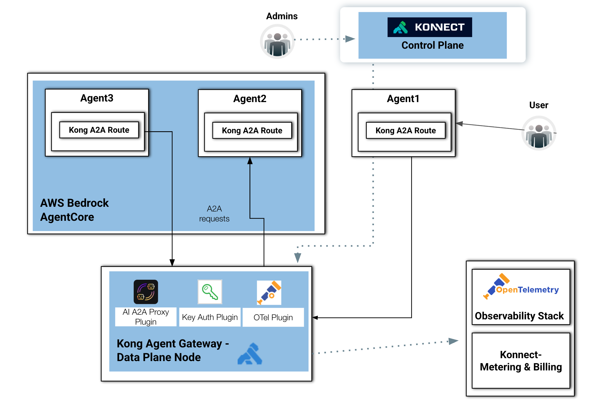

# Step 3: Put an AgentCore agent behind Kong's Agent (A2A) Gateway

[← Step 2](2-kong-konnect-data-plane.md) · **Step 3** · [Step 4 →](4-mcp-gateway.md)

## Why this step

Amazon Bedrock AgentCore is a strong place to *run* agents. It gives you a managed runtime, scaling and built-in inbound authentication. What it doesn't give you on its own is one shared front door that **other agents** (inside AWS, in another cloud or on a laptop) can reach using a plain A2A call, with one set of policies, logs and metrics across all of them.

This step builds that front door. You deploy a small A2A agent to AgentCore, then publish it through Kong at `https://kong-dp.<your domain>/a2a`. Callers don't need AWS credentials. They need an OAuth2 token from **Kong Identity**.

### How Kong reaches AgentCore

An AgentCore runtime accepts **either** IAM (SigV4) signatures **or** JWT bearer tokens for inbound calls, not both ([AWS docs](https://docs.aws.amazon.com/bedrock-agentcore/latest/devguide/runtime-oauth.html)). Kong's **AI A2A Proxy** plugin, in Kong Gateway 3.14, can't sign requests with AWS IAM: its configuration has only `max_request_body_size` and `logging` settings. So this step gives the runtime **JWT inbound auth** that trusts tokens issued by Kong Identity:

1. A caller gets a short-lived token from Kong Identity (client credentials grant).
2. It calls `https://kong-dp.<your domain>/a2a` with that token. Kong forwards the call, token included, to AgentCore.
3. AgentCore checks the token's issuer, signature and `client_id` before the agent runs.

[Step 5](5-kong-identity-oauth2.md) then makes Kong check the token as well, so invalid calls are stopped at the gateway and never reach AWS.

## What it does, in plain English

1. **Explains** the A2A flow and Kong's plugins (diagram and background).
2. **Runs a "hello world" A2A agent on your laptop** (`server_1.py`) and calls it directly, so you can see what A2A requests and responses look like.
3. **Deploys the same agent to AgentCore** with the AgentCore CLI and calls it with SigV4-signed `awscurl`. This runtime (`agent`) uses AgentCore's default IAM auth, and proves the agent runs on AgentCore.
4. **Creates the token issuer:** an authorization server, scope, claim and client in Kong Identity.
5. **Adds a second runtime (`agentjwt`)** with the same code and JWT inbound auth that trusts Kong Identity, and calls it with a bearer token.
6. **Publishes `agentjwt` through Kong.** A decK file creates a Kong service pointing at that runtime, with the `ai-a2a-proxy` plugin. You then call it with plain `curl` and a token.
7. **Shows a second agent** (`client_1.py`) that discovers and talks to the first one through Kong.

## Before you start

- Steps 1 and 2 are complete, and `PAT` and `AWS_DOMAIN` are still exported.
- Python with the A2A SDK, set up as described in [code/a2a/python-a2a-sdk-install.md](code/a2a/python-a2a-sdk-install.md) (uses `uv`).
- Node.js/npm for the AgentCore CLI, plus [`awscurl`](https://pypi.org/project/awscurl/), decK and `jwt-cli`.
- AgentCore available in `us-west-2` for your account.

> **Things to know before you copy commands from this step**
>
> - **Tested versions.** This step was last run end to end with Kong Gateway `3.14.0.3`, AgentCore CLI `1.1.0`, `a2a-sdk` `1.3.1` and decK `1.70`. The AgentCore CLI changes quickly, so if a command or file layout differs, check `agentcore <command> --help`.
> - **Two versions of the agent.** The agent code shown inline below is a simpler version of [`code/a2a/server_1.py`](code/a2a/server_1.py). The file adds middleware that logs request headers and infers the `A2A-Version` header from the request body. The AgentCore deployment copies `server_1.py`, so the file is what actually runs there.
> - **This step starts from a clean slate.** `deck gateway reset ... -f` deletes all existing configuration on the `kong-aws` control plane before `sync` applies `ai-a2a-proxy.yaml`. Steps 4 and 5 then add to it with `deck gateway apply`, which doesn't delete anything. If you re-run this step later, re-run the `apply` commands in Steps 4 and 5 afterwards.
> - **Keep one terminal.** The AgentCore, Kong Identity and Kong sections all reuse variables exported earlier in this step (`AGENTCORE_URL`, `ISSUER_URL`, `CLIENT_ID`, `CLIENT_SECRET`, `JWT_URL`), and Step 5 needs them too.

---

# The A2A Flow

This diagram illustrates a secure and observable Agent-to-Agent (A2A) communication architecture built using **AWS Bedrock AgentCore**, **Kong Agent Gateway**, and **Konnect** as the centralized control plane.



The design demonstrates how multiple AI agents can communicate with one another through standardized **A2A Protocol** and routes while Kong provides governance, authentication, telemetry, and operational control.

On the left side, a User initiates requests that are handled by an AI agent running inside AWS Bedrock AgentCore.

Within the AgentCore environment there are two agents. Each agent consumes a Kong A2A Route, representing a gateway-managed endpoint for agent-to-agent communication.

This means the agents are not communicating directly through unmanaged channels. Instead, all interactions pass through Kong-governed A2A routes, enabling:

* security enforcement,
* observability,
* authentication,
* traffic control,
* and policy management.

## Internal Agent and External / Federated Agent Communications

As you can see in the diagram, Agent1 exists outside the AWS Bedrock AgentCore boundary and consumes a Kong A2A Route, allowing it to participate in the same governed communication framework.

It sends requests toward Agent2 through the Kong-managed A2A route which are routed downward into the Kong Agent Gateway Data Plane Node before reaching the target agent.

This demonstrates:
* federated agent architectures,
* multi-runtime agent ecosystems,
* or cross-environment AI interoperability.

Also, it creates a secure hub-and-spoke architecture for distributed Agentic Application Systems.

## Kong Agent Gateway

At the center-bottom is the Kong Agent Gateway, which acts as the runtime enforcement and routing layer for all A2A traffic.

The gateway contains several important plugins:

* **AI A2A Proxy Plugin**: This is the core plugin responsible for:
    * brokering agent-to-agent communication
    * routing A2A protocol traffic
    * mediating requests between agents
    * standardizing communication semantics

* **Key Auth Plugin**: The Key Authentication Plugin secures communication between agents by enforcing:
    * API keys
    * identity validation
    * access policies

* **OTel Plugin**: The OpenTelemetry Plugin exports metrics, logs and traces. This enables deep observability into:
    * agent execution
    * inter-agent latency
    * request flows
    * failures
    * operational performance

## Kong Konnect Plugins

One of the main capabilities the Kong Gateway provides is extensibility. An extensive list of plugins allows you to implement specific policies to protect and control the APIs deployed in the gateway. The plugins offload critical and complex processing usually implemented by backend services and apps. With the Gateway and its plugins in place, the backend services can focus on business logic only, leading to a faster app development processes. Each plugin is responsible for specific functionality, including:

* Authentication/authorization to implement security mechanisms such as basic authentication, LDAP, mutual TLS (mTLS), API key, open policy agent (OPA)-based access control policies, etc.
* Traffic control to implement canary releases, mocking endpoints, and routing policies based on request headers, etc.
* Transformations to transform requests before routing them to the upstreams and to transform responses before returning to the consumers.
* Proxy Caching Advanced and GraphQL Proxy Caching Advanced cache and serve requested responses.
* Rate limiting, rate limiting advanced, service protection, and GraphQL rate limiting advanced – rate limit how many HTTP requests can be made in a given time frame.
* OpenID Connect and Upstream OAuth for session storage and token caching.
* Integration with Kafka-based data/event streaming infrastructures.
* WebSockets Size Limit and WebSockets Validator plugins to control the events sent by the devices for IoT projects where MQTT over WebSockets connections are extensively used.

### Kong AI gateway plugins

On the other hand, Kong AI Gateway leverages the existing Kong API Gateway extensibility model to provide specific AI-based plugins more precisely to protect LLM infrastructures, including:

* **AI Proxy** and **AI Proxy Advanced** plugins use multi-LLM capability to abstract and load balance multiple LLM models based on policies, including latency time, model usage, semantics, etc.
* Prompt engineering templates:
    * **AI Prompt Template** plugin is responsible for pre-configuring AI prompts to users.
    * **AI Prompt Decorator** plugin injects messages at the start or end of a caller’s chat history.
    * **AI Prompt Guard** plugin lets you configure a series of PCRE-compatible regular expressions to allow and block specific prompts, words, phrases, etc and have more control over an LLM service.
    * **AI Semantic Prompt Guard** plugin enables self-configurable semantic (or pattern-matching) prompt protection.
* **AI Semantic Cache** plugin caches responses based on threshold to improve performance (and therefore end-user experience) while optimizing for cost.
* **AI Rate Limiting Advanced** lets you tailor per-user or per-model policies based on the tokens returned by the LLM provider or craft a custom functions to count the tokens for requests.
* **AI Request Transformer** and **AI Response Transformer** plugins seamlessly integrate with LLMs, enabling introspection and transformation of a request’s body before proxying it to the upstream service prior to forwarding the response to the client.
* **MCP Proxy** and **MCP OAuth2** abstract and protect MCP Servers and RESTful API.

## Konnect Control Plane

At the top-right, administrators interact with the Konnect Control Plane. The dotted management connection indicates that Konnect centrally manages Kong Agent Gateway configuration, including A2A routes, plugin policies, authentication settings, etc.

Konnect distributes configuration to the Kong data plane nodes without being directly involved in runtime traffic.

## Observability and Metering

Konnect provides out-of-the box Observability capabilities, including dashboard, reports, etc. At the sames, as described in the diagram, telemetry and usage data can be exported to external OpenTelemetry Observability Stack. Similarly, Konnect Metering & Billing service can be used to chargeback or quota enforcement.

# The A2A Protocol

The official [Agent2Agent (A2A) Protocol](https://a2a-protocol.org/) portal defines it as follows:
"The A2A protocol is an open standard that enables seamless communication and collaboration between AI agents."

Conceptually, A2A, announced by [Google in April 2025](https://developers.googleblog.com/en/a2a-a-new-era-of-agent-interoperability), treats agents as networked participants that exchange structured requests and responses around tasks and outcomes instead of exposing internal implementation details. This model aligns naturally with controller/task-worker architectures: a coordinating agent can decompose work, assign subtasks to specialized agents, monitor progress, and aggregate results. By separating orchestration from execution, A2A supports scalable multi-agent systems where capabilities can evolve independently while maintaining a consistent communication contract.

The lastest [A2A 1.0 Protocol Specification](https://a2a-protocol.org/v1.0.0/specification/) page provides a nice introduction including [main concepts and main components](https://a2a-protocol.org/v1.0.0/topics/key-concepts/).

## The first Agent

To get started consider this [basic Agent](code/a2a/server_1.py).

```
import uuid
import uvicorn

from starlette.applications import Starlette


from a2a.server.agent_execution import AgentExecutor
from a2a.server.request_handlers import DefaultRequestHandler
from a2a.server.tasks import InMemoryTaskStore
from a2a.server.routes.agent_card_routes import create_agent_card_routes
from a2a.server.routes.jsonrpc_routes import create_jsonrpc_routes

from a2a.types import (
    AgentCapabilities,
    AgentCard,
    AgentInterface,
    AgentSkill,
    # TaskArtifactUpdateEvent,
    TaskState,
)

from a2a.server.tasks import TaskUpdater
from a2a.helpers import new_text_artifact, new_task


class HelloWorldAgentExecutor(AgentExecutor):
    async def execute(self, context, event_queue): # -> None:
        # message/send and message/stream both arrive here

        # A2A separates task lifecycle from task output.
        # 1. announce task exists / started
        task = context.current_task
        if task is None:
            task = new_task(
                task_id=context.task_id or str(uuid.uuid4()),
                context_id=context.context_id or str(uuid.uuid4()),
                state=TaskState.TASK_STATE_SUBMITTED,
                history=[context.message] if context.message else None,
        )
        await event_queue.enqueue_event(task)
        updater = TaskUpdater(event_queue, task.id, task.context_id)

        # 2. task output event (task produced content)
        result = "that's the response"
        await updater.add_artifact(
            parts=new_text_artifact(
                name="result",
                text="that's the response",
            ).parts,
            name="result",
        )
        await updater.complete()


    async def cancel(self, context, event_queue): # -> None:
        raise Exception('cancel not supported')
        


if __name__ == '__main__':
    skill = AgentSkill(
        id='hello_world',
        name='Returns hello world',
        description='just returns hello world',
        tags=['hello world'],
        examples=['hi', 'hello world'],
    )

    agent_card = AgentCard(
        name='Hello World Agent',
        description='Just a hello world agent',
        version='1.0.0',
        icon_url='http://localhost:9000/icon.png',
        supported_interfaces=[
            AgentInterface(
                url='http://localhost:9000',
                protocol_binding='JSONRPC',
                protocol_version='1.0',
            ),
        ],
        default_input_modes=['text'],
        default_output_modes=['text'],
        capabilities=AgentCapabilities(streaming=True),
        skills=[skill],
    )

    request_handler = DefaultRequestHandler(
        agent_card=agent_card,
        agent_executor=HelloWorldAgentExecutor(),
        task_store=InMemoryTaskStore(),
    )

    routes = [
        *create_agent_card_routes(agent_card=agent_card),
        *create_jsonrpc_routes(
            request_handler=request_handler,
            rpc_url='/',
            enable_v0_3_compat=True,
        ),
    ]

    app = Starlette(routes=routes)
    uvicorn.run(app, host='0.0.0.0', port=9000)
```

The Agent defines an AgentCard with has only one Skill. Here are some concise definitions provided by the **A2A Protocol** specification:
* An [Agent Skill](https://a2a-protocol.org/v1.0.0/tutorials/python/3-agent-skills-and-card/#agent-skills) describes a specific capability or function the Agent can perform. It's a building block that tells clients what kinds of tasks the agent is good for.
* An [Agent Card](https://a2a-protocol.org/v1.0.0/tutorials/python/3-agent-skills-and-card/#agent-card) is a JSON document that an A2A Server makes available, typically at a [.well-known/agent-card.json endpoint](https://a2a-protocol.org/v1.0.0/topics/agent-discovery/#1-well-known-uri). It's like a digital business card for the agent.

To try it out, make sure you have [Python and the official A2A SDK](code/a2a/python-a2a-sdk-install.md) installed.

Put the Agent to run:
```
python3 server_1.py
```

### Discovery Endpoint
In another terminal send a request to its discovery endpoint:
```
curl -s http://127.0.0.1:9000/.well-known/agent-card.json | jq
```

You should get something like:
```
{
  "name": "Hello World Agent",
  "description": "Just a hello world agent",
  "supportedInterfaces": [
    {
      "url": "http://localhost:9000/",
      "protocolBinding": "JSONRPC",
      "protocolVersion": "1.0"
    }
  ],
  "version": "1.0.0",
  "capabilities": {
    "streaming": true
  },
  "defaultInputModes": [
    "text"
  ],
  "defaultOutputModes": [
    "text"
  ],
  "skills": [
    {
      "id": "hello_world",
      "name": "Returns hello world",
      "description": "just returns hello world",
      "tags": [
        "hello world"
      ],
      "examples": [
        "hi",
        "hello world"
      ]
    }
  ],
  "iconUrl": "http://localhost:9000/icon.png"
}
```

### Agent request

As described in the Card, the Agent has only one SKill. If you send a request you should be able to see a response:

```
curl -sX POST http://127.0.0.1:9000 \
  -H "Content-Type: application/json" \
  -H "A2A-Version: 1.0" \
  --json '{
    "jsonrpc": "2.0",
    "id": "1",
    "method": "SendMessage",
    "params": {
      "message": {
        "messageId": "msg-001",
        "role": "ROLE_USER",
        "parts": [
          {
            "text": "How much is 100 USD in EUR?"
          }
        ]
      }
    }
  }' | jq
```

```
curl -sX POST http://127.0.0.1:9000 \
     -H "Content-Type: application/json" \
     --json '{
       "jsonrpc": "2.0",
       "id": "1",
       "method": "message/send",
       "params": {
         "message": {
           "kind": "message",
           "messageId": "msg-001",
           "role": "user",
           "parts": [
             {
               "kind": "text",
               "text": "How much is 100 USD in EUR?"
             }
           ]
         }
       }
     }' | jq
```

You should see a response like this:
```
{
  "id": "1",
  "jsonrpc": "2.0",
  "result": {
    "artifacts": [
      {
        "artifactId": "87f7e375-1e7a-40fe-9b7f-cf7f16e55893",
        "name": "result",
        "parts": [
          {
            "kind": "text",
            "text": "that's the response"
          }
        ]
      }
    ],
    "contextId": "c01764fb-d5a7-44d6-8435-d25e6f4d68bf",
    "history": [
      {
        "contextId": "c01764fb-d5a7-44d6-8435-d25e6f4d68bf",
        "kind": "message",
        "messageId": "msg-001",
        "parts": [
          {
            "kind": "text",
            "text": "How much is 100 USD in EUR?"
          }
        ],
        "role": "user",
        "taskId": "ffd933ef-7347-4419-a800-683b443f2a93"
      }
    ],
    "id": "ffd933ef-7347-4419-a800-683b443f2a93",
    "kind": "task",
    "status": {
      "state": "completed",
      "timestamp": "2026-05-25T20:04:59.292857Z"
    }
  }
}
```

## A2A Inspector

https://github.com/a2aproject/a2a-inspector

> **Checkpoint: the agent works locally.** The discovery call returns the Agent Card and the `SendMessage` / `message/send` calls return an artifact with the text `that's the response`. If both work, stop `server_1.py` with `Ctrl+C` and move on to AgentCore. (The A2A Inspector linked above is an optional UI for exploring A2A agents.)

# Amazon Bedrock AgentCore

## Create the project

Let's use the [AgentCore CLI](https://docs.aws.amazon.com/bedrock-agentcore/latest/devguide/agentcore-get-started-cli.html) to deploy the agent. Its [GitHub repo](https://github.com/aws/agentcore-cli) has a comprehensive command reference.

```
npm install -g @aws/agentcore
agentcore --version
```

Create the project from the A2A Python template. Run this outside this repo, for example in a working folder of your own. Older CLI versions took `--defaults`; current versions take `--template` (`agentcore create --help` lists the templates).
```
agentcore create --name agentcorekong --template a2a-python-strands --region us-west-2
cd agentcorekong
```

This creates `agentcore/agentcore.json` (the project spec) and `app/agent/` (the code for a runtime named `agent`). The template's code is a Strands LLM agent. Replace it with this guide's agent, using the path to your clone of this repo:
```
cp <path-to-this-repo>/code/a2a/server_1.py app/agent/
```

### Agent configuration

The template's `app/agent/pyproject.toml` pins `a2a-sdk ~= 0.3`, but `server_1.py` uses the 1.x API (`a2a.helpers`, `a2a.server.routes`), so the agent would crash on start. It also pulls in Strands, which this agent doesn't use. Replace the file:

```
cat > app/agent/pyproject.toml << 'EOF'
[build-system]
requires = ["hatchling ~= 1.27.0"]
build-backend = "hatchling.build"

[project]
name = "agent"
version = "0.1.0"
description = "A2A hello world agent for the Kong guide"
readme = "README.md"
requires-python = ">=3.10"
dependencies = [
    "a2a-sdk[all]",
    "uvicorn",
    "aws-opentelemetry-distro",
    "bedrock-agentcore",
    "botocore[crt]",
]

[tool.hatch.build.targets.wheel]
packages = ["."]
EOF
```

The deployment installs dependencies from `pyproject.toml`. To check the imports on your laptop first (optional), refresh the template's lockfile, which also pins the old SDK:
```
cd app/agent
uv lock --upgrade-package a2a-sdk
uv sync
uv run python -c "import a2a.helpers, a2a.server.routes.agent_card_routes; print('imports OK')"
cd ../..
```

Point the runtime at `server_1.py` and remove the template's memory store, which this agent doesn't use and which would be billed:
```
jq '.memories = [] | .runtimes[0].entrypoint = "server_1.py"' agentcore/agentcore.json > /tmp/ac.json && mv /tmp/ac.json agentcore/agentcore.json
cat agentcore/agentcore.json
```

You should see:
```
{
  "name": "agentcorekong",
  "version": 2,
  "managedBy": "CDK",
  "runtimes": [
    {
      "name": "agent",
      "build": "CodeZip",
      "modelProvider": "Bedrock",
      "entrypoint": "server_1.py",
      "codeLocation": "app/agent",
      "runtimeVersion": "PYTHON_3_14",
      "protocol": "A2A"
    }
  ],
  "memories": []
}
```

### Deploy the Agent

```
agentcore deploy --region us-west-2
```

The first deploy creates a target named `default` in `agentcore/aws-targets.json` from your current account and region, and bootstraps CDK in the account if it hasn't been. It takes about 5 to 10 minutes and ends with `Deploy to AWS Complete`. If it can't find credentials from an `aws login` session, export them first with `eval "$(aws configure export-credentials --format env)"`.

## Check the Status

`agentcore status` opens an interactive view (press `q` to leave). For scripts, use the JSON form:
```
agentcore status --json
```

Here's an example:
```
{
  "projectName": "agentcorekong",
  "target": "default",
  "region": "us-west-2",
  "resources": [
    {
      "resourceType": "runtime",
      "name": "agent",
      "deploymentState": "deployed",
      "arn": "arn:aws:bedrock-agentcore:us-west-2:<YOUR_AWS_ACCOUNT>:runtime/agentcorekong_default_agent-XXXXXXXXXX"
    }
  ]
}
```

The CLI doesn't print the invocation URL, so build it from the runtime ARN (URL-encoded):
```
export AGENTCORE_ARN=$(agentcore status --json | jq -r '.resources[] | select(.name=="agent") | .arn')
export AGENTCORE_IDENTIFIER="${AGENTCORE_ARN##*/}"
export AGENTCORE_URL="https://bedrock-agentcore.us-west-2.amazonaws.com/runtimes/$(jq -rn --arg a "$AGENTCORE_ARN" '$a|@uri')/invocations"
echo $AGENTCORE_URL
```

Check that the runtime is ready:
```
aws bedrock-agentcore-control get-agent-runtime \
  --agent-runtime-id $AGENTCORE_IDENTIFIER \
  --region us-west-2 --query status --output text
```

It should print `READY`.

## Call it with SigV4

This runtime uses AgentCore's default inbound auth, so every request must be SigV4-signed. Use [**awscurl**](https://pypi.org/project/awscurl/), which signs with your local AWS credentials.

Discovery endpoint:
```
awscurl \
  --service bedrock-agentcore \
  --region us-west-2 \
  $AGENTCORE_URL/.well-known/agent-card.json
```

Send a request:
```
awscurl -X POST \
  $AGENTCORE_URL \
  --service bedrock-agentcore \
  --region us-west-2 \
  -H "Content-Type: application/json" \
  -d '{
  "jsonrpc": "2.0",
  "id": "1",
  "method": "message/send",
  "params": {
    "message": {
      "kind": "message",
      "messageId": "msg-001",
      "role": "user",
      "parts": [
        {
          "kind": "text",
          "text": "How much is 100 USD in EUR?"
        }
      ]
    }
  }
}' | jq
```

```
awscurl -X POST \
  $AGENTCORE_URL \
  --service bedrock-agentcore \
  --region us-west-2 \
  -H "Content-Type: application/json" \
  -H "A2A-Version: 1.0" \
  -d '{
    "jsonrpc": "2.0",
    "id": "1",
    "method": "SendMessage",
    "params": {
      "message": {
        "messageId": "msg-001",
        "role": "ROLE_USER",
        "parts": [
          {
            "text": "How much is 100 USD in EUR?"
          }
        ]
      }
    }
  }' | jq
```

## Check the Agent logs

```
export LOGGROUPNAME="/aws/bedrock-agentcore/runtimes/$AGENTCORE_IDENTIFIER-DEFAULT"

aws logs tail $LOGGROUPNAME \
  --follow \
  --region us-west-2
```

A Python traceback here usually means a missing dependency or an import error. Check `pyproject.toml` first.

> **Checkpoint: the agent works on AgentCore.** `get-agent-runtime` prints `READY`, and the signed `awscurl` request returns the same `that's the response` artifact you saw locally.

# Kong Identity: the token issuer AgentCore will trust

Kong can't produce the SigV4 signature the `agent` runtime requires, so Kong will front a second runtime that accepts JWT bearer tokens instead. That runtime needs to know which issuer to trust, so create the issuer first: an authorization server in **Kong Identity**, the OAuth2 server built into Konnect. Step 5 explores it in more detail.

The commands use the [Kong Identity API](https://developer.konghq.com/api/konnect/kong-identity) in the Konnect **US** region, and take each ID straight from its create response.

Create the authorization server:
```
AUTHZ_JSON=$(curl -s -X POST https://us.api.konghq.com/v1/auth-servers \
  -H "Authorization: Bearer $PAT" \
  --json '{"name":"AuthZ_Server_1","audience":"http://kong.dev","description":"AuthZ Server 1"}')
echo "$AUTHZ_JSON" | jq '{id, name, audience, issuer}'
export AUTHZ_SERVER_ID=$(echo "$AUTHZ_JSON" | jq -r .id)
export ISSUER_URL=$(echo "$AUTHZ_JSON" | jq -r .issuer)
```

You should see an `id` and an issuer like `https://xxxxxx.us.identity.konghq.com/auth`. Authorization server names are unique per organization and region, so if the name is taken, pick another.

Add a scope and a custom claim:
```
SCOPE_JSON=$(curl -s -X POST "https://us.api.konghq.com/v1/auth-servers/$AUTHZ_SERVER_ID/scopes" \
  -H "Authorization: Bearer $PAT" \
  --json '{"name":"scope1","description":"scope1","default":false,"include_in_metadata":false,"enabled":true}')
echo "$SCOPE_JSON" | jq '{id, name}'
export SCOPE_ID=$(echo "$SCOPE_JSON" | jq -r .id)
```

```
curl -s -X POST "https://us.api.konghq.com/v1/auth-servers/$AUTHZ_SERVER_ID/claims" \
  -H "Authorization: Bearer $PAT" \
  --json '{"name":"claim1","value":"claim1","include_in_token":true,"include_in_all_scopes":false,"include_in_scopes":["'$SCOPE_ID'"],"enabled":true}' | jq '{id, name}'
```

Create the client, the machine-to-machine credential callers will use. Its tokens last **900 seconds (15 minutes)**: AgentCore rejects any token that expires within about a minute (`Ineffectual token, will expire within the next minute`), so a 60-second token would always fail.
```
CLIENT_JSON=$(curl -s -X POST "https://us.api.konghq.com/v1/auth-servers/$AUTHZ_SERVER_ID/clients" \
  -H "Authorization: Bearer $PAT" \
  --json '{"name":"client1","grant_types":["client_credentials"],"allow_all_scopes":false,"allow_scopes":["'$SCOPE_ID'"],"access_token_duration":900,"id_token_duration":900,"response_types":["id_token","token"]}')
echo "$CLIENT_JSON" | jq 'del(.client_secret)'
export CLIENT_ID=$(echo "$CLIENT_JSON" | jq -r .id)
export CLIENT_SECRET=$(echo "$CLIENT_JSON" | jq -r .client_secret)
echo "secret length: ${#CLIENT_SECRET}"
```

Konnect shows the client secret only once, and these commands keep it in your shell rather than on screen. If you lose it, create a new client.

Get a token and check the claims AgentCore will validate:
```
TOKEN=$(curl -s -X POST "$ISSUER_URL/oauth/token" \
  -H "Content-Type: application/x-www-form-urlencoded" \
  -d "grant_type=client_credentials" -d "client_id=$CLIENT_ID" \
  -d "client_secret=$CLIENT_SECRET" -d "scope=scope1" | jq -r '.access_token')
echo $TOKEN | jwt decode - | sed -n '/Token claims/,$p'
curl -s $ISSUER_URL/.well-known/openid-configuration | jq '{issuer, jwks_uri}'
```

The token's `iss` must equal the `issuer` in the discovery document, and `client_id` must equal `$CLIENT_ID`. `exp` minus `iat` should be `900`.

# A second runtime that accepts Kong Identity tokens

Add a runtime named `agentjwt` to the same project, with a custom JWT authorizer. AgentCore fetches Kong Identity's signing keys from the discovery URL and accepts only tokens issued to your client. The CLI spells the key `customJwtAuthorizer`, while the AWS API spells it `customJWTAuthorizer`.

```
AUTH_CFG=$(jq -nc --arg d "$ISSUER_URL/.well-known/openid-configuration" --arg c "$CLIENT_ID" \
  '{customJwtAuthorizer:{discoveryUrl:$d,allowedClients:[$c]}}')
echo "$AUTH_CFG"

agentcore add runtime --name agentjwt --language python --protocol A2A \
  --authorizer-type CUSTOM_JWT --authorizer-configuration "$AUTH_CFG"
```

The command writes only template docs into `app/agentjwt/`. Give it the same code and dependencies as the first runtime, and point its entrypoint at `server_1.py`:
```
cp app/agent/server_1.py app/agentjwt/
sed 's/^name = "agent"/name = "agentjwt"/' app/agent/pyproject.toml > app/agentjwt/pyproject.toml
jq '.runtimes |= map(if .name=="agentjwt" then .entrypoint="server_1.py" else . end)' agentcore/agentcore.json > /tmp/ac.json && mv /tmp/ac.json agentcore/agentcore.json
jq '.runtimes[] | {name, entrypoint, authorizerType, authorizerConfiguration}' agentcore/agentcore.json
```

You should see `agent` with no authorizer and `agentjwt` with `"authorizerType": "CUSTOM_JWT"`, your discovery URL and your client ID, both with `server_1.py`.

Deploy again. This adds the second runtime and leaves the first as it is:
```
agentcore deploy --region us-west-2
```

Build the new runtime's URL:
```
export JWT_ARN=$(agentcore status --json | jq -r '.resources[] | select(.name=="agentjwt") | .arn')
export JWT_URL="https://bedrock-agentcore.us-west-2.amazonaws.com/runtimes/$(jq -rn --arg a "$JWT_ARN" '$a|@uri')/invocations"
echo $JWT_URL
```

Call it **directly**, with a bearer token and no SigV4 signature. Fetch a fresh token first:
```
TOKEN=$(curl -s -X POST "$ISSUER_URL/oauth/token" \
  -H "Content-Type: application/x-www-form-urlencoded" \
  -d "grant_type=client_credentials" -d "client_id=$CLIENT_ID" \
  -d "client_secret=$CLIENT_SECRET" -d "scope=scope1" | jq -r '.access_token')

curl -s -X POST "$JWT_URL" \
  -H "Authorization: Bearer $TOKEN" \
  --json '{"jsonrpc":"2.0","id":"1","method":"message/send","params":{"message":{"kind":"message","messageId":"msg-001","role":"user","parts":[{"kind":"text","text":"hi"}]}}}' | jq
```

The result contains the `that's the response` artifact. No session ID header is needed.

> **Checkpoint: AgentCore trusts Kong Identity.** The `agentjwt` runtime answers a bearer-token call. From here on, the SigV4 `agent` runtime isn't used. You can keep it for comparison or remove it (see [Tearing this step down](#tearing-this-step-down)).

**What the next section does.** The first command strips the host from `JWT_URL` and keeps only the path, which identifies the `agentjwt` runtime. The `cat > ai-a2a-proxy.yaml` block writes a decK file that defines:

- a Kong **service** `a2a-agentcore` pointing at `bedrock-agentcore.us-west-2.amazonaws.com` plus that path,
- a **route** `a2a-route` that answers on `/a2a`,
- the **`ai-a2a-proxy`** plugin, set to log A2A statistics and payloads. It has no upstream authentication settings, so the caller's `Authorization` header passes through to AgentCore unchanged.

`deck gateway sync` then pushes it to the `kong-aws` control plane, and Konnect hands it to your data plane on EKS.

# Kong Agent Gateway

## Kong AI A2A Proxy Plugin

```
export DECK_AGENTCORE_PATH="${JWT_URL#*bedrock-agentcore.us-west-2.amazonaws.com}"
echo $DECK_AGENTCORE_PATH
```

It should print a path starting with `/runtimes/arn%3Aaws` and ending in `/invocations`.

```
cat > ai-a2a-proxy.yaml << 'EOF'
_format_version: "3.0"
services:
- name: a2a-agentcore
  protocol: https
  host: bedrock-agentcore.us-west-2.amazonaws.com
  port: 443
  path: ${{ env "DECK_AGENTCORE_PATH" }}
  routes:
    - name: a2a-route
      paths:
      - "/a2a"
      strip_path: true
      protocols:
      - http
      - https
      plugins:
      - name: ai-a2a-proxy
        instance_name: ai-a2a-proxy1
        enabled: true
        config:
          max_request_body_size: 0
          logging:
            log_statistics: true
            log_payloads: true
EOF
```

## Configure Kong Data Plane
```
deck gateway ping --konnect-control-plane-name kong-aws --konnect-token $PAT
```

```
deck gateway reset --konnect-control-plane-name kong-aws --konnect-token $PAT -f
deck gateway sync --konnect-control-plane-name kong-aws --konnect-token $PAT ai-a2a-proxy.yaml
```

The `sync` should report `Created: 3` (service, route and plugin).

## Send a request

Wait about 10 seconds for Konnect to push the configuration, get a fresh token, then call the agent through Kong:

```
TOKEN=$(curl -s -X POST "$ISSUER_URL/oauth/token" \
  -H "Content-Type: application/x-www-form-urlencoded" \
  -d "grant_type=client_credentials" -d "client_id=$CLIENT_ID" \
  -d "client_secret=$CLIENT_SECRET" -d "scope=scope1" | jq -r '.access_token')

curl -sX POST https://kong-dp.$AWS_DOMAIN/a2a \
     -H "Authorization: Bearer $TOKEN" \
     --json '{
       "jsonrpc": "2.0",
       "id": "1",
       "method": "message/send",
       "params": {
         "message": {
           "kind": "message",
           "messageId": "msg-001",
           "role": "user",
           "parts": [
             {
               "kind": "text",
               "text": "How much is 100 USD in EUR?"
             }
           ]
         }
       }
     }' | jq
```

Now send the same request **without** the `Authorization` header. AgentCore refuses it:
```
{"jsonrpc":"2.0","error":{"code":-32001,"message":"Missing Authentication Token"}}
```

At this point Kong passes every request through and only AgentCore checks the token. [Step 5](5-kong-identity-oauth2.md) adds the check at the gateway.

> **Checkpoint: the agent works through Kong.** With a token, the `curl` to `https://kong-dp.$AWS_DOMAIN/a2a` returns the same artifact as the direct call. The caller needs no AWS credentials, only a Kong Identity token.

The code below is the same as [`code/a2a/client_1.py`](code/a2a/client_1.py). Set it up as "Agent 2" in [python-a2a-sdk-install.md](code/a2a/python-a2a-sdk-install.md), and point `base_url` at `https://kong-dp.<your domain>/a2a`. It resolves the Agent Card through Kong, then lets you chat with the AgentCore agent.

> **Not yet updated for tokens.** `client_1.py` doesn't send an `Authorization` header, so AgentCore (and, after Step 5, Kong) rejects its calls. To use it, add the header to the `httpx.AsyncClient`, for example `headers={"Authorization": f"Bearer {token}"}`. This hasn't been tested yet.

# The second Agent

```
import asyncio
import httpx
from a2a.client import A2ACardResolver, ClientFactory, ClientConfig
from a2a.types import (
    Message,
    Part,
    TextPart,
    Role,
    TransportProtocol,
)

from uuid import uuid4


async def main():
    base_url = 'http://kong-dp.kong-demo.com/a2a'

    async with httpx.AsyncClient(timeout=60.0 ) as httpx_client:
        # 1. Resolve the agent card
        resolver = A2ACardResolver(
            httpx_client=httpx_client,
            base_url=base_url,
        )
        agent_card = await resolver.get_agent_card()
        print("----- Agent Card -----")
        print(agent_card.model_dump_json(indent=2))
        print("----- Agent Card -----")

        # 2. Create client via ClientFactory
        factory = ClientFactory(
            ClientConfig(
                supported_transports=[TransportProtocol.jsonrpc],
                use_client_preference=True,
                httpx_client=httpx_client,
            )
        )
        client = factory.create(agent_card)

        # 3. Send Messages
        print("\nAgent ready. Type 'quit' to exit.\n")
        while True:
            try:
                prompt = input("User: ")
            except (EOFError, KeyboardInterrupt):
                break
            if prompt.strip().lower() in ("quit", "exit"):
                break
            message = Message(
                role=Role.user,
                parts=[Part(root=TextPart(text=prompt))],
                messageId=str(uuid4()),
            )

            async for event in client.send_message(message):
                if isinstance(event, Message):
                    for part in event.parts:
                        print(part.root.text)
                else:
                    task, update = event
                    print(task)


asyncio.run(main())
```

---

## Verify

A `curl -sX POST https://kong-dp.<your domain>/a2a ...` with a fresh Kong Identity token (the "Send a request" command under *Kong Agent Gateway*) returns a JSON-RPC result whose artifact text is `that's the response`. Without a token, the call returns `Missing Authentication Token`.

That pair of responses proves the whole chain: Kong on EKS received the call and forwarded it, AgentCore validated the Kong Identity token, and the agent answered.

## Common problems

- **`agentcore create` says `--defaults` is unknown.** Current CLI versions use `--template`. Run `agentcore create --help` for the list.
- **The runtime starts, then crashes with `No module named 'a2a.helpers'`.** The template pins `a2a-sdk` 0.3.x. Replace `pyproject.toml` as shown above. Locally, also run `uv lock --upgrade-package a2a-sdk`.
- **`agentcore add runtime` says `authorizerConfiguration with customJwtAuthorizer is required`.** The JSON key must be spelled `customJwtAuthorizer` for the CLI.
- **A direct or Kong call returns `Ineffectual token, will expire within the next minute`.** The client's tokens are too short-lived. Set `access_token_duration` to 900 or more (a `PATCH` on the client, with the same fields as the create call) and fetch a new token.
- **`deck gateway sync` fails with `validation error: unknown field` on `ai-a2a-proxy`.** The config contains an `auth:` block. This plugin has no upstream auth settings in Kong 3.14. Remove the block.
- **Kong returns `Missing Authentication Token`.** The request had no `Authorization: Bearer` header, or the token wasn't issued to the client in the runtime's `allowedClients`.
- **`awscurl` returns 403.** `awscurl` signs with your local AWS credentials. Make sure they're set (`aws configure`, or export them from an `aws login` session) and allowed to invoke the runtime.
- **Kong returns 404 "no Route matched".** The configuration hasn't reached the data plane yet, or `deck gateway sync` failed. Re-run this step's `deck gateway sync` and check its output.
- **`DECK_AGENTCORE_PATH` is empty.** `JWT_URL` wasn't exported in the same shell. Re-run the `export JWT_ARN=...` and `export JWT_URL=...` commands.
- **More:** see [docs/troubleshooting.md](docs/troubleshooting.md#step-3-a2a-and-agentcore).

## Tearing this step down

`agentcore remove all -y`, then `agentcore deploy`, removes both runtimes (this teardown hasn't been re-tested with two runtimes). Delete the `AuthZ_Server_1` authorization server in Konnect (**Identity**) once you've finished Step 5.

[← Step 2](2-kong-konnect-data-plane.md) · **Step 3** · [Step 4 →](4-mcp-gateway.md)

---

## Appendix: working notes

> Scratch notes kept for reference: a CLI version check, a link to AgentCore Gateway's MCP semantic search, and two `jq` experiments that list tool names from a chat request. They're not part of the deployment path.

aws --version
aws-cli/2.15.46 Python/3.11.8 Linux/5.10.215–203.850.amzn2.x86_64 exe/x86_64.ubuntu.24 prompt/off

--- MCP Semantic Search tool
https://docs.aws.amazon.com/bedrock-agentcore/latest/devguide/gateway-using-mcp-semantic-search.html

echo "{\"messages\":[{\"role\":\"system\",\"content\":\"Be helpful\"},{\"role\":\"user\",\"content\":[{\"type\":\"text\",\"text\":\"hi\"}]}],\"stream_options\":{\"include_usage\":true},\"tools\":[{\"function\":{\"description\":\"Get orders for a user\",\"name\":\"get-orders\",\"parameters\":{\"properties\":{\"query_userid\":{\"type\":\"string\",\"description\":\"User ID to filter orders\"}},\"additionalProperties\":false,\"required\":[\"query_userid\"],\"type\":\"object\"}},\"type\":\"function\"},{\"function\":{\"description\":\"Get users\",\"name\":\"get-users\",\"parameters\":{\"properties\":{\"query_id\":{\"type\":\"string\",\"description\":\"Optional user ID\"}},\"required\":[],\"additionalProperties\":false,\"type\":\"object\"}},\"type\":\"function\"},{\"function\":{\"description\":\"Get the current balance for a given customer.\",\"name\":\"get_balance\",\"parameters\":{\"properties\":{\"customer_id\":{\"title\":\"Customer Id\",\"description\":\"Property customer_id\",\"type\":\"string\"}},\"required\":[\"customer_id\"],\"title\":\"get_balanceArguments\",\"type\":\"object\"}},\"type\":\"function\"}],\"stream\":true,\"model\":\"us.anthropic.claude-sonnet-4-20250514-v1:0\"}" | jq 

{
  "messages": [
    {
      "role": "system",
      "content": "Be helpful"
    },
    {
      "role": "user",
      "content": [
        {
          "type": "text",
          "text": "hi"
        }
      ]
    }
  ],
  "stream_options": {
    "include_usage": true
  },
  "tools": [
    {
      "function": {
        "description": "Get orders for a user",
        "name": "get-orders",
        "parameters": {
          "properties": {
            "query_userid": {
              "type": "string",
              "description": "User ID to filter orders"
            }
          },
          "additionalProperties": false,
          "required": [
            "query_userid"
          ],
          "type": "object"
        }
      },
      "type": "function"
    },
    {
      "function": {
        "description": "Get users",
        "name": "get-users",
        "parameters": {
          "properties": {
            "query_id": {
              "type": "string",
              "description": "Optional user ID"
            }
          },
          "required": [],
          "additionalProperties": false,
          "type": "object"
        }
      },
      "type": "function"
    },
    {
      "function": {
        "description": "Get the current balance for a given customer.",
        "name": "get_balance",
        "parameters": {
          "properties": {
            "customer_id": {
              "title": "Customer Id",
              "description": "Property customer_id",
              "type": "string"
            }
          },
          "required": [
            "customer_id"
          ],
          "title": "get_balanceArguments",
          "type": "object"
        }
      },
      "type": "function"
    }
  ],
  "stream": true,
  "model": "us.anthropic.claude-sonnet-4-20250514-v1:0"
}

echo "{\"messages\":[{\"content\":\"Be helpful\",\"role\":\"system\"},{\"content\":[{\"text\":\"list all users\",\"type\":\"text\"}],\"role\":\"user\"}],\"tools\":[{\"type\":\"function\",\"function\":{\"name\":\"x_amz_bedrock_agentcore_search\",\"description\":\"A special tool that returns a trimmed down list of tools given a context. Use this tool only when there are many tools available and you want to get a subset that matches the provided context.\",\"parameters\":{\"required\":[\"query\"],\"type\":\"object\",\"properties\":{\"query\":{\"type\":\"string\",\"description\":\"Property query\"}}}}},{\"type\":\"function\",\"function\":{\"name\":\"kong-agentcore-mcp___get_balance\",\"description\":\"Get the current balance for a given customer.\",\"parameters\":{\"required\":[\"customer_id\"],\"type\":\"object\",\"properties\":{\"customer_id\":{\"description\":\"Property customer_id\",\"type\":\"string\",\"title\":\"Customer Id\"}}}}},{\"type\":\"function\",\"function\":{\"name\":\"kong-mcp-gateway___get-orders\",\"description\":\"Get orders for a user\",\"parameters\":{\"additionalProperties\":false,\"required\":[\"query_userid\"],\"type\":\"object\",\"properties\":{\"query_userid\":{\"type\":\"string\",\"description\":\"User ID to filter orders\"}}}}},{\"type\":\"function\",\"function\":{\"name\":\"kong-mcp-gateway___get-users\",\"description\":\"Get users\",\"parameters\":{\"required\":[],\"additionalProperties\":false,\"type\":\"object\",\"properties\":{\"query_id\":{\"type\":\"string\",\"description\":\"Optional user ID\"}}}}}],\"stream_options\":{\"include_usage\":true},\"model\":\"us.anthropic.claude-sonnet-4-20250514-v1:0\",\"stream\":true}" \
| jq -r '.tools[].function.name'
get-orders
get-users
get_balance

