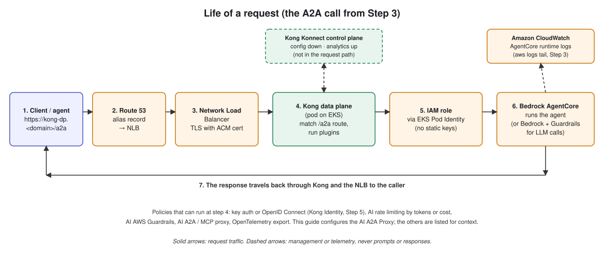
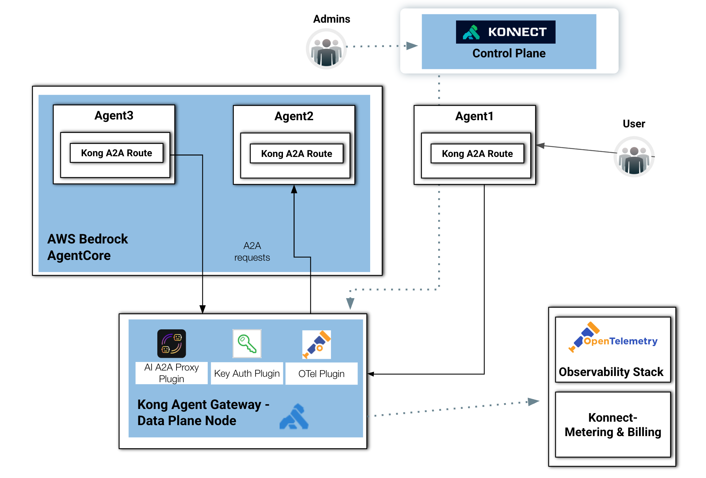

# Step 3: Put an AgentCore agent behind Kong's Agent (A2A) Gateway

[← Step 2](2-kong-konnect-data-plane.md) · **Step 3** · [Step 4 →](4-mcp-gateway.md)

## Why this step

Amazon Bedrock AgentCore is a strong place to *run* agents. It gives you a managed runtime, scaling and IAM-signed (SigV4) invocation. What it doesn't give you on its own is one shared front door that **other agents** (inside AWS, in another cloud or on a laptop) can reach using a plain A2A call, with one set of policies, logs and metrics across all of them.

This step builds that front door. You deploy a small A2A agent to AgentCore, then publish it through Kong at `https://kong-dp.<your domain>/a2a`. Kong's **AI A2A Proxy** plugin calls AgentCore for you, and the IAM role from Step 2 (`bedrock-agentcore:InvokeAgentRuntime`, `bedrock-agentcore:GetAgentCard`) authorizes it. Callers don't need AWS credentials, and AgentCore stays private to IAM.

## What it does, in plain English

1. **Explains** the A2A flow and Kong's plugins (diagram and background).
2. **Runs a "hello world" A2A agent on your laptop** (`server_1.py`) and calls it directly, so you can see what A2A requests and responses look like.
3. **Deploys the same agent to AgentCore** with the AgentCore CLI and calls it with SigV4-signed `awscurl`.
4. **Publishes it through Kong.** A decK file creates a Kong service pointing at the AgentCore runtime, with the `ai-a2a-proxy` plugin handling AWS IAM auth. You then call it with plain `curl`.
5. **Shows a second agent** (`client_1.py`) that discovers and talks to the first one through Kong.

## Before you start

- Steps 1 and 2 are complete, and `PAT` and `AWS_DOMAIN` are still exported.
- Python with the A2A SDK, set up as described in [code/a2a/python-a2a-sdk-install.md](code/a2a/python-a2a-sdk-install.md) (uses `uv`).
- Node.js/npm for the AgentCore CLI, plus [`awscurl`](https://pypi.org/project/awscurl/) and decK.
- AgentCore available in `us-west-2` for your account.

> **Things to know before you copy commands from this step**
>
> - **Hard-coded hostname.** The Kong test request and `client_1.py` use the sample domain `kong-dp.kong-demo.com`. Use `kong-dp.$AWS_DOMAIN` (your domain from Step 1) instead when you run them.
> - **Two versions of the agent.** The agent code shown inline below is a simpler version of [`code/a2a/server_1.py`](code/a2a/server_1.py). The file adds middleware that logs request headers and infers the `A2A-Version` header from the request body. The AgentCore deployment copies `server_1.py`, so the file is what actually runs there.
> - **decK replaces, it doesn't merge.** `deck gateway reset ... -f` deletes all existing configuration on the `kong-aws` control plane before `sync` applies `ai-a2a-proxy.yaml`. Step 4 and Step 5 do the same, so running them removes this step's route.


*The request path you're building, from caller to AgentCore and back.*

---

# The A2A Flow

This diagram illustrates a secure and observable Agent-to-Agent (A2A) communication architecture built using **AWS Bedrock AgentCore**, **Kong Agent Gateway**, and **Konnect** as the centralized control plane.



The design demonstrates how multiple AI agents can communicate with one another through standardized **A2A Protocol** and routes while Kong provides governance, authentication, telemetry, and operational control.

On the left side, a User initiates requests that are handled by an AI agent running inside AWS Bedrock AgentCore.

Within the AgentCore environment there are two agents. Each agent consumes a Kong A2A Route, representing a gateway-managed endpoint for agent-to-agent communication.

This means the agents are not communicating directly through unmanaged channels. Instead, all interactions pass through Kong-governed A2A routes, enabling:

* security enforcement,
* observability,
* authentication,
* traffic control,
* and policy management.

## Internal Agent and External / Federated Agent Communications

As you can see in the diagram, Agent1 exists outside the AWS Bedrock AgentCore boundary and consumes a Kong A2A Route, allowing it to participate in the same governed communication framework.

It sends requests toward Agent2 through the Kong-managed A2A route which are routed downward into the Kong Agent Gateway Data Plane Node before reaching the target agent.

This demonstrates:
* federated agent architectures,
* multi-runtime agent ecosystems,
* or cross-environment AI interoperability.

Also, it creates a secure hub-and-spoke architecture for distributed Agentic Application Systems.


## Kong Agent Gateway

At the center-bottom is the Kong Agent Gateway, which acts as the runtime enforcement and routing layer for all A2A traffic.

The gateway contains several important plugins:

* **AI A2A Proxy Plugin**: This is the core plugin responsible for:
    * brokering agent-to-agent communication
    * routing A2A protocol traffic
    * mediating requests between agents
    * standardizing communication semantics

* **Key Auth Plugin**: The Key Authentication Plugin secures communication between agents by enforcing:
    * API keys
    * identity validation
    * access policies

* **OTel Plugin**: The OpenTelemetry Plugin exports metrics, logs and traces. This enables deep observability into:
    * agent execution
    * inter-agent latency
    * request flows
    * failures
    * operational performance

## Kong Konnect Plugins

One of the main capabilities the Kong Gateway provides is extensibility. An extensive list of plugins allows you to implement specific policies to protect and control the APIs deployed in the gateway. The plugins offload critical and complex processing usually implemented by backend services and apps. With the Gateway and its plugins in place, the backend services can focus on business logic only, leading to a faster app development processes. Each plugin is responsible for specific functionality, including:

* Authentication/authorization to implement security mechanisms such as basic authentication, LDAP, mutual TLS (mTLS), API key, open policy agent (OPA)-based access control policies, etc.
* Traffic control to implement canary releases, mocking endpoints, and routing policies based on request headers, etc.
* Transformations to transform requests before routing them to the upstreams and to transform responses before returning to the consumers.
* Proxy Caching Advanced and GraphQL Proxy Caching Advanced cache and serve requested responses.
* Rate limiting, rate limiting advanced, service protection, and GraphQL rate limiting advanced – rate limit how many HTTP requests can be made in a given time frame.
* OpenID Connect and Upstream OAuth for session storage and token caching.
* Integration with Kafka-based data/event streaming infrastructures.
* WebSockets Size Limit and WebSockets Validator plugins to control the events sent by the devices for IoT projects where MQTT over WebSockets connections are extensively used.


### Kong AI gateway plugins

On the other hand, Kong AI Gateway leverages the existing Kong API Gateway extensibility model to provide specific AI-based plugins more precisely to protect LLM infrastructures, including:

* **AI Proxy** and **AI Proxy Advanced** plugins use multi-LLM capability to abstract and load balance multiple LLM models based on policies, including latency time, model usage, semantics, etc.
* Prompt engineering templates:
    * **AI Prompt Template** plugin is responsible for pre-configuring AI prompts to users.
    * **AI Prompt Decorator** plugin injects messages at the start or end of a caller’s chat history.
    * **AI Prompt Guard** plugin lets you configure a series of PCRE-compatible regular expressions to allow and block specific prompts, words, phrases, etc and have more control over an LLM service.
    * **AI Semantic Prompt Guard** plugin enables self-configurable semantic (or pattern-matching) prompt protection.
* **AI Semantic Cache** plugin caches responses based on threshold to improve performance (and therefore end-user experience) while optimizing for cost.
* **AI Rate Limiting Advanced** lets you tailor per-user or per-model policies based on the tokens returned by the LLM provider or craft a custom functions to count the tokens for requests.
* **AI Request Transformer** and **AI Response Transformer** plugins seamlessly integrate with LLMs, enabling introspection and transformation of a request’s body before proxying it to the upstream service prior to forwarding the response to the client.
* **MCP Proxy** and **MCP OAuth2** abstract and protect MCP Servers and RESTful API.


## Konnect Control Plane

At the top-right, administrators interact with the Konnect Control Plane. The dotted management connection indicates that Konnect centrally manages Kong Agent Gateway configuration, including A2A routes, plugin policies, authentication settings, etc.

Konnect distributes configuration to the Kong data plane nodes without being directly involved in runtime traffic.

## Observability and Metering

Konnect provides out-of-the box Observability capabilities, including dashboard, reports, etc. At the sames, as described in the diagram, telemetry and usage data can be exported to external OpenTelemetry Observability Stack. Similarly, Konnect Metering & Billing service can be used to chargeback or quota enforcement.


# The A2A Protocol

The official [Agent2Agent (A2A) Protocol](https://a2a-protocol.org/) portal defines it as follows:
"The A2A protocol is an open standard that enables seamless communication and collaboration between AI agents."

Conceptually, A2A, announced by [Google in April 2025](https://developers.googleblog.com/en/a2a-a-new-era-of-agent-interoperability), treats agents as networked participants that exchange structured requests and responses around tasks and outcomes instead of exposing internal implementation details. This model aligns naturally with controller/task-worker architectures: a coordinating agent can decompose work, assign subtasks to specialized agents, monitor progress, and aggregate results. By separating orchestration from execution, A2A supports scalable multi-agent systems where capabilities can evolve independently while maintaining a consistent communication contract.

The lastest [A2A 1.0 Protocol Specification](https://a2a-protocol.org/v1.0.0/specification/) page provides a nice introduction including [main concepts and main components](https://a2a-protocol.org/v1.0.0/topics/key-concepts/).


## The first Agent

To get started consider this [basic Agent](code/a2a/server_1.py).

```
import uuid
import uvicorn

from starlette.applications import Starlette


from a2a.server.agent_execution import AgentExecutor
from a2a.server.request_handlers import DefaultRequestHandler
from a2a.server.tasks import InMemoryTaskStore
from a2a.server.routes.agent_card_routes import create_agent_card_routes
from a2a.server.routes.jsonrpc_routes import create_jsonrpc_routes

from a2a.types import (
    AgentCapabilities,
    AgentCard,
    AgentInterface,
    AgentSkill,
    # TaskArtifactUpdateEvent,
    TaskState,
)

from a2a.server.tasks import TaskUpdater
from a2a.helpers import new_text_artifact, new_task


class HelloWorldAgentExecutor(AgentExecutor):
    async def execute(self, context, event_queue): # -> None:
        # message/send and message/stream both arrive here

        # A2A separates task lifecycle from task output.
        # 1. announce task exists / started
        task = context.current_task
        if task is None:
            task = new_task(
                task_id=context.task_id or str(uuid.uuid4()),
                context_id=context.context_id or str(uuid.uuid4()),
                state=TaskState.TASK_STATE_SUBMITTED,
                history=[context.message] if context.message else None,
        )
        await event_queue.enqueue_event(task)
        updater = TaskUpdater(event_queue, task.id, task.context_id)

        # 2. task output event (task produced content)
        result = "that's the response"
        await updater.add_artifact(
            parts=new_text_artifact(
                name="result",
                text="that's the response",
            ).parts,
            name="result",
        )
        await updater.complete()


    async def cancel(self, context, event_queue): # -> None:
        raise Exception('cancel not supported')
        


if __name__ == '__main__':
    skill = AgentSkill(
        id='hello_world',
        name='Returns hello world',
        description='just returns hello world',
        tags=['hello world'],
        examples=['hi', 'hello world'],
    )

    agent_card = AgentCard(
        name='Hello World Agent',
        description='Just a hello world agent',
        version='1.0.0',
        icon_url='http://localhost:9000/icon.png',
        supported_interfaces=[
            AgentInterface(
                url='http://localhost:9000',
                protocol_binding='JSONRPC',
                protocol_version='1.0',
            ),
        ],
        default_input_modes=['text'],
        default_output_modes=['text'],
        capabilities=AgentCapabilities(streaming=True),
        skills=[skill],
    )

    request_handler = DefaultRequestHandler(
        agent_card=agent_card,
        agent_executor=HelloWorldAgentExecutor(),
        task_store=InMemoryTaskStore(),
    )

    routes = [
        *create_agent_card_routes(agent_card=agent_card),
        *create_jsonrpc_routes(
            request_handler=request_handler,
            rpc_url='/',
            enable_v0_3_compat=True,
        ),
    ]

    app = Starlette(routes=routes)
    uvicorn.run(app, host='0.0.0.0', port=9000)
```

The Agent defines an AgentCard with has only one Skill. Here are some concise definitions provided by the **A2A Protocol** specification:
* An [Agent Skill](https://a2a-protocol.org/v1.0.0/tutorials/python/3-agent-skills-and-card/#agent-skills) describes a specific capability or function the Agent can perform. It's a building block that tells clients what kinds of tasks the agent is good for.
* An [Agent Card](https://a2a-protocol.org/v1.0.0/tutorials/python/3-agent-skills-and-card/#agent-card) is a JSON document that an A2A Server makes available, typically at a [.well-known/agent-card.json endpoint](https://a2a-protocol.org/v1.0.0/topics/agent-discovery/#1-well-known-uri). It's like a digital business card for the agent.

To try it out, make sure you have [Python and the official A2A SDK](code/a2a/python-a2a-sdk-install.md) installed.

Put the Agent to run:
```
python3 server_1.py
```

### Discovery Endpoint
In another terminal send a request to its discovery endpoint:
```
curl -s http://127.0.0.1:9000/.well-known/agent-card.json | jq
```

You should get something like:
```
{
  "name": "Hello World Agent",
  "description": "Just a hello world agent",
  "supportedInterfaces": [
    {
      "url": "http://localhost:9000/",
      "protocolBinding": "JSONRPC",
      "protocolVersion": "1.0"
    }
  ],
  "version": "1.0.0",
  "capabilities": {
    "streaming": true
  },
  "defaultInputModes": [
    "text"
  ],
  "defaultOutputModes": [
    "text"
  ],
  "skills": [
    {
      "id": "hello_world",
      "name": "Returns hello world",
      "description": "just returns hello world",
      "tags": [
        "hello world"
      ],
      "examples": [
        "hi",
        "hello world"
      ]
    }
  ],
  "iconUrl": "http://localhost:9000/icon.png"
}
```

### Agent request

As described in the Card, the Agent has only one SKill. If you send a request you should be able to see a response:

```
curl -sX POST http://127.0.0.1:9000 \
  -H "Content-Type: application/json" \
  -H "A2A-Version: 1.0" \
  --json '{
    "jsonrpc": "2.0",
    "id": "1",
    "method": "SendMessage",
    "params": {
      "message": {
        "messageId": "msg-001",
        "role": "ROLE_USER",
        "parts": [
          {
            "text": "How much is 100 USD in EUR?"
          }
        ]
      }
    }
  }' | jq
```

```
curl -sX POST http://127.0.0.1:9000 \
     -H "Content-Type: application/json" \
     --json '{
       "jsonrpc": "2.0",
       "id": "1",
       "method": "message/send",
       "params": {
         "message": {
           "kind": "message",
           "messageId": "msg-001",
           "role": "user",
           "parts": [
             {
               "kind": "text",
               "text": "How much is 100 USD in EUR?"
             }
           ]
         }
       }
     }' | jq
```


You should see a response like this:
```
{
  "id": "1",
  "jsonrpc": "2.0",
  "result": {
    "artifacts": [
      {
        "artifactId": "87f7e375-1e7a-40fe-9b7f-cf7f16e55893",
        "name": "result",
        "parts": [
          {
            "kind": "text",
            "text": "that's the response"
          }
        ]
      }
    ],
    "contextId": "c01764fb-d5a7-44d6-8435-d25e6f4d68bf",
    "history": [
      {
        "contextId": "c01764fb-d5a7-44d6-8435-d25e6f4d68bf",
        "kind": "message",
        "messageId": "msg-001",
        "parts": [
          {
            "kind": "text",
            "text": "How much is 100 USD in EUR?"
          }
        ],
        "role": "user",
        "taskId": "ffd933ef-7347-4419-a800-683b443f2a93"
      }
    ],
    "id": "ffd933ef-7347-4419-a800-683b443f2a93",
    "kind": "task",
    "status": {
      "state": "completed",
      "timestamp": "2026-05-25T20:04:59.292857Z"
    }
  }
}
```

## A2A Inspector

https://github.com/a2aproject/a2a-inspector


> **Checkpoint: the agent works locally.** The discovery call returns the Agent Card and the `SendMessage` / `message/send` calls return an artifact with the text `that's the response`. If both work, stop `server_1.py` with `Ctrl+C` and move on to AgentCore. (The A2A Inspector linked above is an optional UI for exploring A2A agents.)

# Amazon Bedrock AgentCore

## Deployment
Let's use the [AgentCore CLI](https://docs.aws.amazon.com/bedrock-agentcore/latest/devguide/agentcore-get-started-cli.html) to deploy the agent. Its [GitHub repo](https://github.com/aws/agentcore-cli) has a comprehensive command reference.

```
npm install -g @aws/agentcore
agentcore --version
```

Create the new Agent directory structure. The ``defaults`` use the default configuration with Python, Strands, Bedrock, ano no memory.
```
agentcore create --name agentcorekong --defaults --region us-west-2
```

Copy the Agent code to the right directory
```
cp ./server_1.py ./agentcorekong/app/agentcorekong
```

### Agent configuration

Make sure the ``./agentcorekong/app/agentcorekong/pyptoject.toml`` file has the Python dependencies required: ``uvicorn`` and ``a2a-sdk[all]``. Here's an example:

```
[build-system]
requires = ["hatchling"]
build-backend = "hatchling.build"

[project]
name = "agentcorekong"
version = "0.1.0"
description = "AgentCore Runtime Application using Strands SDK"
readme = "README.md"
requires-python = ">=3.10"
dependencies = [
    "aws-opentelemetry-distro",
    "bedrock-agentcore >= 1.9.1",
    "botocore[crt] >= 1.35.0",
    "mcp >= 1.19.0",
    "strands-agents >= 1.13.0",
    "uvicorn",
    "a2a-sdk[all]"
]

[tool.hatch.build.targets.wheel]
packages = ["."]
```


Make sure the ``./agentcorekong/agentocore.json`` file has the protocol configured to ``A2A`` and the entrypoint is referring to your code. Here's an example:

```
{
  "$schema": "https://schema.agentcore.aws.dev/v1/agentcore.json",
  "name": "agentcorekong",
  "version": 1,
  "managedBy": "CDK",
  "tags": {
    "agentcore:created-by": "agentcore-cli",
    "agentcore:project-name": "agentcorekong"
  },
  "runtimes": [
    {
      "name": "agentcorekong",
      "build": "CodeZip",
      "entrypoint": "server_1.py",
      "codeLocation": "app/agentcorekong/",
      "runtimeVersion": "PYTHON_3_14",
      "networkMode": "PUBLIC",
      "protocol": "A2A"
    }
  ],
  "memories": [],
  "credentials": [],
  "evaluators": [],
  "onlineEvalConfigs": [],
  "agentCoreGateways": [],
  "policyEngines": [],
  "configBundles": [],
  "abTests": [],
  "httpGateways": []
}
```

### Deploy the Agent

Deploy the Agent with the AgentCore CLI:
```
cd agentcorekong
agentcore deploy
```

Typical output is:
```
  AgentCore Deploy

  Project: agentcorekong
  Target: us-west-2:<YOUR_AWS_ACCOUNT>

  [done]    Validate project
  [done]    Check dependencies
  [done]    Build CDK project
  [done]    Synthesize CloudFormation
  [done]    Check stack status
  [done]    Computing diff changes...
  [done]    Publish assets

  ╭────────────────────────────────────────────────╮
  │ ✓ Deploy to AWS Complete                       │
  │                                                │
  │ [████████████████████] 5/5                     │
  ╰────────────────────────────────────────────────╯

  Deployed 1 stack(s): AgentCore-agentcorekong-default

  Note: Transaction search enabled. It takes ~10 minutes for transaction search to be fully active and for traces from invocations to be indexed.

  Log: agentcore/.cli/logs/deploy/deploy-20260525-173453.log

  Next: Run agentcore invoke to test your agent, or agentcore status to view deployment status

  Esc back · Ctrl+C quit
```

## Check the Status

Running ``agentcore status`` you get the URL where the Agent is located.
```
agentcore status
```

Here's an example:
```
AgentCore Status (target: default, us-west-2)

Agents
  agentcorekong: Deployed - Runtime: READY (arn:aws:bedrock-agentcore:us-west-2:<YOUR_AWS_ACCOUNT>:runtime/agentcorekong_agentcorekong-mU6f9tFT0B)
  URL: https://bedrock-agentcore.us-west-2.amazonaws.com/runtimes/arn%3Aaws%3Abedrock-agentcore%3Aus-west-2%3A481711488351%3Aruntime%2Fagentcorekong_agentcorekong-hJOstcE91q/invocations
```

You can also check the Agent with an AWS CLI command:
```
export AGENTCORE_IDENTIFIER=$(agentcore status --json | jq -r '.resources[0].identifier | split("/")[-1]')

aws bedrock-agentcore-control get-agent-runtime \
  --agent-runtime-id $AGENTCORE_IDENTIFIER \
  --region us-west-2
```

## Get the AgentCore URL with
```
export AGENTCORE_URL=$(agentcore status --json | jq -r '.resources[0].invocationUrl')
```

## Discovery Endpoint

```
awscurl \
  --service bedrock-agentcore \
  --region us-west-2 \
  $AGENTCORE_URL/.well-known/agent-card.json
```

## Send a request

All requests should be SigV4 signed. Use [**awscurl**](https://pypi.org/project/awscurl/) to send them. Make sure you run ``aws configure`` to configure you local environment with your AWS Access and Secret Keys.


Send a request
```
awscurl -X POST \
  $AGENTCORE_URL \
  --service bedrock-agentcore \
  --region us-west-2 \
  -H "Content-Type: application/json" \
  -d '{
  "jsonrpc": "2.0",
  "id": "1",
  "method": "message/send",
  "params": {
    "message": {
      "kind": "message",
      "messageId": "msg-001",
      "role": "user",
      "parts": [
        {
          "kind": "text",
          "text": "How much is 100 USD in EUR?"
        }
      ]
    }
  }
}' | jq
```

```
awscurl -X POST \
  $AGENTCORE_URL \
  --service bedrock-agentcore \
  --region us-west-2 \
  -H "Content-Type: application/json" \
  -H "A2A-Version: 1.0" \
  -d '{
    "jsonrpc": "2.0",
    "id": "1",
    "method": "SendMessage",
    "params": {
      "message": {
        "messageId": "msg-001",
        "role": "ROLE_USER",
        "parts": [
          {
            "text": "How much is 100 USD in EUR?"
          }
        ]
      }
    }
  }' | jq
```


If you want to delete the Agent run:
```
agentcore remove all -y
agentcore deploy
```


## Check the Agent logs

Get the Log Group Name:
```
export LOGGROUPNAME=$(echo "/aws/bedrock-agentcore/runtimes/$AGENTCORE_IDENTIFIER-DEFAULT")

aws logs tail $LOGGROUPNAME \
  --follow \
  --region us-west-2
```


> **Checkpoint: the agent works on AgentCore.** `agentcore status` shows `Runtime: READY`, and the signed `awscurl` request returns the same `that's the response` artifact you saw locally. Make sure `AGENTCORE_URL` is exported in your shell, because the next section builds the Kong configuration from it.

<!-- TODO: capture screenshot: Amazon Bedrock AgentCore console → Runtimes (us-west-2), runtime "agentcorekong" with status Ready and protocol A2A -->
<!--  -->
*Screenshot pending (`images/step3-a2a/02-agentcore-runtime-ready.png`): the `agentcorekong` runtime in the AgentCore console, status Ready.*

**What the next section does.** The first command strips the host from `AGENTCORE_URL` and keeps only the path, which identifies your runtime. The `cat > ai-a2a-proxy.yaml` block writes a decK file that defines:

- a Kong **service** `a2a-agentcore` pointing at `bedrock-agentcore.us-west-2.amazonaws.com` plus that path,
- a **route** `a2a-route` that answers on `/a2a`,
- the **`ai-a2a-proxy`** plugin, set to authenticate to AWS with IAM (`provider: "aws_iam"`) and to log A2A statistics and payloads.

`deck gateway sync` then pushes it to the `kong-aws` control plane, and Konnect hands it to your data plane on EKS.

# Kong Agent Gateway


## Kong AI A2A Proxy Plugin

```
export DECK_AGENTCORE_PATH="${AGENTCORE_URL#*bedrock-agentcore.us-west-2.amazonaws.com}"
```


```
cat > ai-a2a-proxy.yaml << 'EOF'
_format_version: "3.0"
services:
- name: a2a-agentcore
  protocol: https
  host: bedrock-agentcore.us-west-2.amazonaws.com
  port: 443
  path: ${{ env "DECK_AGENTCORE_PATH" }}
  routes:
    - name: a2a-route
      paths:
      - "/a2a"
      strip_path: true
      protocols:
      - http
      - https
      plugins:
      - name: ai-a2a-proxy
        instance_name: ai-a2a-proxy1
        enabled: true
        config:
          auth:
            provider: "aws_iam"
            aws_iam:
              aws_region: "us-west-2"
          max_request_body_size: 0
          logging:
            log_statistics: true
            log_payloads: true
EOF
```


## Configure Kong Data Plane
```
deck gateway ping --konnect-control-plane-name kong-aws --konnect-token $PAT
```

```
deck gateway reset --konnect-control-plane-name kong-aws --konnect-token $PAT -f
deck gateway sync --konnect-control-plane-name kong-aws --konnect-token $PAT ai-a2a-proxy.yaml
```


## Send a request

```
curl -sX POST https://kong-dp.kong-demo.com/a2a \
     -H "Content-Type: application/json" \
     --json '{
       "jsonrpc": "2.0",
       "id": "1",
       "method": "message/send",
       "params": {
         "message": {
           "kind": "message",
           "messageId": "msg-001",
           "role": "user",
           "parts": [
             {
               "kind": "text",
               "text": "How much is 100 USD in EUR?"
             }
           ]
         }
       }
     }' | jq
```


> **Checkpoint: the agent works through Kong.** The `curl` to `/a2a` (with your own domain in place of `kong-demo.com`) returns the same artifact as the direct AgentCore call. This time no AWS signature is needed on the client side, because Kong signs the call to AgentCore using its Pod Identity role.

<!-- TODO: capture screenshot: Konnect → Gateway Manager → kong-aws → Routes, showing "a2a-route" on path /a2a with the ai-a2a-proxy plugin enabled -->
<!--  -->
*Screenshot pending (`images/step3-a2a/03-konnect-a2a-route.png`): `a2a-route` and its `ai-a2a-proxy` plugin in Konnect.*

The code below is the same as [`code/a2a/client_1.py`](code/a2a/client_1.py). Set it up as "Agent 2" in [python-a2a-sdk-install.md](code/a2a/python-a2a-sdk-install.md), and point `base_url` at your own domain. It resolves the Agent Card through Kong, then lets you chat with the AgentCore agent.

# The second Agent

```
import asyncio
import httpx
from a2a.client import A2ACardResolver, ClientFactory, ClientConfig
from a2a.types import (
    Message,
    Part,
    TextPart,
    Role,
    TransportProtocol,
)

from uuid import uuid4


async def main():
    base_url = 'http://kong-dp.kong-demo.com/a2a'

    async with httpx.AsyncClient(timeout=60.0 ) as httpx_client:
        # 1. Resolve the agent card
        resolver = A2ACardResolver(
            httpx_client=httpx_client,
            base_url=base_url,
        )
        agent_card = await resolver.get_agent_card()
        print("----- Agent Card -----")
        print(agent_card.model_dump_json(indent=2))
        print("----- Agent Card -----")

        # 2. Create client via ClientFactory
        factory = ClientFactory(
            ClientConfig(
                supported_transports=[TransportProtocol.jsonrpc],
                use_client_preference=True,
                httpx_client=httpx_client,
            )
        )
        client = factory.create(agent_card)

        # 3. Send Messages
        print("\nAgent ready. Type 'quit' to exit.\n")
        while True:
            try:
                prompt = input("User: ")
            except (EOFError, KeyboardInterrupt):
                break
            if prompt.strip().lower() in ("quit", "exit"):
                break
            message = Message(
                role=Role.user,
                parts=[Part(root=TextPart(text=prompt))],
                messageId=str(uuid4()),
            )

            async for event in client.send_message(message):
                if isinstance(event, Message):
                    for part in event.parts:
                        print(part.root.text)
                else:
                    task, update = event
                    print(task)


asyncio.run(main())
```


---

## Verify

A plain, unsigned `curl -sX POST https://kong-dp.<your domain>/a2a ...` (the "Send a request" command under *Kong Agent Gateway*) returns a JSON-RPC result whose artifact text is `that's the response`.

That single response proves the whole chain: Kong on EKS received the call, the `ai-a2a-proxy` plugin authenticated to AgentCore with the Pod Identity IAM role, and the agent on AgentCore answered.

## What you should see


*The A2A flow: every agent-to-agent call goes through a Kong-managed A2A route.*

The two pending screenshots (AgentCore runtime Ready, and the route in Konnect) are listed in [images/README.md](images/README.md).

## Common problems

- **`agentcore deploy` succeeds but `awscurl` returns 403.** `awscurl` signs with your local AWS credentials. Run `aws configure` first. Make sure those credentials are allowed to invoke the runtime.
- **Kong returns 401/403 from AgentCore.** The Kong pod's IAM role needs `bedrock-agentcore:InvokeAgentRuntime` and `bedrock-agentcore:GetAgentCard`. Check that the Pod Identity association from Step 2 targets the `kaigateway-podid-sa` service account in the `kong` namespace.
- **Kong returns 404 "no Route matched".** You may have run Step 4 or 5 already. Their `deck gateway reset` removes this route. Re-run this step's `deck gateway sync`.
- **`DECK_AGENTCORE_PATH` is empty.** `AGENTCORE_URL` wasn't exported in the same shell. Re-run the `export AGENTCORE_URL=...` command.
- **More:** see [docs/troubleshooting.md](docs/troubleshooting.md#step-3-a2a-and-agentcore).

## Tearing this step down

The "If you want to delete the Agent run" block (`agentcore remove all -y`, then `agentcore deploy`) removes the AgentCore runtime.

[← Step 2](2-kong-konnect-data-plane.md) · **Step 3** · [Step 4 →](4-mcp-gateway.md)

---

## Appendix: working notes

> Scratch notes kept for reference: a CLI version check, a link to AgentCore Gateway's MCP semantic search, and two `jq` experiments that list tool names from a chat request. They're not part of the deployment path.

aws --version
aws-cli/2.15.46 Python/3.11.8 Linux/5.10.215–203.850.amzn2.x86_64 exe/x86_64.ubuntu.24 prompt/off


--- MCP Semantic Search tool
https://docs.aws.amazon.com/bedrock-agentcore/latest/devguide/gateway-using-mcp-semantic-search.html


echo "{\"messages\":[{\"role\":\"system\",\"content\":\"Be helpful\"},{\"role\":\"user\",\"content\":[{\"type\":\"text\",\"text\":\"hi\"}]}],\"stream_options\":{\"include_usage\":true},\"tools\":[{\"function\":{\"description\":\"Get orders for a user\",\"name\":\"get-orders\",\"parameters\":{\"properties\":{\"query_userid\":{\"type\":\"string\",\"description\":\"User ID to filter orders\"}},\"additionalProperties\":false,\"required\":[\"query_userid\"],\"type\":\"object\"}},\"type\":\"function\"},{\"function\":{\"description\":\"Get users\",\"name\":\"get-users\",\"parameters\":{\"properties\":{\"query_id\":{\"type\":\"string\",\"description\":\"Optional user ID\"}},\"required\":[],\"additionalProperties\":false,\"type\":\"object\"}},\"type\":\"function\"},{\"function\":{\"description\":\"Get the current balance for a given customer.\",\"name\":\"get_balance\",\"parameters\":{\"properties\":{\"customer_id\":{\"title\":\"Customer Id\",\"description\":\"Property customer_id\",\"type\":\"string\"}},\"required\":[\"customer_id\"],\"title\":\"get_balanceArguments\",\"type\":\"object\"}},\"type\":\"function\"}],\"stream\":true,\"model\":\"us.anthropic.claude-sonnet-4-20250514-v1:0\"}" | jq 

{
  "messages": [
    {
      "role": "system",
      "content": "Be helpful"
    },
    {
      "role": "user",
      "content": [
        {
          "type": "text",
          "text": "hi"
        }
      ]
    }
  ],
  "stream_options": {
    "include_usage": true
  },
  "tools": [
    {
      "function": {
        "description": "Get orders for a user",
        "name": "get-orders",
        "parameters": {
          "properties": {
            "query_userid": {
              "type": "string",
              "description": "User ID to filter orders"
            }
          },
          "additionalProperties": false,
          "required": [
            "query_userid"
          ],
          "type": "object"
        }
      },
      "type": "function"
    },
    {
      "function": {
        "description": "Get users",
        "name": "get-users",
        "parameters": {
          "properties": {
            "query_id": {
              "type": "string",
              "description": "Optional user ID"
            }
          },
          "required": [],
          "additionalProperties": false,
          "type": "object"
        }
      },
      "type": "function"
    },
    {
      "function": {
        "description": "Get the current balance for a given customer.",
        "name": "get_balance",
        "parameters": {
          "properties": {
            "customer_id": {
              "title": "Customer Id",
              "description": "Property customer_id",
              "type": "string"
            }
          },
          "required": [
            "customer_id"
          ],
          "title": "get_balanceArguments",
          "type": "object"
        }
      },
      "type": "function"
    }
  ],
  "stream": true,
  "model": "us.anthropic.claude-sonnet-4-20250514-v1:0"
}


echo "{\"messages\":[{\"content\":\"Be helpful\",\"role\":\"system\"},{\"content\":[{\"text\":\"list all users\",\"type\":\"text\"}],\"role\":\"user\"}],\"tools\":[{\"type\":\"function\",\"function\":{\"name\":\"x_amz_bedrock_agentcore_search\",\"description\":\"A special tool that returns a trimmed down list of tools given a context. Use this tool only when there are many tools available and you want to get a subset that matches the provided context.\",\"parameters\":{\"required\":[\"query\"],\"type\":\"object\",\"properties\":{\"query\":{\"type\":\"string\",\"description\":\"Property query\"}}}}},{\"type\":\"function\",\"function\":{\"name\":\"kong-agentcore-mcp___get_balance\",\"description\":\"Get the current balance for a given customer.\",\"parameters\":{\"required\":[\"customer_id\"],\"type\":\"object\",\"properties\":{\"customer_id\":{\"description\":\"Property customer_id\",\"type\":\"string\",\"title\":\"Customer Id\"}}}}},{\"type\":\"function\",\"function\":{\"name\":\"kong-mcp-gateway___get-orders\",\"description\":\"Get orders for a user\",\"parameters\":{\"additionalProperties\":false,\"required\":[\"query_userid\"],\"type\":\"object\",\"properties\":{\"query_userid\":{\"type\":\"string\",\"description\":\"User ID to filter orders\"}}}}},{\"type\":\"function\",\"function\":{\"name\":\"kong-mcp-gateway___get-users\",\"description\":\"Get users\",\"parameters\":{\"required\":[],\"additionalProperties\":false,\"type\":\"object\",\"properties\":{\"query_id\":{\"type\":\"string\",\"description\":\"Optional user ID\"}}}}}],\"stream_options\":{\"include_usage\":true},\"model\":\"us.anthropic.claude-sonnet-4-20250514-v1:0\",\"stream\":true}" \
| jq -r '.tools[].function.name'
get-orders
get-users
get_balance

