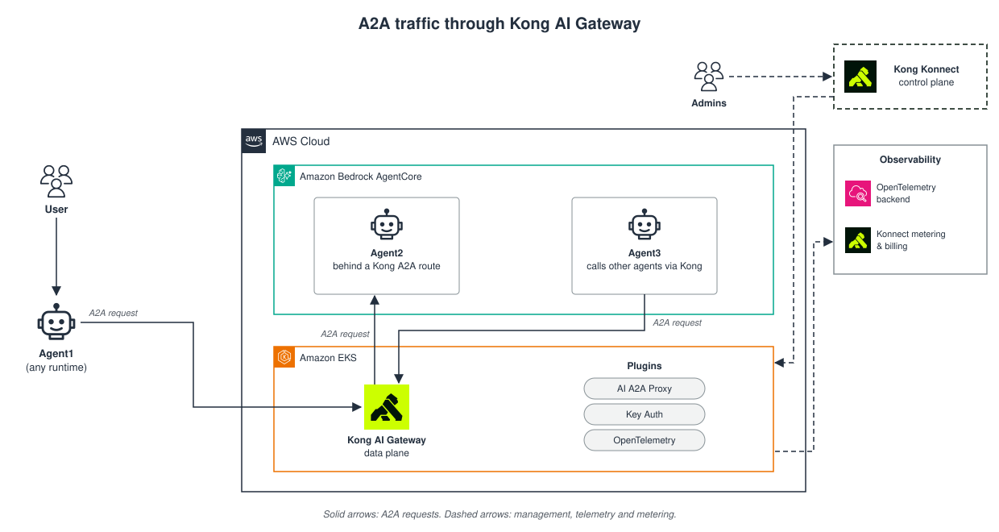
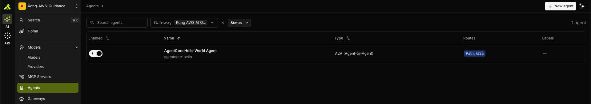

# Step 3: Put an AgentCore agent behind the AI Gateway

[← Step 2](2-kong-konnect-data-plane.md) · **Step 3** · [Step 4 →](4-mcp-gateway.md)

## Why this step

Amazon Bedrock AgentCore is a strong place to *run* agents. It gives you a managed runtime, scaling and IAM-signed (SigV4) invocation. What it doesn't give you on its own is one shared front door that **other agents** (inside AWS, in another cloud or on a laptop) can reach using a plain A2A call, with one set of policies, logs and metrics across all of them.

This step builds that front door. You deploy a small A2A agent to AgentCore, then publish it on the AI Gateway as an **Agent** at `https://ai-dp.<your domain>/a2a`. AgentCore keeps its default IAM authentication: the AI Gateway **signs every call with SigV4**, using the data plane's Pod Identity role from Step 2 (`bedrock-agentcore:InvokeAgentRuntime`). Callers don't need AWS credentials, and AgentCore stays private to IAM.

## What it does, in plain English

1. **Explains** the A2A flow (diagram and background).
2. **Runs a "hello world" A2A agent on your laptop** (`server_1.py`) and calls it directly, so you can see what A2A requests and responses look like.
3. **Deploys the same agent to AgentCore** with the AgentCore CLI and calls it with SigV4-signed `awscurl`.
4. **Publishes it on the AI Gateway** with kongctl: an Agent at `/a2a` whose upstream auth is AWS SigV4. You then call it with plain `curl`.

Until Step 5 adds a token check, `/a2a` accepts calls from anyone who knows the URL.

## Before you start

- Steps 1 and 2 are complete, and `PAT` and `AWS_DOMAIN` are still exported.
- Python with the A2A SDK, set up as described in [code/a2a/python-a2a-sdk-install.md](code/a2a/python-a2a-sdk-install.md) (uses `uv`).
- Node.js/npm for the AgentCore CLI, plus [`awscurl`](https://pypi.org/project/awscurl/) and kongctl.
- AgentCore available in `us-west-2` for your account.

> **Things to know before you copy commands from this step**
>
> - **Tested versions.** This step was last run end to end with AgentCore CLI `1.1.0`, `a2a-sdk` `1.3.1`, kongctl `1.28.4` and the `kong/kong-ai-gateway:2.3.1` data plane. The AgentCore CLI changes quickly, so if a command or file layout differs, check `agentcore <command> --help`.
> - **Two versions of the agent.** The agent code shown inline below is a simpler version of [`code/a2a/server_1.py`](code/a2a/server_1.py). The file adds middleware that logs request headers and infers the `A2A-Version` header from the request body. The AgentCore deployment copies `server_1.py`, so the file is what actually runs there.
> - **Keep one terminal.** Later steps reuse `AGENTCORE_URL` from this step.

---

# The A2A Flow

This diagram illustrates a secure and observable Agent-to-Agent (A2A) communication architecture built using **AWS Bedrock AgentCore**, **Kong Agent Gateway**, and **Konnect** as the centralized control plane.



The design demonstrates how multiple AI agents can communicate with one another through standardized **A2A Protocol** and routes while Kong provides governance, authentication, telemetry, and operational control.

On the left side, a User initiates requests that are handled by an AI agent running inside AWS Bedrock AgentCore.

Within the AgentCore environment there are two agents. Each agent consumes a Kong A2A Route, representing a gateway-managed endpoint for agent-to-agent communication.

This means the agents are not communicating directly through unmanaged channels. Instead, all interactions pass through Kong-governed A2A routes, enabling:

* security enforcement,
* observability,
* authentication,
* traffic control,
* and policy management.

## Internal Agent and External / Federated Agent Communications

As you can see in the diagram, Agent1 exists outside the AWS Bedrock AgentCore boundary and consumes a Kong A2A Route, allowing it to participate in the same governed communication framework.

It sends requests toward Agent2 through the Kong-managed A2A route which are routed downward into the Kong Agent Gateway Data Plane Node before reaching the target agent.

This demonstrates:
* federated agent architectures,
* multi-runtime agent ecosystems,
* or cross-environment AI interoperability.

Also, it creates a secure hub-and-spoke architecture for distributed Agentic Application Systems.


## Kong AI Gateway

In this design the gateway is the **AI Gateway data plane** from Step 2. The agent is declared in Konnect as an **Agent** entity, which:

* routes A2A traffic on its own path (`/a2a` here) and rewrites the agent card so clients keep talking through the gateway,
* authenticates to the upstream agent, here with AWS SigV4 for AgentCore,
* applies an **Auth Strategy** to callers (Step 5) and records A2A analytics in Konnect.

## Konnect Control Plane

At the top-right, administrators interact with the Konnect Control Plane. The dotted management connection indicates that Konnect centrally manages the AI Gateway's configuration, including agents, policies and authentication settings.

Konnect distributes configuration to the Kong data plane nodes without being directly involved in runtime traffic.

## Observability and Metering

Konnect provides out-of-the box Observability capabilities, including dashboard, reports, etc. As described in the diagram, telemetry and usage data can be exported to external OpenTelemetry Observability Stack. Similarly, Konnect Metering & Billing service can be used to chargeback or quota enforcement.

# The A2A Protocol

The official [Agent2Agent (A2A) Protocol](https://a2a-protocol.org/) portal defines it as follows:
"The A2A protocol is an open standard that enables seamless communication and collaboration between AI agents."

Conceptually, A2A, announced by [Google in April 2025](https://developers.googleblog.com/en/a2a-a-new-era-of-agent-interoperability), treats agents as networked participants that exchange structured requests and responses around tasks and outcomes instead of exposing internal implementation details. This model aligns naturally with controller/task-worker architectures: a coordinating agent can decompose work, assign subtasks to specialized agents, monitor progress, and aggregate results. By separating orchestration from execution, A2A supports scalable multi-agent systems where capabilities can evolve independently while maintaining a consistent communication contract.

The lastest [A2A 1.0 Protocol Specification](https://a2a-protocol.org/v1.0.0/specification/) page provides a nice introduction including [main concepts and main components](https://a2a-protocol.org/v1.0.0/topics/key-concepts/).

## The first Agent

To get started consider this [basic Agent](code/a2a/server_1.py).

```
import uuid
import uvicorn

from starlette.applications import Starlette


from a2a.server.agent_execution import AgentExecutor
from a2a.server.request_handlers import DefaultRequestHandler
from a2a.server.tasks import InMemoryTaskStore
from a2a.server.routes.agent_card_routes import create_agent_card_routes
from a2a.server.routes.jsonrpc_routes import create_jsonrpc_routes

from a2a.types import (
    AgentCapabilities,
    AgentCard,
    AgentInterface,
    AgentSkill,
    # TaskArtifactUpdateEvent,
    TaskState,
)

from a2a.server.tasks import TaskUpdater
from a2a.helpers import new_text_artifact, new_task


class HelloWorldAgentExecutor(AgentExecutor):
    async def execute(self, context, event_queue): # -> None:
        # message/send and message/stream both arrive here

        # A2A separates task lifecycle from task output.
        # 1. announce task exists / started
        task = context.current_task
        if task is None:
            task = new_task(
                task_id=context.task_id or str(uuid.uuid4()),
                context_id=context.context_id or str(uuid.uuid4()),
                state=TaskState.TASK_STATE_SUBMITTED,
                history=[context.message] if context.message else None,
        )
        await event_queue.enqueue_event(task)
        updater = TaskUpdater(event_queue, task.id, task.context_id)

        # 2. task output event (task produced content)
        result = "that's the response"
        await updater.add_artifact(
            parts=new_text_artifact(
                name="result",
                text="that's the response",
            ).parts,
            name="result",
        )
        await updater.complete()


    async def cancel(self, context, event_queue): # -> None:
        raise Exception('cancel not supported')
        


if __name__ == '__main__':
    skill = AgentSkill(
        id='hello_world',
        name='Returns hello world',
        description='just returns hello world',
        tags=['hello world'],
        examples=['hi', 'hello world'],
    )

    agent_card = AgentCard(
        name='Hello World Agent',
        description='Just a hello world agent',
        version='1.0.0',
        icon_url='http://localhost:9000/icon.png',
        supported_interfaces=[
            AgentInterface(
                url='http://localhost:9000',
                protocol_binding='JSONRPC',
                protocol_version='1.0',
            ),
        ],
        default_input_modes=['text'],
        default_output_modes=['text'],
        capabilities=AgentCapabilities(streaming=True),
        skills=[skill],
    )

    request_handler = DefaultRequestHandler(
        agent_card=agent_card,
        agent_executor=HelloWorldAgentExecutor(),
        task_store=InMemoryTaskStore(),
    )

    routes = [
        *create_agent_card_routes(agent_card=agent_card),
        *create_jsonrpc_routes(
            request_handler=request_handler,
            rpc_url='/',
            enable_v0_3_compat=True,
        ),
    ]

    app = Starlette(routes=routes)
    uvicorn.run(app, host='0.0.0.0', port=9000)
```

The Agent defines an AgentCard with has only one Skill. Here are some concise definitions provided by the **A2A Protocol** specification:
* An [Agent Skill](https://a2a-protocol.org/v1.0.0/tutorials/python/3-agent-skills-and-card/#agent-skills) describes a specific capability or function the Agent can perform. It's a building block that tells clients what kinds of tasks the agent is good for.
* An [Agent Card](https://a2a-protocol.org/v1.0.0/tutorials/python/3-agent-skills-and-card/#agent-card) is a JSON document that an A2A Server makes available, typically at a [.well-known/agent-card.json endpoint](https://a2a-protocol.org/v1.0.0/topics/agent-discovery/#1-well-known-uri). It's like a digital business card for the agent.

To try it out, run the agent from the root of this repo. `uv` installs Python 3.13 and the A2A SDK for this run and starts the agent, so there's no virtual environment to set up:
```
uv run --python 3.13 --with uvicorn --with "a2a-sdk[all]" code/a2a/server_1.py
```

The first run takes a minute while it downloads the packages. The agent is up when it prints `Uvicorn running on http://0.0.0.0:9000`. It keeps running in this terminal; stop it with Ctrl+C when you're done.

### Discovery Endpoint
In another terminal send a request to its discovery endpoint:
```
curl -s http://127.0.0.1:9000/.well-known/agent-card.json | jq
```

You should get something like:
```
{
  "name": "Hello World Agent",
  "description": "Just a hello world agent",
  "supportedInterfaces": [
    {
      "url": "http://localhost:9000/",
      "protocolBinding": "JSONRPC",
      "protocolVersion": "1.0"
    }
  ],
  "version": "1.0.0",
  "capabilities": {
    "streaming": true
  },
  "defaultInputModes": [
    "text"
  ],
  "defaultOutputModes": [
    "text"
  ],
  "skills": [
    {
      "id": "hello_world",
      "name": "Returns hello world",
      "description": "just returns hello world",
      "tags": [
        "hello world"
      ],
      "examples": [
        "hi",
        "hello world"
      ]
    }
  ],
  "iconUrl": "http://localhost:9000/icon.png"
}
```

### Agent request

As described in the Card, the Agent has only one SKill. If you send a request you should be able to see a response:

```
curl -sX POST http://127.0.0.1:9000 \
  -H "Content-Type: application/json" \
  -H "A2A-Version: 1.0" \
  --json '{
    "jsonrpc": "2.0",
    "id": "1",
    "method": "SendMessage",
    "params": {
      "message": {
        "messageId": "msg-001",
        "role": "ROLE_USER",
        "parts": [
          {
            "text": "How much is 100 USD in EUR?"
          }
        ]
      }
    }
  }' | jq
```

```
curl -sX POST http://127.0.0.1:9000 \
     -H "Content-Type: application/json" \
     --json '{
       "jsonrpc": "2.0",
       "id": "1",
       "method": "message/send",
       "params": {
         "message": {
           "kind": "message",
           "messageId": "msg-001",
           "role": "user",
           "parts": [
             {
               "kind": "text",
               "text": "How much is 100 USD in EUR?"
             }
           ]
         }
       }
     }' | jq
```

You should see a response like this:
```
{
  "id": "1",
  "jsonrpc": "2.0",
  "result": {
    "artifacts": [
      {
        "artifactId": "87f7e375-1e7a-40fe-9b7f-cf7f16e55893",
        "name": "result",
        "parts": [
          {
            "kind": "text",
            "text": "that's the response"
          }
        ]
      }
    ],
    "contextId": "c01764fb-d5a7-44d6-8435-d25e6f4d68bf",
    "history": [
      {
        "contextId": "c01764fb-d5a7-44d6-8435-d25e6f4d68bf",
        "kind": "message",
        "messageId": "msg-001",
        "parts": [
          {
            "kind": "text",
            "text": "How much is 100 USD in EUR?"
          }
        ],
        "role": "user",
        "taskId": "ffd933ef-7347-4419-a800-683b443f2a93"
      }
    ],
    "id": "ffd933ef-7347-4419-a800-683b443f2a93",
    "kind": "task",
    "status": {
      "state": "completed",
      "timestamp": "2026-05-25T20:04:59.292857Z"
    }
  }
}
```

## A2A Inspector

https://github.com/a2aproject/a2a-inspector

> **Checkpoint: the agent works locally.** The discovery call returns the Agent Card and the `SendMessage` / `message/send` calls return an artifact with the text `that's the response`. If both work, stop `server_1.py` with `Ctrl+C` and move on to AgentCore. (The A2A Inspector linked above is an optional UI for exploring A2A agents.)

# Amazon Bedrock AgentCore

## Create the project

Let's use the [AgentCore CLI](https://docs.aws.amazon.com/bedrock-agentcore/latest/devguide/agentcore-get-started-cli.html) to deploy the agent. Its [GitHub repo](https://github.com/aws/agentcore-cli) has a comprehensive command reference.

```
npm install -g @aws/agentcore
agentcore --version
```

Create the project from the A2A Python template. Run this from the root of this repo. Older CLI versions took `--defaults`; current versions take `--template` (`agentcore create --help` lists the templates).
```
agentcore create --name agentcorekong --template a2a-python-strands --region us-west-2
cd agentcorekong
```

This creates `agentcore/agentcore.json` (the project spec) and `app/agent/` (the code for a runtime named `agent`). The template's code is a Strands LLM agent. Replace it with this guide's agent:
```
cp ../code/a2a/server_1.py app/agent/
```

### Agent configuration

The template's `app/agent/pyproject.toml` pins `a2a-sdk ~= 0.3`, but `server_1.py` uses the 1.x API (`a2a.helpers`, `a2a.server.routes`), so the agent would crash on start. It also pulls in Strands, which this agent doesn't use. Replace the file:

```
cat > app/agent/pyproject.toml << 'EOF'
[build-system]
requires = ["hatchling ~= 1.27.0"]
build-backend = "hatchling.build"

[project]
name = "agent"
version = "0.1.0"
description = "A2A hello world agent for the Kong guide"
readme = "README.md"
requires-python = ">=3.10"
dependencies = [
    "a2a-sdk[all]",
    "uvicorn",
    "aws-opentelemetry-distro",
    "bedrock-agentcore",
    "botocore[crt]",
]

[tool.hatch.build.targets.wheel]
packages = ["."]
EOF
```

The deployment installs dependencies from `pyproject.toml`. To check the imports on your laptop first (optional), refresh the template's lockfile, which also pins the old SDK:
```
cd app/agent
uv lock --upgrade-package a2a-sdk
uv sync
uv run python -c "import a2a.helpers, a2a.server.routes.agent_card_routes; print('imports OK')"
cd ../..
```

Point the runtime at `server_1.py` and remove the template's memory store, which this agent doesn't use and which would be billed:
```
jq '.memories = [] | .runtimes[0].entrypoint = "server_1.py"' agentcore/agentcore.json > /tmp/ac.json && mv /tmp/ac.json agentcore/agentcore.json
cat agentcore/agentcore.json
```

You should see:
```
{
  "name": "agentcorekong",
  "version": 2,
  "managedBy": "CDK",
  "runtimes": [
    {
      "name": "agent",
      "build": "CodeZip",
      "modelProvider": "Bedrock",
      "entrypoint": "server_1.py",
      "codeLocation": "app/agent",
      "runtimeVersion": "PYTHON_3_14",
      "protocol": "A2A"
    }
  ],
  "memories": []
}
```

### Deploy the Agent

```
agentcore deploy --region us-west-2
```

The first deploy creates a target named `default` in `agentcore/aws-targets.json` from your current account and region, and bootstraps CDK in the account if it hasn't been. It takes about 5 to 10 minutes and ends with `Deploy to AWS Complete`. If it can't find credentials from an `aws login` session, export them first, then run the deploy again:

```bash
eval "$(aws configure export-credentials --format env)"
```

This copies your session into fixed environment variables that don't refresh. Use it only in the terminal for this step. Don't run `eksctl` or `helm` in that terminal afterward: once the copied keys expire, they fail with `ExpiredToken` even after you sign in again. To go back to your normal session, clear them:

```bash
unset AWS_ACCESS_KEY_ID AWS_SECRET_ACCESS_KEY AWS_SESSION_TOKEN AWS_CREDENTIAL_EXPIRATION
```

## Check the Status

`agentcore status` opens an interactive view (press `q` to leave). For scripts, use the JSON form:
```
agentcore status --json
```

Here's an example:
```
{
  "projectName": "agentcorekong",
  "target": "default",
  "region": "us-west-2",
  "resources": [
    {
      "resourceType": "runtime",
      "name": "agent",
      "deploymentState": "deployed",
      "arn": "arn:aws:bedrock-agentcore:us-west-2:<YOUR_AWS_ACCOUNT>:runtime/agentcorekong_default_agent-XXXXXXXXXX"
    }
  ]
}
```

The CLI doesn't print the invocation URL, so build it from the runtime ARN (URL-encoded):
```
export AGENTCORE_ARN=$(agentcore status --json | jq -r '.resources[] | select(.name=="agent") | .arn')
export AGENTCORE_IDENTIFIER="${AGENTCORE_ARN##*/}"
export AGENTCORE_URL="https://bedrock-agentcore.us-west-2.amazonaws.com/runtimes/$(jq -rn --arg a "$AGENTCORE_ARN" '$a|@uri')/invocations"
echo $AGENTCORE_URL
```

Check that the runtime is ready:
```
aws bedrock-agentcore-control get-agent-runtime \
  --agent-runtime-id $AGENTCORE_IDENTIFIER \
  --region us-west-2 --query status --output text
```

It should print `READY`.

## Call it with SigV4

This runtime uses AgentCore's default inbound auth, so every request must be SigV4-signed. Use [**awscurl**](https://pypi.org/project/awscurl/), which signs with your local AWS credentials.

Discovery endpoint:
```
awscurl \
  --service bedrock-agentcore \
  --region us-west-2 \
  $AGENTCORE_URL/.well-known/agent-card.json
```

Send a request:
```
awscurl -X POST \
  $AGENTCORE_URL \
  --service bedrock-agentcore \
  --region us-west-2 \
  -H "Content-Type: application/json" \
  -d '{
  "jsonrpc": "2.0",
  "id": "1",
  "method": "message/send",
  "params": {
    "message": {
      "kind": "message",
      "messageId": "msg-001",
      "role": "user",
      "parts": [
        {
          "kind": "text",
          "text": "How much is 100 USD in EUR?"
        }
      ]
    }
  }
}' | jq
```

```
awscurl -X POST \
  $AGENTCORE_URL \
  --service bedrock-agentcore \
  --region us-west-2 \
  -H "Content-Type: application/json" \
  -H "A2A-Version: 1.0" \
  -d '{
    "jsonrpc": "2.0",
    "id": "1",
    "method": "SendMessage",
    "params": {
      "message": {
        "messageId": "msg-001",
        "role": "ROLE_USER",
        "parts": [
          {
            "text": "How much is 100 USD in EUR?"
          }
        ]
      }
    }
  }' | jq
```

## Check the Agent logs

```
export LOGGROUPNAME="/aws/bedrock-agentcore/runtimes/$AGENTCORE_IDENTIFIER-DEFAULT"

aws logs tail $LOGGROUPNAME \
  --follow \
  --region us-west-2
```

A Python traceback here usually means a missing dependency or an import error. Check `pyproject.toml` first.

> **Checkpoint: the agent works on AgentCore.** `get-agent-runtime` prints `READY`, and the signed `awscurl` request returns the same `that's the response` artifact you saw locally. Keep `AGENTCORE_URL` exported: the next section uses it.


# Publish the agent on the AI Gateway

[`code/ai-gateway/step3-agent.yaml`](code/ai-gateway/step3-agent.yaml) declares one **Agent** on the `kong-aws-ai` gateway:

```yaml
ai_gateway_agents:
  - ref: agentcore-hello
    ai_gateway: !lookup {name: kong-aws-ai}
    name: agentcore-hello
    display_name: AgentCore Hello World Agent
    type: a2a
    enabled: true
    config:
      url: !env AGENTCORE_URL
      route:
        paths:
          - /a2a
        strip_path: true
      upstream:
        auth:
          type: aws
          region: us-west-2
      logging:
        payloads: true
```

- `config.url` is the runtime's invocation URL, read from `AGENTCORE_URL`.
- `upstream.auth.type: aws` with no keys makes the gateway sign each call with SigV4, using the credentials Pod Identity gives the data plane.
- `route.paths` publishes it at `/a2a`.

Preview the change, then apply it, from the root of this repo:

```
cd ..
kongctl diff --mode apply -f code/ai-gateway/step3-agent.yaml --pat "$PAT"
kongctl apply -f code/ai-gateway/step3-agent.yaml --auto-approve --pat "$PAT"
```

> **kongctl refuses `--pat`?** If a wrapper such as konnect-guard blocks token flags, leave `--pat "$PAT"` off and pin this folder to a kongctl profile for the organization that holds `kong-aws-ai`. See [troubleshooting](docs/troubleshooting.md#kongctl-reaches-the-wrong-konnect-organization-or-refuses---pat).

The preview shows one `ai_gateway_agent` to create. In Konnect it appears under **AI Gateway → Agents**, with its route `/a2a`:


*The AgentCore agent, declared on the AI Gateway.*

## Send a request

Wait about 10 seconds for Konnect to push the configuration, then call the agent through the gateway, with no AWS credentials:

```
curl -s -X POST https://ai-dp.$AWS_DOMAIN/a2a \
  --json '{
    "jsonrpc": "2.0",
    "id": "1",
    "method": "message/send",
    "params": {
      "message": {
        "kind": "message",
        "messageId": "msg-001",
        "role": "user",
        "parts": [
          {
            "kind": "text",
            "text": "How much is 100 USD in EUR?"
          }
        ]
      }
    }
  }' | jq
```

The result contains the `that's the response` artifact. The data plane log shows the gateway signing the call:

```
kubectl logs -n kong deploy/kong-aws-ai-dp --since=5m | grep -i aws_iam
```

You should see `[ai-a2a-proxy] Creating aws_iam auth handler`.

> **Checkpoint: the agent works through the AI Gateway.** A plain `curl` to `https://ai-dp.$AWS_DOMAIN/a2a` returns the same artifact as the signed `awscurl` call. Kong signed the call to AgentCore with its Pod Identity role.

## A second agent

[`code/a2a/client_1.py`](code/a2a/client_1.py) is a small A2A client that resolves the Agent Card through the gateway and lets you chat with the agent. Set it up as "Agent 2" in [python-a2a-sdk-install.md](code/a2a/python-a2a-sdk-install.md) and point `base_url` at `https://ai-dp.<your domain>/a2a`. It hasn't been tested against the AI Gateway yet, and after Step 5 it would also need to send an `Authorization: Bearer` header.

---

## Verify

A plain `curl -s -X POST https://ai-dp.<your domain>/a2a ...` (the "Send a request" command above) returns a JSON-RPC result whose artifact text is `that's the response`, and the data plane log shows `Creating aws_iam auth handler`.

That proves the whole chain: the AI Gateway data plane on EKS received the call, signed it to AgentCore with the Pod Identity IAM role, and the agent answered.

## Common problems

- **`agentcore create` says `--defaults` is unknown.** Current CLI versions use `--template`. Run `agentcore create --help` for the list.
- **The runtime starts, then crashes with `No module named 'a2a.helpers'`.** The template pins `a2a-sdk` 0.3.x. Replace `pyproject.toml` as shown above. Locally, also run `uv lock --upgrade-package a2a-sdk`.
- **`awscurl` returns 403.** `awscurl` signs with your local AWS credentials. Make sure they're set (`aws configure`, or export them from an `aws login` session) and allowed to invoke the runtime.
- **The gateway call returns `403` or `Missing Authentication Token` from AWS.** The data plane isn't signing with IAM credentials. Check that it runs as `kaigateway-podid-sa` (Step 2), and that the Pod Identity role allows `bedrock-agentcore:InvokeAgentRuntime`.
- **The gateway returns 404 "no Route matched".** The agent hasn't reached the data plane yet, or `kongctl apply` failed. Wait a few seconds, then check the apply output.
- **kongctl says `AGENTCORE_URL` is empty, or the agent's URL is wrong.** Re-run the `export AGENTCORE_ARN=...` and `export AGENTCORE_URL=...` commands in the same shell.
- **More:** see [docs/troubleshooting.md](docs/troubleshooting.md#step-3-a2a-and-agentcore).

## Tearing this step down

Section 4 of [docs/teardown.md](docs/teardown.md) removes the AgentCore runtime. Deleting the AI Gateway (section 1) removes the Agent.

[← Step 2](2-kong-konnect-data-plane.md) · **Step 3** · [Step 4 →](4-mcp-gateway.md)
