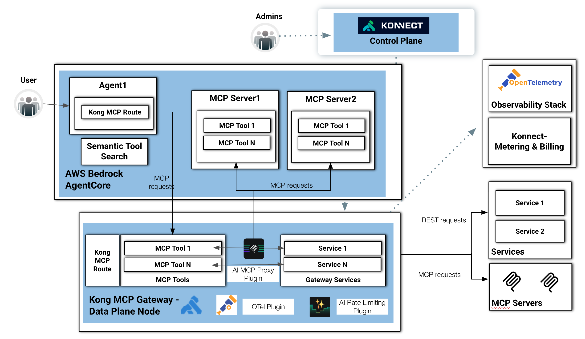

# Step 4: Turn a REST API into MCP tools with Kong's MCP Gateway

[← Step 3](3-a2a-agent-gateway-agentcore.md) · **Step 4** · [Step 5 →](5-kong-identity-oauth2.md)

## Why this step

Agents get useful when they can call tools. The **Model Context Protocol (MCP)** is the common way to describe and call those tools. If every agent connects straight to every MCP server, you get a mesh of credentials and no single place to see or limit tool usage. That mesh is hard to audit.

The MCP Gateway pattern puts Kong between agents and tools. Agents talk MCP to Kong. Kong forwards to MCP servers, or turns ordinary REST APIs into MCP tools, and applies the same authentication, rate limiting and telemetry it applies to LLM and A2A traffic. Most companies already have plenty of REST APIs, so turning them into MCP tools without writing an MCP server is often the quickest win.

## What it does, in plain English

1. **Explains** the MCP flow: agents in AgentCore, MCP servers and tools, Kong's **AI MCP Proxy** plugin, and the governance around them.
2. **Publishes an MCP server on Kong** at `https://kong-dp.<your domain>/mcp`. Kong's **AI MCP Proxy** plugin, in `conversion-listener` mode, turns two REST endpoints into two MCP tools: `check-inventory` and `list-orders`.
3. **Calls it like an MCP client would.** You initialize a session, list the tools and call one.

The REST API behind the tools is Kong's public echo service, `httpbin.konghq.com`. It returns whatever request it receives, so you don't need to deploy a backend, and you can see exactly what Kong sent when an agent called a tool.

This step **adds** to Kong's configuration with `deck gateway apply`, which creates or updates entities without deleting anything. Step 3's `/a2a` route keeps working.

## Before you start

- Steps 2 and 3 are complete. `PAT` and `AWS_DOMAIN` are exported.
- decK is installed and has the `deck gateway apply` command (`deck gateway apply --help` shows its usage).
- The data plane image from Step 2 (`kong/kong-gateway:3.14.0.3`) meets the plugin's minimum version (Kong Gateway 3.12).

> **Test before you rely on it.** This step is new. The plugin configuration follows Kong's AI MCP Proxy documentation, but it hasn't been run end to end against this guide's EKS and Konnect setup yet.

---

# The MCP Flow

This diagram illustrates an AI-native architecture that combines AWS Bedrock AgentCore, Kong MCP Gateway, and MCP (Model Context Protocol) Servers to provide secure, observable, and governable access to tools and services for AI agents.



At a high level, the flow is divided into four major domains:

⸻

1. User and Agent Runtime Layer

On the left side, a User interacts with an AI application running inside AWS Bedrock AgentCore.

Inside the AgentCore environment:

* Agent1 represents an AI agent responsible for orchestrating requests and interacting with external capabilities.
* The agent communicates through a Kong MCP Route, which acts as the controlled entry point for MCP-based interactions.
* A Semantic Tool Search component enables the agent to dynamically discover the most relevant MCP tools at runtime instead of relying on static integrations.

This creates a flexible agentic architecture where tools can be selected semantically based on the user request and context.

⸻

2. MCP Server Layer

Within the same AgentCore environment, there are multiple MCP servers:

* MCP Server1
* MCP Server2

Each MCP server exposes one or more MCP tools:

* MCP Tool 1
* MCP Tool N

These tools represent callable capabilities such as:

* APIs
* retrieval functions
* automation actions
* enterprise integrations
* data access services

The diagram shows MCP requests flowing from the agent to these MCP servers, demonstrating how the agent dynamically invokes external capabilities using the MCP protocol.

⸻

3. Kong MCP Gateway (Data Plane)

The lower section represents the Kong MCP Gateway Data Plane Node, which acts as the centralized runtime gateway for MCP traffic.

This layer includes several important components:

Kong MCP Route

The gateway exposes MCP-compatible routes that receive requests from agents and MCP servers.

MCP Tools

The gateway can directly expose MCP tools itself, allowing Kong to behave as an MCP-native gateway endpoint.

AI MCP Proxy Plugin

This plugin is the core intelligence layer inside Kong. It:

* translates and proxies MCP requests,
* brokers communication between agents and services,
* standardizes tool invocation,
* and enables policy enforcement.

Gateway Services

The gateway forwards requests to backend services:

* Service 1
* Service N

These services can be:

* REST APIs,
* internal enterprise systems,
* databases,
* external SaaS platforms,
* or additional MCP servers.

⸻

4. Governance, Security, and Observability

The architecture emphasizes centralized governance and operational visibility.

Konnect Control Plane

At the top, administrators manage the platform through the Konnect Control Plane.

This control plane:

* configures routes,
* manages plugins,
* distributes policies,
* and controls the Kong data plane nodes.

Observability Stack

On the right side:

* the OpenTelemetry stack receives telemetry exported through the OTel Plugin.
* This enables distributed tracing, metrics, and logging for AI and MCP traffic.

Konnect Metering & Billing

Usage information is exported for:

* chargeback,
* quota management,
* cost visibility,
* and AI consumption analytics.

AI Rate Limiting Plugin

The gateway also includes an AI-focused rate limiting plugin that protects:

* LLM endpoints,
* MCP tools,
* and backend services from abuse or excessive consumption.

⸻

5. External Services and MCP Servers

On the far right, the architecture integrates with external environments:

REST Services

Standard REST requests are forwarded to traditional backend services.

External MCP Servers

The gateway can also proxy and federate requests to external MCP servers, enabling:

* tool federation,
* multi-domain agent ecosystems,
* and distributed agent architectures.

⸻

Architectural Significance

This design demonstrates how:

* AWS Bedrock AgentCore provides the agent runtime,
* Kong MCP Gateway provides governance and secure connectivity,
* and MCP servers provide interoperable tools and capabilities.

The overall architecture enables:

* dynamic tool discovery,
* centralized policy enforcement,
* observability,
* rate limiting,
* protocol mediation,
* and scalable multi-agent interoperability.

It effectively turns Kong into an AI-native control and data plane for MCP ecosystems.

## Publish an MCP server on Kong

### Write the decK file

This file defines three things:

- a **service**, `mcp-echo-api`, pointing at `https://httpbin.konghq.com/anything` (the REST API behind the tools),
- a **route**, `mcp-route`, that answers on `/mcp` (the MCP endpoint agents connect to),
- the **`ai-mcp-proxy`** plugin in `conversion-listener` mode. Each entry under `tools` becomes one MCP tool: its description tells the agent what it does, and its `method`, `path` and `parameters` tell Kong which REST call to make.

The tool paths start with `/mcp/` because they must match the route's path. `strip_path: true` removes `/mcp` before Kong calls the upstream, so `check-inventory` becomes `GET https://httpbin.konghq.com/anything/inventory?sku=...`.

```bash
cat > ai-mcp-proxy.yaml << 'EOF'
_format_version: "3.0"
services:
- name: mcp-echo-api
  url: https://httpbin.konghq.com/anything
  routes:
  - name: mcp-route
    paths:
    - /mcp
    strip_path: true
    protocols:
    - http
    - https
    plugins:
    - name: ai-mcp-proxy
      instance_name: ai-mcp-proxy1
      config:
        mode: conversion-listener
        server:
          timeout: 60000
        tools:
        - name: check-inventory
          description: Check how many units of a product are in stock, by SKU.
          method: GET
          path: /mcp/inventory
          annotations:
            title: Check inventory
            read_only_hint: true
          parameters:
          - name: sku
            in: query
            required: true
            description: The product SKU to look up.
            schema:
              type: string
        - name: list-orders
          description: List recent orders, optionally filtered by status.
          method: GET
          path: /mcp/orders
          annotations:
            title: List orders
            read_only_hint: true
          parameters:
          - name: status
            in: query
            required: false
            description: Only return orders with this status, for example shipped.
            schema:
              type: string
EOF
```

### Apply it to the control plane

`deck gateway apply` adds these entities to `kong-aws` and leaves everything else (including Step 3's A2A route) in place. Konnect then pushes the change to your data plane on EKS.

```bash
deck gateway apply --konnect-control-plane-name kong-aws --konnect-token $PAT ai-mcp-proxy.yaml
```

## Call the MCP server

MCP clients talk JSON-RPC over HTTP. A client first **initializes** a session, then **lists** the tools, then **calls** one. The commands below do the same thing with `curl`, so you can see each message. Responses can come back as plain JSON or as a short `text/event-stream` message (lines starting with `event:` and `data:`); both are normal.

### 1. Initialize a session

This saves the response headers to `mcp-headers.txt`, because the server may return an `Mcp-Session-Id` header that later requests must send back.

```bash
curl -s -D mcp-headers.txt -X POST https://kong-dp.$AWS_DOMAIN/mcp \
  -H "Content-Type: application/json" \
  -H "Accept: application/json, text/event-stream" \
  --data '{"jsonrpc":"2.0","id":1,"method":"initialize","params":{"protocolVersion":"2025-06-18","capabilities":{},"clientInfo":{"name":"curl","version":"1.0"}}}'
```

```bash
export MCP_SESSION_ID=$(grep -i '^mcp-session-id:' mcp-headers.txt | awk '{print $2}' | tr -d '\r')
echo "Session: $MCP_SESSION_ID"
```

You should get a JSON-RPC `result` with `serverInfo` and `capabilities`. If `Session:` prints nothing, the server didn't issue a session ID. Run the next commands as they are; if they're rejected, see Common problems below.

### 2. List the tools

```bash
curl -s -X POST https://kong-dp.$AWS_DOMAIN/mcp \
  -H "Content-Type: application/json" \
  -H "Accept: application/json, text/event-stream" \
  -H "Mcp-Session-Id: $MCP_SESSION_ID" \
  --data '{"jsonrpc":"2.0","id":2,"method":"tools/list"}'
```

The result lists `check-inventory` and `list-orders`, each with its description and an `inputSchema` built from the `parameters` in the decK file. This is exactly what an agent sees when it asks Kong which tools exist.

### 3. Call a tool

```bash
curl -s -X POST https://kong-dp.$AWS_DOMAIN/mcp \
  -H "Content-Type: application/json" \
  -H "Accept: application/json, text/event-stream" \
  -H "Mcp-Session-Id: $MCP_SESSION_ID" \
  --data '{"jsonrpc":"2.0","id":3,"method":"tools/call","params":{"name":"check-inventory","arguments":{"sku":"KONG-123"}}}'
```

The result's `content` holds httpbin's echo of the REST call Kong made. Look for `"url": "https://httpbin.konghq.com/anything/inventory?sku=KONG-123"` and `"args": {"sku": "KONG-123"}`. That proves the agent's MCP tool call became a normal REST request, made and logged by Kong.

## Point a real agent at it

Any MCP client that supports the **Streamable HTTP** transport can use `https://kong-dp.<your domain>/mcp` as its server URL, including agents built with the Strands SDK on AgentCore. To swap the echo API for a real one, change the service `url` and the `tools` list, then run `deck gateway apply` again.

---

## Verify

The `tools/list` call returns `check-inventory` and `list-orders`, and the `tools/call` call returns httpbin's echo showing `/anything/inventory?sku=KONG-123`. Step 3's `/a2a` route still answers, because `deck gateway apply` didn't remove it.

## Common problems

- **`deck gateway apply` isn't a known command.** Your decK is too old. Upgrade decK and check with `deck gateway apply --help`.
- **`deck gateway ...` fails with an authentication error.** `PAT` isn't exported, or it has expired. Generate a new one in Konnect as described in Step 2.
- **`/mcp` returns 404 "no Route matched".** The configuration hasn't reached the data plane yet, or the apply failed. Re-run the apply command and check its output.
- **`tools/list` or `tools/call` returns an error about the session.** Re-run the initialize command and the `export MCP_SESSION_ID=...` command, then try again.
- **More:** see [docs/troubleshooting.md](docs/troubleshooting.md#step-4-mcp-gateway).

## Tearing this step down

Deleting the `kong-aws` control plane in [Clean up](README.md#clean-up) removes this route too. Delete `ai-mcp-proxy.yaml` and `mcp-headers.txt` from your working directory when you're done.

[← Step 3](3-a2a-agent-gateway-agentcore.md) · **Step 4** · [Step 5 →](5-kong-identity-oauth2.md)
