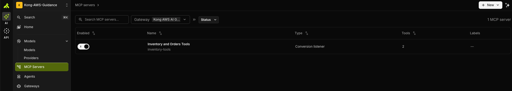

# Step 4: Turn a REST API into MCP tools on the AI Gateway

[← Step 3](3-a2a-agent-gateway-agentcore.md) · **Step 4** · [Step 5 →](5-kong-identity-oauth2.md)

## Why this step

Agents get useful when they can call tools. The **Model Context Protocol (MCP)** is the common way to describe and call those tools. If every agent connects straight to every MCP server, you get a mesh of credentials and no single place to see or limit tool usage. That mesh is hard to audit.

The MCP Gateway pattern puts Kong between agents and tools. Agents talk MCP to Kong. Kong forwards to MCP servers, or turns ordinary REST APIs into MCP tools, and applies the same authentication, rate limiting and telemetry it applies to model and agent traffic. Most companies already have plenty of REST APIs, so turning them into MCP tools without writing an MCP server is often the quickest win.

## What it does, in plain English

1. **Explains** the MCP flow: agents in AgentCore, MCP servers and tools, and the governance around them.
2. **Runs a small echo API in the cluster** ([go-httpbin](https://github.com/mccutchen/go-httpbin)). It returns whatever request it receives, so you can see exactly what Kong sent when an agent called a tool.
3. **Declares an MCP Server on the AI Gateway** at `https://ai-dp.<your domain>/mcp`. In `conversion-listener` mode it turns two REST endpoints into two MCP tools: `check_inventory` and `list_orders`.
4. **Calls it like an MCP client would.** You initialize a session, list the tools and call one.

Until Step 5 adds a token check, `/mcp` accepts calls from anyone who knows the URL. The tools only reach the echo API, so nothing sensitive is exposed.

## Before you start

- Steps 2 and 3 are complete. `PAT` and `AWS_DOMAIN` are exported, and `kubectl` points at the `kong314` cluster.

> **Tested.** This step was run end to end against the `kong/kong-ai-gateway:2.3.1` data plane with kongctl `1.28.4`.

---

# The MCP Flow

This diagram illustrates an AI-native architecture that combines AWS Bedrock AgentCore, Kong MCP Gateway, and MCP (Model Context Protocol) Servers to provide secure, observable, and governable access to tools and services for AI agents.


At a high level, the flow is divided into four major domains:

⸻

1. User and Agent Runtime Layer

On the left side, a User interacts with an AI application running inside AWS Bedrock AgentCore.

Inside the AgentCore environment:

* Agent1 represents an AI agent responsible for orchestrating requests and interacting with external capabilities.
* The agent communicates through a Kong MCP Route, which acts as the controlled entry point for MCP-based interactions.
* A Semantic Tool Search component enables the agent to dynamically discover the most relevant MCP tools at runtime instead of relying on static integrations.

This creates a flexible agentic architecture where tools can be selected semantically based on the user request and context.

⸻

2. MCP Server Layer

Within the same AgentCore environment, there are multiple MCP servers:

* MCP Server1
* MCP Server2

Each MCP server exposes one or more MCP tools:

* MCP Tool 1
* MCP Tool N

These tools represent callable capabilities such as:

* APIs
* retrieval functions
* automation actions
* enterprise integrations
* data access services

The diagram shows MCP requests flowing from the agent to these MCP servers, demonstrating how the agent dynamically invokes external capabilities using the MCP protocol.

⸻

3. Kong MCP Gateway (Data Plane)

The lower section represents the Kong MCP Gateway Data Plane Node, which acts as the centralized runtime gateway for MCP traffic.

This layer includes several important components:

Kong MCP Route

The gateway exposes MCP-compatible routes that receive requests from agents and MCP servers.

MCP Tools

The gateway can directly expose MCP tools itself, allowing Kong to behave as an MCP-native gateway endpoint.

MCP Server entity

On the AI Gateway, each MCP server is declared as an **MCP Server** entity, the core of the MCP gateway. It:

* translates and proxies MCP requests,
* brokers communication between agents and services,
* standardizes tool invocation,
* and enables policy enforcement.

Gateway Services

The gateway forwards requests to backend services:

* Service 1
* Service N

These services can be:

* REST APIs,
* internal enterprise systems,
* databases,
* external SaaS platforms,
* or additional MCP servers.

⸻

4. Governance, Security, and Observability

The architecture emphasizes centralized governance and operational visibility.

Konnect Control Plane

At the top, administrators manage the platform through the Konnect Control Plane.

This control plane:

* configures routes,
* manages AI entities and policies,
* distributes policies,
* and controls the Kong data plane nodes.

Observability Stack

On the right side:

* the OpenTelemetry stack receives telemetry exported by the gateway.
* This enables distributed tracing, metrics, and logging for AI and MCP traffic.

Konnect Metering & Billing

Usage information is exported for:

* chargeback,
* quota management,
* cost visibility,
* and AI consumption analytics.

AI Rate Limiting

The gateway can also apply AI-focused rate limiting policies that protect:

* LLM endpoints,
* MCP tools,
* and backend services from abuse or excessive consumption.

⸻

5. External Services and MCP Servers

On the far right, the architecture integrates with external environments:

REST Services

Standard REST requests are forwarded to traditional backend services.

External MCP Servers

The gateway can also proxy and federate requests to external MCP servers, enabling:

* tool federation,
* multi-domain agent ecosystems,
* and distributed agent architectures.

⸻

Architectural Significance

This design demonstrates how:

* AWS Bedrock AgentCore provides the agent runtime,
* Kong MCP Gateway provides governance and secure connectivity,
* and MCP servers provide interoperable tools and capabilities.

The overall architecture enables:

* dynamic tool discovery,
* centralized policy enforcement,
* observability,
* rate limiting,
* protocol mediation,
* and scalable multi-agent interoperability.

It effectively turns Kong into an AI-native control and data plane for MCP ecosystems.


## Publish an MCP server on the AI Gateway

### Run the echo backend in the cluster

Deploy go-httpbin in the `kong` namespace and give it a cluster-internal service. It isn't exposed outside the cluster.

```bash
kubectl -n kong create deployment httpbin --image=mccutchen/go-httpbin --port=8080
kubectl -n kong expose deployment httpbin --port=8080
kubectl -n kong rollout status deployment/httpbin --timeout=120s
```

You want `successfully rolled out`. If the image pull hits a Docker Hub rate limit, use `ghcr.io/mccutchen/go-httpbin` as the image.

It runs in the cluster rather than on the public internet because a gateway that verifies upstream TLS can't always verify public test services (see [Common problems](#common-problems)).

### Declare the MCP server

[`code/ai-gateway/step4-mcp.yaml`](code/ai-gateway/step4-mcp.yaml) declares one **MCP Server** on `kong-aws-ai`:

- type `conversion-listener`: Kong converts REST operations into MCP tools and serves them itself;
- `config.url` is the REST API behind the tools, `http://httpbin.kong.svc.cluster.local:8080/anything`;
- `config.route.paths` publishes it at `/mcp`, the endpoint agents connect to;
- each entry under `tools` becomes one MCP tool: its description tells the agent what it does, and its `method`, `path` and `parameters` tell Kong which REST call to make.
- tool names use underscores (`check_inventory`), not hyphens. Some models, including Amazon Nova, fail with `Model produced invalid sequence as part of ToolUse` when a tool name has a hyphen.

The tool paths start with `/mcp/` because they include the route's path. Kong strips `/mcp` before calling the upstream, so `check_inventory` becomes `GET http://httpbin.kong.svc.cluster.local:8080/anything/inventory?sku=...`.

```bash
kongctl diff --mode apply -f code/ai-gateway/step4-mcp.yaml --pat "$PAT"
kongctl apply -f code/ai-gateway/step4-mcp.yaml --auto-approve --pat "$PAT"
```

> **kongctl refuses `--pat`?** If a wrapper such as konnect-guard blocks token flags, leave `--pat "$PAT"` off and pin this folder to a kongctl profile for the organization that holds `kong-aws-ai`. See [troubleshooting](docs/troubleshooting.md#kongctl-reaches-the-wrong-konnect-organization-or-refuses---pat).

The preview shows one `ai_gateway_mcp_server` to create, and nothing changed on the Step 3 agent. In Konnect it appears under **AI Gateway → MCP Servers**, with its two tools:


*The MCP server, built from two REST endpoints.*

## Call the MCP server

MCP clients talk JSON-RPC over HTTP. A client first **initializes** a session, then **lists** the tools, then **calls** one. The commands below do the same thing with `curl`, so you can see each message. Responses come back as a short `text/event-stream` message (lines starting with `event:` and `data:`). The JSON-RPC message is on the `data:` line.

### 1. Initialize a session

This saves the response headers to `mcp-headers.txt`, because the server returns an `Mcp-Session-Id` header that later requests must send back.

```bash
curl -s -D mcp-headers.txt -X POST https://ai-dp.$AWS_DOMAIN/mcp \
  -H "Content-Type: application/json" \
  -H "Accept: application/json, text/event-stream" \
  --data '{"jsonrpc":"2.0","id":1,"method":"initialize","params":{"protocolVersion":"2025-06-18","capabilities":{},"clientInfo":{"name":"curl","version":"1.0"}}}'
export MCP_SESSION_ID=$(grep -i '^mcp-session-id:' mcp-headers.txt | awk '{print $2}' | tr -d '\r')
echo "Session: $MCP_SESSION_ID"
```

The result includes `"serverInfo":{"name":"Kong AI Gateway",...}`, and `Session:` prints an ID.

### 2. List the tools

```bash
curl -s -X POST https://ai-dp.$AWS_DOMAIN/mcp \
  -H "Content-Type: application/json" \
  -H "Accept: application/json, text/event-stream" \
  -H "Mcp-Session-Id: $MCP_SESSION_ID" \
  --data '{"jsonrpc":"2.0","id":2,"method":"tools/list"}'
```

The result lists `check_inventory` and `list_orders`, each with its description and an `inputSchema` built from the `parameters` in the YAML file. This is exactly what an agent sees when it asks Kong which tools exist.

Look at the argument names in each `inputSchema`: Kong prefixes every parameter with where it goes in the REST call, so `sku` (a query parameter) becomes **`query_sku`** and `status` becomes **`query_status`**. Tool calls must use those names.

### 3. Call a tool

```bash
curl -s -X POST https://ai-dp.$AWS_DOMAIN/mcp \
  -H "Content-Type: application/json" \
  -H "Accept: application/json, text/event-stream" \
  -H "Mcp-Session-Id: $MCP_SESSION_ID" \
  --data '{"jsonrpc":"2.0","id":3,"method":"tools/call","params":{"name":"check_inventory","arguments":{"query_sku":"KONG-123"}}}'
```

The result's `content` holds httpbin's echo of the REST call Kong made, with `"isError": false`. Look for `"url": "http://httpbin.kong.svc.cluster.local:8080/anything/inventory?sku=KONG-123"` and `"args": {"sku": ["KONG-123"]}` (go-httpbin shows query values as lists). That proves the agent's MCP tool call became a normal REST request, made and logged by Kong.

Try the second tool too:

```bash
curl -s -X POST https://ai-dp.$AWS_DOMAIN/mcp \
  -H "Content-Type: application/json" \
  -H "Accept: application/json, text/event-stream" \
  -H "Mcp-Session-Id: $MCP_SESSION_ID" \
  --data '{"jsonrpc":"2.0","id":4,"method":"tools/call","params":{"name":"list_orders","arguments":{"query_status":"shipped"}}}'
```

## Point a real agent at it

Any MCP client that supports the **Streamable HTTP** transport can use `https://ai-dp.<your domain>/mcp` as its server URL, including agents built with the Strands SDK on AgentCore. After Step 5 it also needs a Kong Identity token. To swap the echo API for a real one, change `config.url` and the `tools` list, then run `kongctl apply` again.

---

## Verify

The `tools/list` call returns `check_inventory` and `list_orders`, and the `tools/call` call returns httpbin's echo showing `/anything/inventory?sku=KONG-123`. Step 3's `/a2a` still answers.

## Common problems

- **`tools/list` or `tools/call` returns an error about the session.** Re-run the initialize command and the `export MCP_SESSION_ID=...` command, then try again.
- **`tools/call` returns `Additional properties are not allowed ('sku' was unexpected)`.** Use the argument names from `tools/list`: `query_sku` and `query_status`.
- **`tools/call` returns `HTTP call failed with status 502`.** Kong couldn't reach the backend or verify its certificate. The data plane log names the cause (`kubectl logs -n kong deploy/kong-aws-ai-dp --since=5m`). Check that the `httpbin` deployment is running. With the public `https://httpbin.konghq.com`, a Kong data plane that verifies upstream TLS fails with `unable to get local issuer certificate`, which is why this step uses an in-cluster backend.
- **`/mcp` returns 404 "no Route matched".** The MCP server hasn't reached the data plane yet, or `kongctl apply` failed. Check the apply output.
- **More:** see [docs/troubleshooting.md](docs/troubleshooting.md#step-4-mcp-tools).

## Tearing this step down

Remove the echo backend with `kubectl -n kong delete service,deployment httpbin`. Deleting the AI Gateway ([docs/teardown.md](docs/teardown.md), section 1) removes the MCP server. Delete `mcp-headers.txt` from your working directory when you're done.

[← Step 3](3-a2a-agent-gateway-agentcore.md) · **Step 4** · [Step 5 →](5-kong-identity-oauth2.md)
