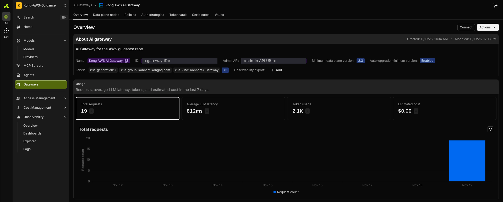

# Step 6: Add the LLM Gateway to Amazon Bedrock

[← Step 5](5-kong-identity-oauth2.md) · **Step 6** · [Step 7 →](7-connect-agent-model-tools.md)

## Why this step

Agents and apps call models too, and each team usually wires itself to each provider separately. Putting model traffic through the same AI Gateway gives it the same token check as your agents and tools, and adds what's specific to models: one OpenAI-compatible endpoint whatever the provider, and per-request **token, latency and cost analytics** in Konnect.

This step declares a **Model Provider** for Amazon Bedrock and a **Model** that routes to **Amazon Nova Micro**. Clients call it the way they'd call OpenAI, at `https://ai-dp.<your domain>/v1/chat/completions`. Kong translates the request for Bedrock and **signs it with SigV4**, using the same Pod Identity role it uses for AgentCore. No AWS keys are stored anywhere. Callers need the same Kong Identity token as Step 5.

## What it does, in plain English

1. Checks that your AWS account can use Nova Micro, and that Kong's IAM role may call Bedrock.
2. Declares the `aws-bedrock` Model Provider (Pod Identity credentials) and the `nova-micro` Model (OpenAI format, at `/v1`), protected by the Step 5 auth strategy.
3. Calls the model without a token (rejected) and with one (Nova answers, with token usage).
4. Sends a few minutes of traffic and shows where model usage appears in Konnect.

## Before you start

- Steps 2 to 5 are complete. `PAT`, `AWS_DOMAIN`, `ISSUER_URL`, `INTROSPECTION_URL`, `CLIENT_ID`, `CLIENT_SECRET` and `CACHE_TOKENS_SALT` are exported (Steps 2 and 5).
- Your account has access to **Amazon Nova Micro** in `us-west-2`.

> **Tested.** This step was run end to end against the `kong/kong-ai-gateway:2.3.1` data plane with kongctl `1.28.4`.

---

## Check Bedrock access

First, can your account use the model? This uses your own AWS credentials, and costs a fraction of a cent:

```bash
aws bedrock-runtime converse --region us-west-2 --model-id us.amazon.nova-micro-v1:0 \
  --messages '[{"role":"user","content":[{"text":"Say hi in five words"}]}]' \
  --query 'output.message.content[0].text' --output text
```

A short reply means it can. `AccessDeniedException ... don't have access to the model` means you need to enable it in the Bedrock console (us-west-2, **Model access**).

Second, may Kong's role call Bedrock? Step 2's policy allows it. This confirms it on the role Pod Identity actually uses:

```bash
ROLE_ARN=$(aws eks describe-pod-identity-association --cluster-name kong314 --region us-west-2 \
  --association-id $(aws eks list-pod-identity-associations --cluster-name kong314 --region us-west-2 \
    --namespace kong --service-account kaigateway-podid-sa --query 'associations[0].associationId' --output text) \
  --query 'association.roleArn' --output text)
echo $ROLE_ARN
aws iam simulate-principal-policy --policy-source-arn $ROLE_ARN \
  --action-names bedrock:InvokeModel bedrock:InvokeModelWithResponseStream --resource-arns '*' \
  --query 'EvaluationResults[].[EvalActionName,EvalDecision]' --output text
```

Both actions should say `allowed`.

## Declare the provider and the model

[`code/ai-gateway/step6-bedrock.yaml`](code/ai-gateway/step6-bedrock.yaml) declares:

- **`aws-bedrock`**, a Bedrock **Model Provider** with `auth.type: aws` and no keys, so the gateway signs with its Pod Identity role.
- **`nova-micro`**, a **Model** in OpenAI format with the `generate` capability, at `/v1`, matched when the request body says `"model": "nova-micro"`. Its target is `us.amazon.nova-micro-v1:0` in `us-west-2`.
- The Step 5 auth strategy again, so the model can reference it in `access.auth_strategies`. Without that block, anyone who found the URL could run Bedrock calls on your bill.

```bash
kongctl diff --mode apply -f code/ai-gateway/step6-bedrock.yaml --pat "$PAT"
kongctl apply -f code/ai-gateway/step6-bedrock.yaml --auto-approve --pat "$PAT"
```

> **kongctl refuses `--pat`?** If a wrapper such as konnect-guard blocks token flags, leave `--pat "$PAT"` off and pin this folder to a kongctl profile for the organization that holds `kong-aws-ai`. See [troubleshooting](docs/troubleshooting.md#kongctl-reaches-the-wrong-konnect-organization-or-refuses---pat).

The preview shows the provider and the model to create. The auth strategy shows no change, apart from a secret write. In Konnect they appear under **AI Gateway → Models** and **Providers**.

## Call the model

Wait about 10 seconds, then:

```bash
echo "--- no token:"
curl -s -o /dev/null -w "%{http_code}\n" https://ai-dp.$AWS_DOMAIN/v1/chat/completions \
  --json '{"model":"nova-micro","messages":[{"role":"user","content":"hi"}]}'
echo "--- valid token:"
TOKEN=$(curl -s -X POST "$ISSUER_URL/oauth/token" -d grant_type=client_credentials \
  -d client_id=$CLIENT_ID -d client_secret=$CLIENT_SECRET -d scope=scope1 | jq -r .access_token)
curl -s https://ai-dp.$AWS_DOMAIN/v1/chat/completions -H "Authorization: Bearer $TOKEN" \
  --json '{"model":"nova-micro","messages":[{"role":"user","content":"In one sentence, what does an API gateway do?"}]}' \
  | jq '{model, reply: .choices[0].message.content, usage}'
```

Without a token: `401`. With one, an OpenAI-style response from Nova:

```
{
  "model": "us.amazon.nova-micro-v1:0",
  "reply": "An API gateway acts as a single entry point that manages and routes requests to various backend services while providing features like load balancing, security, and rate limiting.",
  "usage": {
    "completion_tokens": 32,
    "total_tokens": 43,
    "prompt_tokens": 11
  }
}
```

## See model usage in Konnect

Send a few minutes of traffic. [`scripts/traffic.sh`](scripts/traffic.sh) makes accepted and rejected calls to the model, the agent and the MCP server in each round:

```bash
ROUNDS=20 ./scripts/traffic.sh
```

Then open **AI Gateway → Gateways → Kong AWS AI Gateway**. After a few minutes the **Usage** tiles on its Overview fill in from the model calls:


*The gateway's Overview after some model traffic.*

| Tile | What it shows |
|---|---|
| **Total requests** | Model requests in the last 7 days. Agent and MCP calls aren't counted here |
| **Average LLM latency** | Time Bedrock took to answer, on average |
| **Token usage** | Prompt and completion tokens across all model calls |
| **Estimated cost** | Rounded to the cent. A few thousand Nova Micro tokens cost a fraction of a cent, so it shows `$0.00` |

For the full picture, open **Observability → Overview**. It shows the exact cost, p95 latency and error rate, and the top consumers: which models, providers and Kong Identity clients made the calls, and how many calls each MCP server handled:


*Observability → Overview: model usage and cost, plus MCP server calls. The client ID is blanked out.*

---

## Verify

1. `/v1/chat/completions` with `"model":"nova-micro"` returns `401` without a token.
2. With a valid token it returns Nova's answer, `"model": "us.amazon.nova-micro-v1:0"` and a `usage` block.
3. A few minutes after some traffic, the gateway's Overview shows requests, latency and tokens, and **Observability → Overview** shows the cost.

[`scripts/verify.sh`](scripts/verify.sh) runs these checks plus Steps 2 to 5's in one go. See [docs/demo.md](docs/demo.md).

## Common problems

- **The call returns an `AccessDenied` from Bedrock.** Either your account doesn't have access to the model in `us-west-2` (run the `converse` check above), or the data plane isn't running as `kaigateway-podid-sa` (Step 2).
- **The call returns an error about the model.** The request's `"model"` must be `nova-micro`, the name declared on the gateway, not the Bedrock model ID.
- **kongctl says `config.cache_tokens_salt is required`, or the strategy's values are empty.** This file re-declares the Step 5 auth strategy, so the Step 5 variables must be exported. Use the same `CACHE_TOKENS_SALT` as in Step 5.
- **The Overview tiles stay at 0.** Analytics take a few minutes, and only model calls count there. Send traffic and refresh.
- **More:** see [docs/troubleshooting.md](docs/troubleshooting.md#step-6-llm-gateway-to-bedrock).

## Tearing this step down

Deleting the AI Gateway ([docs/teardown.md](docs/teardown.md), section 1) removes the provider and the model. The rest of that page removes everything else the guide creates.

[← Step 5](5-kong-identity-oauth2.md) · **Step 6** · [Step 7 →](7-connect-agent-model-tools.md)
