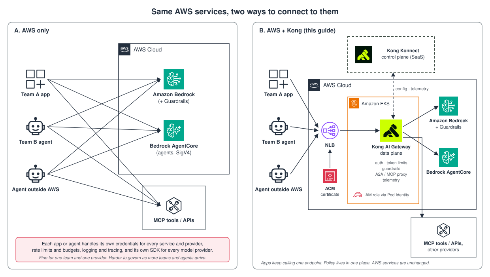
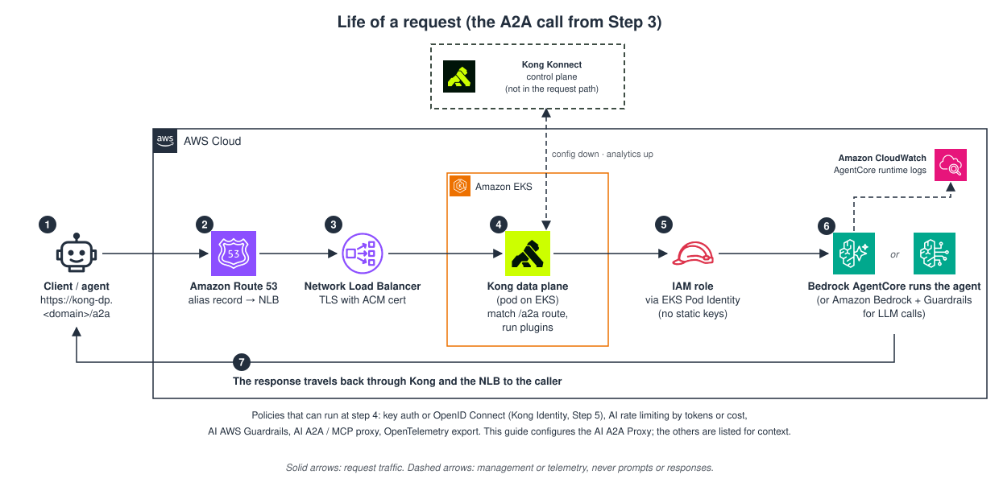

# Kong AI Gateway on AWS: LLM, MCP and Agent (A2A) Gateways with Amazon EKS and Bedrock AgentCore

You're probably already building GenAI on AWS with Bedrock models, AgentCore-hosted agents and IAM. As more teams and agents come online, every model call, tool call and agent-to-agent call needs the same things: authentication, limits, logging and one place to change policy. This guide deploys **Kong AI Gateway** inside your AWS account, on Amazon EKS behind a Network Load Balancer with an ACM certificate, as that shared front door. Kong's data plane sits in your VPC and uses an IAM role to call AWS services. Kong Konnect manages its configuration. The result adds a consistent policy and visibility layer on top of the AWS services you already use, and doesn't replace any of them.

## Contents

1. [Why Kong, if I already have AWS?](#why-kong-if-i-already-have-aws)
2. [Architecture](#architecture)
3. [What you'll build](#what-youll-build)
4. [Who this is for](#who-this-is-for)
5. [Prerequisites](#prerequisites)
6. [Steps](#steps)
   - [Step 1: Build the AWS foundation](#step-1-build-the-aws-foundation)
   - [Step 2: Run Kong AI Gateway on EKS, managed from Konnect](#step-2-run-kong-ai-gateway-on-eks-managed-from-konnect)
   - [Step 3: Put an AgentCore agent behind the AI Gateway](#step-3-put-an-agentcore-agent-behind-the-ai-gateway)
   - [Step 4: Turn a REST API into MCP tools on the AI Gateway](#step-4-turn-a-rest-api-into-mcp-tools-on-the-ai-gateway)
   - [Step 5: Require Kong Identity tokens on the agent and tools](#step-5-require-kong-identity-tokens-on-the-agent-and-tools)
   - [Step 6: Add the LLM Gateway to Amazon Bedrock](#step-6-add-the-llm-gateway-to-amazon-bedrock)
7. [Test and demo](#test-and-demo)
8. [Clean up](#clean-up)
9. [Repo layout](#repo-layout)
10. [Next steps and further reading](#next-steps-and-further-reading)

## Why Kong, if I already have AWS?

It's a fair question. AWS already gives you models (Bedrock), safety filters (Guardrails), an agent runtime and tool gateway (AgentCore), identity (IAM, Cognito), API management (API Gateway), edge protection (WAF), logs and metrics (CloudWatch) and secrets (Secrets Manager). Kong doesn't replace any of these.

Kong becomes useful once you have **more than one kind of AI traffic, more than one team, or more than one provider**. Then you want one place to apply the same identity, limits and logging to LLM calls, MCP tool calls and agent-to-agent calls, whether they go to Bedrock or somewhere else. Kong runs inside your VPC as that layer and calls AWS services with an IAM role you control.

| AWS service you already use | What Kong adds on top |
|---|---|
| **Amazon Bedrock** | One OpenAI-compatible or provider-native endpoint across Bedrock and non-AWS providers. Per-team routing, fallback and load balancing between models. |
| **Bedrock Guardrails** | Applies your existing guardrail at the gateway with Kong's AI AWS Guardrails policy, so the same guardrail covers traffic to non-Bedrock models too. |
| **Bedrock AgentCore** | A single A2A front door for agents on AgentCore *and* outside it. Callers present an OAuth2 token from Kong Identity, Kong checks it, then Kong signs the call to AgentCore with its own IAM role (Steps 3 and 5). No caller holds AWS credentials. |
| **IAM / Pod Identity** | Kong gets AWS access only through an IAM role you scope and audit. Consumer-level identity (API keys, OAuth2, OIDC) applies on top for the humans and agents calling Kong. |
| **API Gateway / WAF** | AI-aware policies on top of request-based throttling: limits counted in **tokens or dollars** per consumer or group, and prompt-level guards. |
| **CloudWatch** | AI-specific metrics (tokens, cost, model, latency per consumer) for LLM, MCP and A2A traffic, plus OpenTelemetry export. |
| **MemoryDB / ElastiCache** | Used as Kong's Redis backend for semantic caching, semantic routing and shared rate-limit counters. |

The full, even-handed comparison, including when you **don't** need Kong, is in [docs/why-kong-on-aws.md](docs/why-kong-on-aws.md).


*Left: each app wires itself to each AWS service. Right: the same AWS services, with Kong in front applying shared policy.*

## Architecture


*The reference architecture.*

Kong is split into two halves. The **control plane** (a Kong Konnect AI Gateway, run by Kong) is where agents, MCP servers, models and policies are declared. The **data plane** (Kong AI Gateway pods on your EKS cluster) is where traffic actually flows. The data plane connects out to Konnect to fetch configuration and send telemetry. Your prompts, responses and agent messages stay on the data plane in your VPC.

### Follow one request through the system

This is the path an A2A call takes once you've finished Step 5. MCP and model calls follow the same path and differ only in the AI Gateway entity and the upstream service.


*One request, end to end.*

1. **The client resolves the name.** An app or agent calls `https://ai-dp.<your domain>/a2a` with a Kong Identity token. Route 53 answers with the NLB's address (alias record from Step 2).
2. **The NLB terminates TLS.** The Network Load Balancer presents your ACM wildcard certificate on port 443 (Step 1) and forwards plain HTTP to the AI Gateway pods on port 8000.
3. **Kong matches the request to an AI entity.** The data plane on EKS matches `/a2a` to the **Agent** declared in Konnect. Its **Auth Strategy** checks the caller's token with Kong Identity (Step 5) and rejects the call with `401` if it isn't valid. AI rate limiting and Guardrails policies would run at this point too.
4. **Kong signs the call to AWS.** The data plane uses the IAM role attached through EKS Pod Identity (Step 2) to sign the request with SigV4, with no static AWS keys. The same happens for model calls to Bedrock (Step 6).
5. **The AWS service does the work.** AgentCore runs the agent (Step 3), or Bedrock runs the model (Step 6).
6. **The response comes back the same way,** through Kong and the NLB to the client.
7. **Everyone gets the logs they need.** Kong sends analytics to Konnect, including token usage and latency for model calls, and can also export OpenTelemetry. AgentCore writes its own logs to CloudWatch (you'll tail them in Step 3). The reference architecture also streams Kong metrics to CloudWatch, but this guide doesn't configure that yet.

Deeper dives on each flow:
- [Kong AI Gateway and Amazon Bedrock AgentCore](docs/concepts/kong-ai-gateway-and-agentcore.md): how AgentCore and Kong split responsibilities.
- [The LLM/GenAI flow](docs/concepts/llm-gateway-flow.md): agent → Kong LLM Gateway → Bedrock, OpenAI, Anthropic.
- [All flows together](docs/concepts/all-flows.md): LLM, MCP and A2A traffic through one data plane.
- [Solution overview](docs/solution-overview.md): summary, features, use cases and architecture steps.

## What you'll build

When you finish Steps 1–6 you'll have:

- An **EKS cluster** with the AWS Load Balancer Controller and EKS Pod Identity.
- A **Konnect AI Gateway** (`kong-aws-ai`) and its **data plane** on EKS, with AWS access through an **IAM role** rather than keys.
- A **public HTTPS endpoint**, `ai-dp.<your domain>`, served by an NLB with an **ACM** certificate and a **Route 53** alias.
- An **A2A agent running on Bedrock AgentCore**, published as an **Agent** at `/a2a`. Kong signs each call to AgentCore with its IAM role (Step 3).
- An **MCP Server** at `/mcp`, turning a REST API into two MCP tools that any MCP client can list and call (Step 4).
- A **Kong Identity** OAuth2 authorization server and an **Auth Strategy**, so every route needs a valid, short-lived token (Step 5).
- An **LLM Gateway to Amazon Bedrock**: a **Model** at `/v1` that answers OpenAI-style requests with Amazon Nova Micro, with token, latency and cost analytics in Konnect (Step 6).

> **What this guide does *not* configure yet.** The architecture includes Bedrock Guardrails, MemoryDB for semantic caching, Secrets Manager for credentials and CloudWatch for Kong metrics. The IAM policy in Step 2 already grants the Guardrails and Secrets Manager permissions. This guide has **no deployment steps** for these pieces yet.

- Run [Clean up](#clean-up) when you're done.

> **Looking for the plugin-based version?** An earlier version of this guide builds the A2A and MCP gateways with plugins on an API Gateway control plane. It's on the [`restructure-aws-guided-layout`](https://github.com/Kong/guidance-for-kong-genai-mcp-and-a2a-gateways-on-aws/tree/restructure-aws-guided-layout) branch.

## Who this is for

You don't need deep Kubernetes knowledge. Every Kubernetes command is copy-paste, and the step docs explain what each one does. You do need to be comfortable running AWS CLI commands in a terminal.

| You are… | Read this first | Then |
|---|---|---|
| **Cloud architect** | [Why Kong on AWS](docs/why-kong-on-aws.md), [Architecture](#architecture) | [docs/concepts/](docs/concepts/) for the LLM, MCP and A2A flows |
| **Security lead** | Step 2's IAM policy and Pod Identity section, [Step 5](5-kong-identity-oauth2.md) (OAuth2 tokens and introspection) | The "who owns what" table in [docs/why-kong-on-aws.md](docs/why-kong-on-aws.md#who-owns-what) |
| **FinOps / IT lead** | [What you'll build](#what-youll-build), [Step 6](6-llm-gateway-bedrock.md) (token usage and cost in Konnect) | [Clean up](#clean-up) |
| **Platform engineer** | [Prerequisites](#prerequisites), then Steps 1–6 in order | [docs/troubleshooting.md](docs/troubleshooting.md) |

Terms like MCP, A2A, data plane and AgentCore are defined in the [glossary](docs/glossary.md).

## Prerequisites

### Accounts

- **AWS account** with permission to create EKS clusters, IAM policies and roles, Route 53 domains and records, ACM certificates, CloudFormation stacks and Bedrock AgentCore runtimes, all in `us-west-2` (Route 53 Domains uses `us-east-1`). The AgentCore CLI deploys with CDK and bootstraps it in the account on first use.
- **Bedrock**: AgentCore available in `us-west-2` (Step 3), and access to the **Amazon Nova Micro** model in `us-west-2` (Step 6).
- **Kong Konnect account** with **AI Gateway** available (it appears as **AI** in the Konnect sidebar). If you don't have an account, start a [free 30-day trial of Kong Konnect on the AWS Marketplace](https://aws.amazon.com/marketplace/pp/prodview-77nhc3l2cn5im). You'll create a **Personal Access Token** in Step 2. The guide uses the Konnect **US** region (`us.api.konghq.com`).

### Tools

These are the command-line tools the steps use. Install each one from its own install page (linked below). Running each tool's version command is a quick way to confirm it's on your `PATH`.

| Tool | What it's for in this guide | Used in |
|---|---|---|
| [AWS CLI](https://docs.aws.amazon.com/cli/latest/userguide/cli-chap-getting-started.html) | Creates IAM policies, Route 53 records, ACM certificates; inspects the NLB, AgentCore and Bedrock | Steps 1–3, 6 |
| [eksctl](https://github.com/eksctl-io/eksctl) | Creates the EKS cluster, add-ons and Pod Identity associations | Steps 1–2 |
| [kubectl](https://kubernetes.io/docs/tasks/tools/#kubectl) | Applies the Kong Operator resources and checks pods. Use a version within one minor version of the cluster (1.34 to 1.36 for EKS 1.35) | Steps 2, 4 |
| [helm](https://helm.sh/docs/intro/install/) | Installs the AWS Load Balancer Controller and the Kong Operator | Steps 1–2 |
| [kongctl](https://developer.konghq.com/kongctl/) | Declares the AI Gateway's agents, MCP servers, auth strategies and models. 1.28.4 or newer | Steps 2–6 |
| [k9s](https://k9scli.io/) | Optional terminal UI for watching pods | Any |
| [curl](https://curl.se/) | Calls Konnect APIs and tests the gateway. 7.82 or newer, for `--json` | All |
| [jq](https://jqlang.org/) | Extracts values (ARNs, IDs, URLs) from JSON output | All |
| [jwt-cli](https://github.com/mike-engel/jwt-cli) | Decodes access tokens | Step 5 |
| Python + [uv](https://docs.astral.sh/uv/) + A2A SDK | Runs the sample agents | Step 3 ([setup](code/a2a/python-a2a-sdk-install.md)) |
| npm + [AgentCore CLI](https://docs.aws.amazon.com/bedrock-agentcore/latest/devguide/agentcore-get-started-cli.html) | Creates and deploys the AgentCore agent (tested with 1.1.0) | Step 3 |
| [awscurl](https://pypi.org/project/awscurl/) | Sends SigV4-signed requests straight to AgentCore | Step 3 |

### Check your setup

Run these before Step 1. Each one takes seconds, and each catches a problem that would otherwise stop a later step halfway through.

**1. Confirm the tools are installed.** Every command should print a version. "command not found" means that tool still needs installing.

```bash
aws --version
eksctl version
kubectl version --client
helm version --short
kongctl version
curl --version | head -1
jq --version
jwt --version
uv --version
agentcore --version
command -v awscurl
```

**2. Sign in to AWS.** Use the one that matches how you get AWS credentials.

```bash
# AWS console credentials
aws login

# or IAM Identity Center (SSO)
aws sso login --profile <YOUR_PROFILE>
export AWS_PROFILE=<YOUR_PROFILE>
```

**3. Confirm the sign-in worked.**

```bash
aws sts get-caller-identity
```

It should print your `UserId`, `Account` and `Arn`. If it prints `login session has expired, please reauthenticate` (or `Token has expired` for SSO), run step 2 again. Sessions expire, so expect to do this again partway through the guide. `eksctl`, `helm` and `kubectl` all fail with the same message when it happens.

**4. Set the shell defaults the steps assume.**

```bash
export AWS_REGION=us-west-2
export AWS_PAGER=""
export AWS_ACCOUNT_ID=$(aws sts get-caller-identity --query Account --output text)
echo "$AWS_ACCOUNT_ID"
```

The account ID it prints is the value to use wherever a command says `<YOUR_AWS_ACCOUNT_ID>`. Run these in every new terminal window.

**5. For tools that can't read an `aws login` session** (the AgentCore CLI's CDK deploy and `awscurl` in Step 3), export the session as plain environment variables:

```bash
eval "$(aws configure export-credentials --format env)"
```

These exported credentials expire too. After you sign in again, run this line again.

**6. Confirm the account can reach the services this guide uses.**

```bash
# EKS in us-west-2 (an empty list is fine)
aws eks list-clusters --region us-west-2

# Amazon Nova Micro on Bedrock (Step 6). A short reply means you have access.
aws bedrock-runtime converse --region us-west-2 --model-id us.amazon.nova-micro-v1:0 \
  --messages '[{"role":"user","content":[{"text":"Say hi in five words"}]}]' \
  --query 'output.message.content[0].text' --output text
```

`AccessDeniedException` on the first command means your role can't use EKS. On the second, it means the model isn't enabled for the account in `us-west-2`.

**7. Optional: if you already have a Konnect Personal Access Token**, check that it works against the US region. Otherwise you'll create one in Step 2.

```bash
export PAT=<YOUR_PAT>
curl -s -o /dev/null -w "%{http_code}\n" -H "Authorization: Bearer $PAT" \
  https://us.api.konghq.com/v2/control-planes
```

`200` means the token works. `401` means it's wrong or expired.

## Steps

Each step below gives the **why**, a plain-English summary and a **Verify** check. To run a step, open its **full doc**: it has every command in order, with expected output, optional checks and background. Run the steps in order. Each one builds on the one before.

Run everything in **one terminal session**, from the root of this repo. Later steps reuse variables exported earlier (`AWS_DOMAIN`, `CERTIFICATE_ARN`, `HOSTED_ZONE_ID`, `PAT`, `AGENTCORE_URL`, `ISSUER_URL`, `CLIENT_ID`, `CLIENT_SECRET`, `INTROSPECTION_URL`, `CACHE_TOKENS_SALT`). If you open a new terminal, re-run the `export` commands.

> **Placeholders.** Replace `<YOUR_AWS_ACCOUNT_ID>`, `<YOUR_AWS_ACCOUNT>`, `<YOUR_PAT>` and the Route 53 contact fields with your own values. The commands also hard-code the names `kong314`, `us-west-2`, `kong-aws-ai` and `kong-aws-ai-guidance.com`. Keep them, or change them consistently everywhere.

### Step 1: Build the AWS foundation

**Full doc:** [1-eks-cluster.md](1-eks-cluster.md)

**Why this step.** Kong will run inside your own AWS account, on EKS, so AI traffic stays on infrastructure you control and IAM governs it. Before any Kong component exists, you need a cluster, a way to get a load balancer and a trusted HTTPS name.

**What it does.** Creates an EKS cluster with the Pod Identity add-on, installs the AWS Load Balancer Controller (so Kubernetes can create an NLB), registers a domain in Route 53 (or uses one you already have) and issues a wildcard ACM certificate validated through DNS.

**Verify.** The certificate status check at the end of the full doc prints `ISSUED`.

**Common problems.** The certificate stays `PENDING_VALIDATION` (domain registration not finished, the domain isn't delegated to the hosted zone, or the CNAME is in the wrong zone). An IAM policy name already exists in a shared account. See [Step 1 troubleshooting](docs/troubleshooting.md#step-1-eks-and-networking).

### Step 2: Run Kong AI Gateway on EKS, managed from Konnect

**Full doc:** [2-kong-konnect-data-plane.md](2-kong-konnect-data-plane.md)

**Why this step.** This is where Kong and AWS meet. Konnect's AI Gateway is the control plane, where you declare agents, MCP servers, models and auth strategies. It never sits in the request path. The data plane runs as pods in your cluster and gets AWS permissions only through an IAM role bound with EKS Pod Identity.

**What it does.** Creates the `bedrock-policy-kong314` IAM policy and binds it to Kong's service account, installs the Kong Operator with its AI Gateway controller, creates the `kong-aws-ai` AI Gateway in Konnect and its data plane in EKS behind an internet-facing NLB with your ACM certificate, points `ai-dp.<your domain>` at the NLB, and sets up kongctl.

**Verify.** `https://ai-dp.<your domain>` returns `404 Not Found` (Kong is up, nothing is declared yet), and `kongctl get ai-gateways` lists **Kong AWS AI Gateway**.

**Common problems.** The operator's AI data plane controller is off by default. The pod template must name the container `aigw`. Your machine can't resolve the new name yet, or the NLB returns an empty reply while its targets warm up. See [Step 2 troubleshooting](docs/troubleshooting.md#step-2-kong-ai-gateway-on-eks).

### Step 3: Put an AgentCore agent behind the AI Gateway

**Full doc:** [3-a2a-agent-gateway-agentcore.md](3-a2a-agent-gateway-agentcore.md)

**Why this step.** AgentCore runs your agents and requires IAM-signed (SigV4) calls. The AI Gateway gives other agents (inside AWS or not) one plain HTTPS A2A endpoint with consistent policy and logging, and signs the call to AgentCore with its own IAM role, so callers never hold AWS credentials.

**What it does.** Runs a hello-world A2A agent locally, deploys it to AgentCore (checked with SigV4 `awscurl`), then declares it on the AI Gateway as an **Agent** at `/a2a` with AWS SigV4 upstream auth.

**Verify.** A plain `curl` to `https://ai-dp.<your domain>/a2a` returns an artifact whose text is `that's the response`, and the data plane log shows `Creating aws_iam auth handler`.

**Common problems.** The deployed agent crashes because the CLI template pins an old `a2a-sdk`. The call returns `403` from AWS because the data plane isn't using the Pod Identity service account. See [Step 3 troubleshooting](docs/troubleshooting.md#step-3-a2a-and-agentcore).

### Step 4: Turn a REST API into MCP tools on the AI Gateway

**Full doc:** [4-mcp-gateway.md](4-mcp-gateway.md)

**Why this step.** Agents call tools over MCP. Routing those calls through Kong gives tool access the same authentication, limits and telemetry as model and agent traffic, instead of every agent holding credentials for every tool. Most teams already have REST APIs, and Kong can expose them as MCP tools without anyone writing an MCP server.

**What it does.** Runs a small echo API (go-httpbin) inside the cluster, then declares an **MCP Server** at `/mcp` that turns two REST endpoints into two MCP tools, `check-inventory` and `list-orders`. You then initialize a session, list the tools and call one, the way an agent would.

**Verify.** Listing the tools returns `check-inventory` and `list-orders`, and calling `check-inventory` returns the echo of the REST request Kong made (`/anything/inventory?sku=KONG-123`).

**Common problems.** The tool call uses `sku` instead of `query_sku`. The MCP calls are rejected because of the session ID (re-run the initialize step). See [Step 4 troubleshooting](docs/troubleshooting.md#step-4-mcp-tools).

### Step 5: Require Kong Identity tokens on the agent and tools

**Full doc:** [5-kong-identity-oauth2.md](5-kong-identity-oauth2.md)

**Why this step.** After Step 4, anyone who knows the URLs can call your agent and tools. Machine-to-machine traffic (agents calling agents and tools) needs short-lived, scoped tokens that the gateway checks, not shared static keys. Kong Identity is an OAuth2 authorization server built into Konnect. Amazon Cognito is the AWS-native alternative.

**What it does.** Creates an authorization server, scope, custom claim and client-credentials client in Kong Identity, walks through getting, decoding and introspecting a token by hand, then declares an **Auth Strategy** and attaches it to the agent and the MCP server.

**Verify.** Calls to `/a2a` and `/mcp` without a token, or with a bad one, return `401` from Kong. The same calls with a fresh token reach the agent and the tools.

**Common problems.** kongctl requires an explicit `cache_tokens_salt`. An MCP server's `access` block has a different shape from an agent's. See [Step 5 troubleshooting](docs/troubleshooting.md#step-5-kong-identity).

### Step 6: Add the LLM Gateway to Amazon Bedrock

**Full doc:** [6-llm-gateway-bedrock.md](6-llm-gateway-bedrock.md)

**Why this step.** Agents and apps call models too. Putting model traffic through the same gateway gives it the same token check, one OpenAI-compatible endpoint whatever the provider, and per-request token, latency and cost analytics in Konnect.

**What it does.** Declares a Bedrock **Model Provider** (signed with the Pod Identity role) and a **Model** for Amazon Nova Micro at `/v1`, behind the Step 5 auth strategy. Then it sends some traffic and shows the model usage in Konnect.

**Verify.** `/v1/chat/completions` with `"model": "nova-micro"` returns `401` without a token, and Nova's answer with token usage with one. A few minutes later the AI Gateway's Overview shows requests, latency and tokens.

**Common problems.** Your account doesn't have access to Nova Micro. The request uses the Bedrock model ID instead of `nova-micro`. See [Step 6 troubleshooting](docs/troubleshooting.md#step-6-llm-gateway-to-bedrock).

## Test and demo

Once Steps 1–6 are done, [`scripts/verify.sh`](scripts/verify.sh) checks the whole setup in one command: the gateway answers; `/a2a`, `/mcp` and `/v1` reject missing and bad tokens; and with a valid token the agent answers, the MCP tools work and the model replies.

```bash
export AWS_DOMAIN=<your domain> ISSUER_URL=<issuer URL> CLIENT_ID=<client ID> CLIENT_SECRET=<client secret>
./scripts/verify.sh
```

To give the Konnect dashboards something to show, [`scripts/traffic.sh`](scripts/traffic.sh) sends a steady mix of accepted and rejected requests to all three (same variables, plus `ROUNDS`). It's demo traffic, not a test.

[docs/demo.md](docs/demo.md) explains each check and gives a five-minute walk-through for showing the setup to someone else.

## Clean up

Stop billing by removing what you created. **[docs/teardown.md](docs/teardown.md) has the commands for everything, in a safe order.** The EKS cluster and the AgentCore runtime are the main ongoing costs.

In short, roughly in reverse order:
- **The AI Gateway** and its data plane (Step 2), which also deletes the NLB and everything declared on the gateway, plus the `ai-dp.<your domain>` record.
- **The Kong Operator** and the echo backend (Steps 2 and 4).
- **Kong Identity** (Step 5): the `AuthZ_Server_1` authorization server.
- **The AgentCore runtime** and its CloudFormation stack (Step 3).
- **The AWS Load Balancer Controller and the EKS cluster** `kong314` (Step 1), the largest ongoing charges.
- **The ACM certificate** and its validation record (Step 1).
- **IAM policies and roles**: `AWSLoadBalancerControllerIAMPolicy-kong314`, `bedrock-policy-kong314`, `AWSLoadBalancerControllerIAMRole-kong314` and `kaigateway-aws-podid-role` (or the suffixed names you used).
- **Optionally, the Route 53 hosted zone and domain** (Step 1).

Check the Billing console a day later to confirm nothing is still running.

## Repo layout

```
├── README.md                              # this walkthrough
├── 1-eks-cluster.md                       # Step 1: EKS, Load Balancer Controller, Route 53, ACM
├── 2-kong-konnect-data-plane.md           # Step 2: IAM + Pod Identity, Kong Operator, Konnect AI Gateway and EKS data plane, NLB, DNS
├── 3-a2a-agent-gateway-agentcore.md       # Step 3: A2A agent locally → AgentCore → Agent on the AI Gateway (SigV4)
├── 4-mcp-gateway.md                       # Step 4: MCP flow explained; in-cluster REST API exposed as MCP tools
├── 5-kong-identity-oauth2.md              # Step 5: Kong Identity tokens; Auth Strategy on the agent and MCP server
├── 6-llm-gateway-bedrock.md               # Step 6: Bedrock Model Provider and Nova Micro Model; usage in Konnect
├── code/a2a/                              # Step 3 sample agents and Python setup (server_1.py, client_1.py)
├── code/ai-gateway/                       # Kubernetes manifests (Step 2) and one kongctl file per step (Steps 3–6)
├── scripts/
│   ├── verify.sh                          # end-to-end check of /a2a, /mcp and /v1
│   └── traffic.sh                         # demo traffic for the Konnect dashboards
├── docs/
│   ├── demo.md                            # how to test and demo the finished setup
│   ├── teardown.md                        # commands to remove everything
│   ├── why-kong-on-aws.md                 # the AWS-first case for (and against) adding Kong
│   ├── glossary.md                        # every acronym and product term used here
│   ├── troubleshooting.md                 # per-step problems and fixes
│   ├── known-issues.md                    # open issues to resolve before production use
│   ├── solution-overview.md               # solution summary, features, use cases
│   └── concepts/                          # architecture write-ups: AgentCore, LLM flow, all flows
└── images/
    ├── architecture/                      # reference architecture and overview diagrams
    ├── step3-a2a/, step4-mcp/             # A2A and MCP flow diagrams
    └── README.md                          # image conventions and index
```

## Next steps and further reading

- **Add Guardrails.** The IAM permissions are already in place. Kong's docs cover the [AI AWS Guardrails policy](https://developer.konghq.com/ai-gateway/how-to/use-ai-aws-guardrails-policy/) and the [Bedrock provider](https://developer.konghq.com/ai-gateway/ai-providers/bedrock/).
- **Go further with MCP.** An [MCP Server](https://developer.konghq.com/ai-gateway/mcp/) can also proxy existing MCP servers (for example, ones running on AgentCore) and [combine several tool sets](https://developer.konghq.com/ai-gateway/aggregate-mcp-tools/) behind one endpoint.
- **More about the AI Gateway entities.** [AI Gateway 2.x concepts](https://developer.konghq.com/ai-gateway/ai-gateway-v2-concepts/), the [Agent entity](https://developer.konghq.com/ai-gateway/entities/ai-agent/), and [managing AI Gateway with kongctl](https://developer.konghq.com/ai-gateway/kongctl/).
- **AWS references:** [Amazon Bedrock AgentCore](https://docs.aws.amazon.com/bedrock-agentcore/latest/devguide/), [EKS Pod Identity](https://docs.aws.amazon.com/eks/latest/userguide/pod-identities.html), [AWS Load Balancer Controller](https://kubernetes-sigs.github.io/aws-load-balancer-controller/latest/).
- **Protocols:** the [A2A protocol](https://a2a-protocol.org/) and the [Model Context Protocol](https://modelcontextprotocol.io/).
