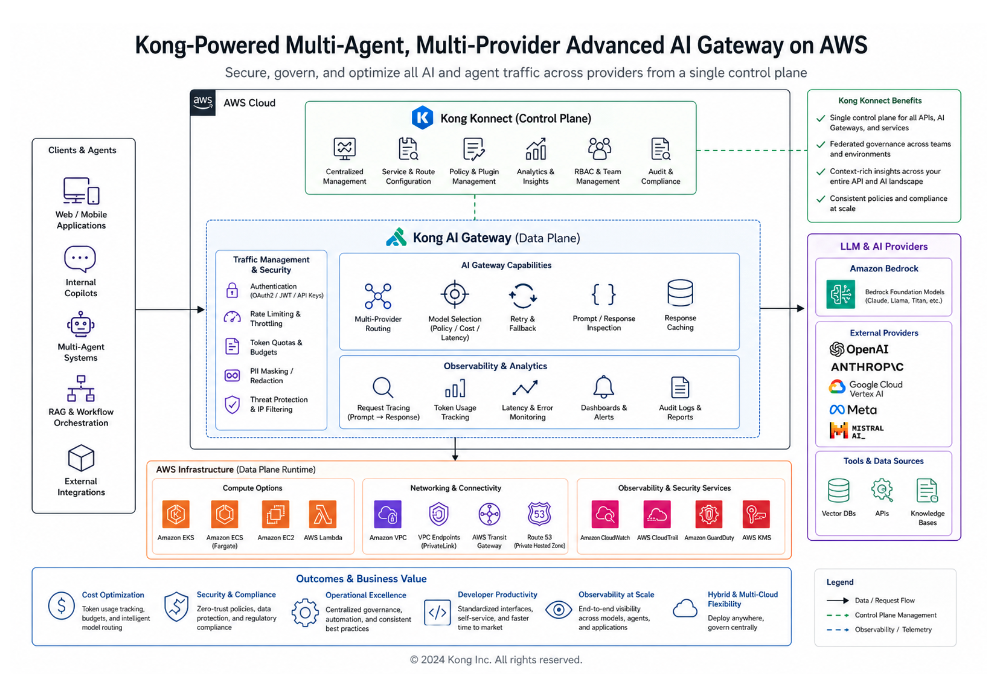
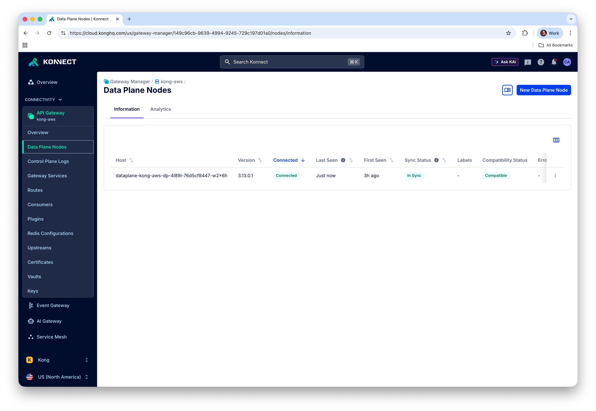
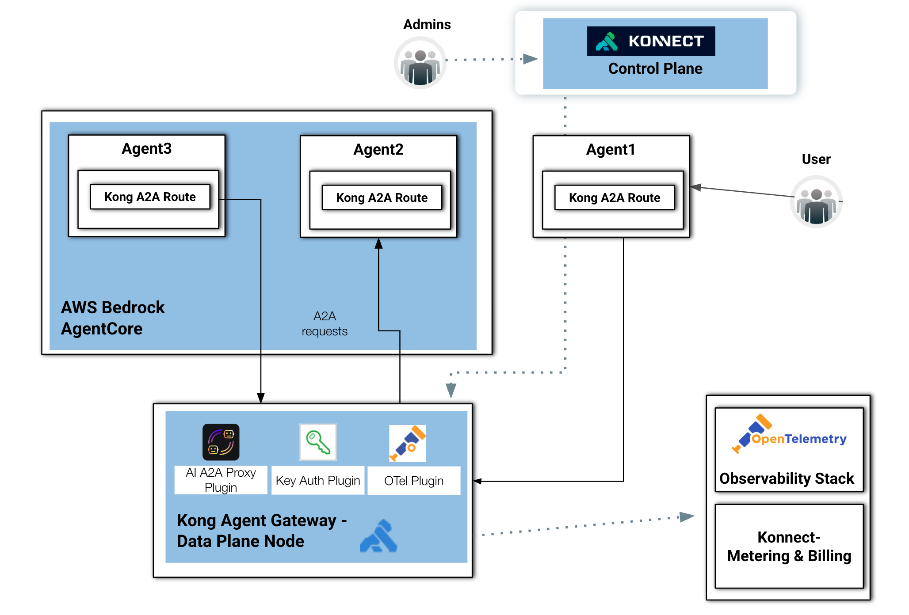
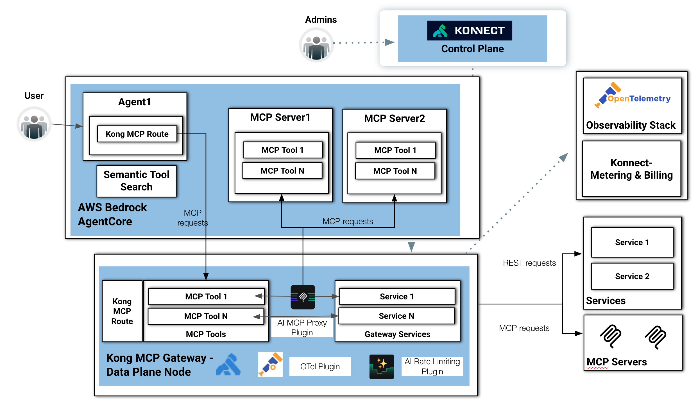

# Kong AI Gateway on AWS: LLM, MCP and Agent (A2A) Gateways with Amazon EKS and Bedrock AgentCore

You're probably already building GenAI on AWS with Bedrock models, AgentCore-hosted agents and IAM. As more teams and agents come online, every model call, tool call and agent-to-agent call needs the same things: authentication, limits, logging and one place to change policy. This guide deploys **Kong AI Gateway** inside your AWS account, on Amazon EKS behind a Network Load Balancer with an ACM certificate, as that shared front door. Kong's data plane sits in your VPC and uses an IAM role to call AWS services. Kong Konnect manages its configuration. The result adds a consistent policy and visibility layer on top of the AWS services you already use, and doesn't replace any of them.

## Contents

1. [Why Kong, if I already have AWS?](#why-kong-if-i-already-have-aws)
2. [Architecture](#architecture)
3. [What you'll build](#what-youll-build)
4. [Who this is for](#who-this-is-for)
5. [Prerequisites](#prerequisites)
6. [Steps](#steps)
   - [Step 1: Build the AWS foundation](#step-1-build-the-aws-foundation)
   - [Step 2: Run Kong's data plane on EKS, managed from Konnect](#step-2-run-kongs-data-plane-on-eks-managed-from-konnect)
   - [Step 3: Put an AgentCore agent behind Kong's Agent (A2A) Gateway](#step-3-put-an-agentcore-agent-behind-kongs-agent-a2a-gateway)
   - [Step 4: The MCP Gateway pattern, and a mocked API to build it on](#step-4-the-mcp-gateway-pattern-and-a-mocked-api-to-build-it-on)
   - [Step 5: Kong Identity as the OAuth2 provider](#step-5-kong-identity-as-the-oauth2-provider)
7. [Clean up](#clean-up)
8. [Repo layout](#repo-layout)
9. [Next steps and further reading](#next-steps-and-further-reading)

## Why Kong, if I already have AWS?

It's a fair question. AWS already gives you models (Bedrock), safety filters (Guardrails), an agent runtime and tool gateway (AgentCore), identity (IAM, Cognito), API management (API Gateway), edge protection (WAF), logs and metrics (CloudWatch) and secrets (Secrets Manager). Kong doesn't replace any of these.

Kong becomes useful once you have **more than one kind of AI traffic, more than one team, or more than one provider**. Then you want one place to apply the same identity, limits and logging to LLM calls, MCP tool calls and agent-to-agent calls, whether they go to Bedrock or somewhere else. Kong runs inside your VPC as that layer and calls AWS services with an IAM role you control.

| AWS service you already use | What Kong adds on top |
|---|---|
| **Amazon Bedrock** | One OpenAI-compatible or provider-native endpoint across Bedrock and non-AWS providers. Per-team routing, fallback and load balancing between models. |
| **Bedrock Guardrails** | Applies your existing guardrail at the gateway with Kong's AI AWS Guardrails plugin, so the same guardrail covers traffic to non-Bedrock models too. |
| **Bedrock AgentCore** | A single A2A front door for agents on AgentCore *and* outside it. Callers use plain HTTPS while Kong signs requests to AgentCore with IAM (Step 3). |
| **IAM / Pod Identity** | Kong gets AWS access only through an IAM role you scope and audit. Consumer-level identity (API keys, OAuth2, OIDC) applies on top for the humans and agents calling Kong. |
| **API Gateway / WAF** | AI-aware policies on top of request-based throttling: limits counted in **tokens or dollars** per consumer or group, and prompt-level guards. |
| **CloudWatch** | AI-specific metrics (tokens, cost, model, latency per consumer) for LLM, MCP and A2A traffic, plus OpenTelemetry export. |
| **MemoryDB / ElastiCache** | Used as Kong's Redis backend for semantic caching, semantic routing and shared rate-limit counters. |

The full, even-handed comparison, including when you **don't** need Kong, is in [docs/why-kong-on-aws.md](docs/why-kong-on-aws.md).


*Left: each app wires itself to each AWS service. Right: the same AWS services, with Kong in front applying shared policy.*

## Architecture


*The reference architecture.*

Kong is split into two halves. The **control plane** (Kong Konnect, run by Kong) is where routes and policies are defined. The **data plane** (Kong Gateway pods on your EKS cluster) is where traffic actually flows. The data plane connects out to Konnect to fetch configuration and send telemetry. Your prompts, responses and agent messages stay on the data plane in your VPC.

### Follow one request through the system

This is the path an A2A call takes once you've finished Step 3. LLM and MCP calls follow the same path and differ only in the plugin and the upstream service.


*One request, end to end.*

1. **The client resolves the name.** An app or agent calls `https://kong-dp.<your domain>/a2a`. Route 53 answers with the NLB's address (alias record from Step 2).
2. **The NLB terminates TLS.** The Network Load Balancer presents your ACM wildcard certificate on port 443 (Step 1) and forwards plain HTTP to the Kong pods on port 8000.
3. **Kong matches a route and runs plugins.** The data plane on EKS matches `/a2a` to the `a2a-route` and runs its plugins. Here that's the AI A2A Proxy. Authentication plugins (key auth, OpenID Connect against Kong Identity in Step 5), AI rate limiting and Guardrails plugins would run at this point too.
4. **Kong authenticates to AWS with IAM.** Kong's pod uses the IAM role attached through EKS Pod Identity (Step 2). No static AWS keys are involved. The policy allows `bedrock-agentcore:InvokeAgentRuntime`, `bedrock:InvokeModel`, `bedrock:ApplyGuardrail` and `secretsmanager:GetSecretValue`, among others.
5. **The AWS service does the work.** AgentCore runs the agent (Step 3). For LLM traffic it would be Bedrock, optionally with Bedrock Guardrails checking the prompt and response.
6. **The response comes back the same way,** through Kong and the NLB to the client.
7. **Everyone gets the logs they need.** Kong sends analytics to Konnect, and can also export OpenTelemetry. AgentCore writes its own logs to CloudWatch (you'll tail them in Step 3). The reference architecture also streams Kong metrics to CloudWatch, but this guide doesn't configure that yet.

Deeper dives on each flow:
- [Kong AI Gateway and Amazon Bedrock AgentCore](docs/concepts/kong-ai-gateway-and-agentcore.md): how AgentCore and Kong split responsibilities.
- [The LLM/GenAI flow](docs/concepts/llm-gateway-flow.md): agent → Kong LLM Gateway → Bedrock, OpenAI, Anthropic.
- [All flows together](docs/concepts/all-flows.md): LLM, MCP and A2A traffic through one data plane.
- [Solution overview](docs/solution-overview.md): summary, features, use cases and architecture steps.


*Kong's capabilities mapped onto AWS.*

## What you'll build

When you finish Steps 1–3 you'll have:

- An **EKS cluster** with the AWS Load Balancer Controller and EKS Pod Identity.
- A **public HTTPS endpoint**, `kong-dp.<your domain>`, served by an NLB with an **ACM** certificate and a **Route 53** alias.
- A **Kong data plane** on EKS, connected to a **Konnect control plane** named `kong-aws`, with AWS access through an **IAM role** rather than keys.
- An **A2A agent running on Bedrock AgentCore**, reachable through Kong at `/a2a` by any A2A client without AWS credentials.

Steps 4 and 5 add a mocked API route and a **Kong Identity** OAuth2 authorization server with the client credentials flow. Both depend on decK files that aren't in this repo yet, so read the notes in those steps first.

> **What this guide does *not* configure yet.** The architecture includes the LLM Gateway to Bedrock, Bedrock Guardrails, MemoryDB for semantic caching, Secrets Manager for credentials and CloudWatch for Kong metrics. The IAM policy in Step 2 already grants the Bedrock, Guardrails and Secrets Manager permissions. This guide has **no deployment steps** for these pieces yet.

- Run [Clean up](#clean-up) when you're done.

## Who this is for

You don't need deep Kubernetes knowledge. Every Kubernetes command is copy-paste, and the step docs explain what each one does. You do need to be comfortable running AWS CLI commands in a terminal.

| You are… | Read this first | Then |
|---|---|---|
| **Cloud architect** | [Why Kong on AWS](docs/why-kong-on-aws.md), [Architecture](#architecture) | [docs/concepts/](docs/concepts/) for the LLM, MCP and A2A flows |
| **Security lead** | Step 2's IAM policy and Pod Identity section, [Step 5](5-kong-identity-oauth2.md) (OAuth2 tokens and introspection) | The "who owns what" diagram in [docs/why-kong-on-aws.md](docs/why-kong-on-aws.md#who-owns-what) |
| **FinOps / IT lead** | [What you'll build](#what-youll-build) (cost estimate), [Why Kong on AWS](docs/why-kong-on-aws.md#where-the-gaps-show-up-in-practice) (token and cost budgets) | [Clean up](#clean-up) |
| **Platform engineer** | [Prerequisites](#prerequisites), then Steps 1–5 in order | [docs/troubleshooting.md](docs/troubleshooting.md) |

Terms like MCP, A2A, data plane and AgentCore are defined in the [glossary](docs/glossary.md).

## Prerequisites

### Accounts

- **AWS account** with permission to create EKS clusters, IAM policies and roles, Route 53 domains and records, ACM certificates and Bedrock AgentCore runtimes, all in `us-west-2` (Route 53 Domains uses `us-east-1`).
- **Kong Konnect account.** If you don't have one, start a [free 30-day trial of Kong Konnect on the AWS Marketplace](https://aws.amazon.com/marketplace/pp/prodview-77nhc3l2cn5im). You'll create a **Personal Access Token** in Step 2. The guide uses the Konnect **US** region (`us.api.konghq.com`).
- **Bedrock AgentCore** available in `us-west-2` for your account (Step 3).

### Tools

These are the command-line tools the steps use. Install each one from its own install page (linked below). Running each tool's version command is a quick way to confirm it's on your `PATH`.

| Tool | What it's for in this guide | Used in |
|---|---|---|
| [Kong decK](https://developer.konghq.com/deck/) | Pushes declarative Kong configuration (routes, plugins) to Konnect | Steps 3–5 |
| [AWS CLI](https://docs.aws.amazon.com/cli/latest/userguide/cli-chap-getting-started.html) | Creates IAM policies, Route 53 records, ACM certificates; inspects the NLB and AgentCore | Steps 1–3 |
| [eksctl](https://github.com/eksctl-io/eksctl) | Creates the EKS cluster, add-ons and Pod Identity associations | Steps 1–2 |
| [kubectl](https://kubernetes.io/docs/tasks/tools/#kubectl) | Applies the Kong Operator resources and checks pods | Step 2 |
| [helm](https://helm.sh/docs/intro/install/) | Installs the AWS Load Balancer Controller and the Kong Operator | Steps 1–2 |
| [k9s](https://k9scli.io/) | Optional terminal UI for watching pods | Any |
| [curl](https://curl.se/) | Calls Konnect APIs and tests the gateway | All |
| [jq](https://jqlang.org/) | Extracts values (ARNs, IDs, URLs) from JSON output | All |
| [jwt-cli](https://github.com/mike-engel/jwt-cli) | Decodes access tokens | Step 5 |
| [wget](https://www.gnu.org/software/wget/) | General-purpose downloads | — |
| Python + [uv](https://docs.astral.sh/uv/) + A2A SDK | Runs the sample agents | Step 3 ([setup](code/a2a/python-a2a-sdk-install.md)) |
| npm + [AgentCore CLI](https://docs.aws.amazon.com/bedrock-agentcore/latest/devguide/agentcore-get-started-cli.html) | Creates and deploys the AgentCore agent | Step 3 |
| [awscurl](https://pypi.org/project/awscurl/) | Sends SigV4-signed requests straight to AgentCore | Step 3 |

## Steps

Each step below gives the **why**, a plain-English summary, the commands you need, a **Verify** check and what you should see. Each step's full doc adds more explanation, expected output, optional checks and background.

Run everything in **one terminal session**. Later steps reuse variables exported earlier (`AWS_DOMAIN`, `CERTIFICATE_ARN`, `HOSTED_ZONE_ID`, `PAT`, `AGENTCORE_URL`).

> **Placeholders.** Replace `<YOUR_AWS_ACCOUNT_ID>`, `<YOUR_AWS_ACCOUNT>`, `<YOUR_PAT>`, `<YOUR_CLIENT_ID>`, `<YOUR_CLIENT_SECRET>` and the Route 53 contact fields with your own values. The commands also hard-code the names `kong314`, `us-west-2` and `kong-aws-ai-guidance.com`. Keep them, or change them consistently everywhere.

### Step 1: Build the AWS foundation

**Full doc:** [1-eks-cluster.md](1-eks-cluster.md)

**Why this step.** Kong will run inside your own AWS account, on EKS, so AI traffic stays on infrastructure you control and IAM governs it. Before any Kong component exists, you need a cluster, a way to get a load balancer and a trusted HTTPS name.

**What it does.** Creates an EKS cluster with the Pod Identity add-on, installs the AWS Load Balancer Controller (so Kubernetes can create an NLB), registers a domain in Route 53 and issues a wildcard ACM certificate validated through DNS.

Create the cluster and enable Pod Identity:

```
eksctl create cluster --name kong314 --version 1.35 --region us-west-2 --nodegroup-name kong-node --node-type c5.xlarge --nodes 1
```

```
eksctl create addon --cluster kong314 \
  --region us-west-2 \
  --name eks-pod-identity-agent
```

Create the IAM policy for the Load Balancer Controller and install it:

```
curl -O https://raw.githubusercontent.com/kubernetes-sigs/aws-load-balancer-controller/v3.2.2/docs/install/iam_policy.json
```

```
aws iam create-policy \
    --policy-name AWSLoadBalancerControllerIAMPolicy \
    --policy-document file://iam_policy.json
```

```
eksctl create podidentityassociation \
    --cluster kong314 \
    --region us-west-2 \
    --namespace kube-system \
    --service-account-name aws-load-balancer-controller \
    --role-name AWSLoadBalancerControllerIAMRole-kong314 \
    --permission-policy-arns arn:aws:iam::<YOUR_AWS_ACCOUNT_ID>:policy/AWSLoadBalancerControllerIAMPolicy
```

```
helm install aws-load-balancer-controller eks/aws-load-balancer-controller -n kube-system \
  --set clusterName=kong314 \
  --set region=us-west-2 \
  --set serviceAccount.create=true \
  --set serviceAccount.name=aws-load-balancer-controller
```

Register the domain (skip if you already own one in Route 53) and wait for registration to finish:

```
export AWS_DOMAIN=kong-aws-ai-guidance.com
```

```
aws route53domains register-domain \
  --domain-name $AWS_DOMAIN \
  --duration-in-years 1 \
  --auto-renew \
  --admin-contact 'FirstName=<FIRST NAME>,LastName=<LAST NAME>,ContactType=PERSON,OrganizationName=<ORG NAME>,AddressLine1=<ADDRESS>,City=<CITY>,State=<STATE>,CountryCode=<COUNTRY CODE>,ZipCode=<ZIP CODE>,PhoneNumber=<PHONE NUMBER>,Email=<EMAIL>' \
  --registrant-contact 'FirstName=<FIRST NAME>,LastName=<LAST NAME>,ContactType=PERSON,OrganizationName=<ORG NAME>,AddressLine1=<ADDRESS>,City=<CITY>,State=<STATE>,CountryCode=<COUNTRY CODE>,ZipCode=<ZIP CODE>,PhoneNumber=<PHONE NUMBER>,Email=<EMAIL>' \
  --tech-contact 'FirstName=<FIRST NAME>,LastName=<LAST NAME>,ContactType=PERSON,OrganizationName=<ORG NAME>,AddressLine1=<ADDRESS>,City=<CITY>,State=<STATE>,CountryCode=<COUNTRY CODE>,ZipCode=<ZIP CODE>,PhoneNumber=<PHONE NUMBER>,Email=<EMAIL>' \
  --privacy-protect-admin-contact \
  --privacy-protect-registrant-contact \
  --privacy-protect-tech-contact \
  --region us-east-1
```

```
export OPERATION_ID=$(aws route53domains list-operations \
  --region us-east-1 \
  --query "Operations[?DomainName=='$AWS_DOMAIN'].{ID:OperationId,Type:Type,Status:Status}" | jq -r '.[0].ID')
```

```
aws route53domains get-operation-detail \
  --operation-id $OPERATION_ID \
  --region us-east-1 | jq -r '.Status'
```

Request the certificate, then add ACM's validation CNAME to Route 53:

```
aws acm request-certificate \
  --domain-name "*.${AWS_DOMAIN}" \
  --validation-method DNS \
  --region us-west-2
```

```
export CERTIFICATE_ARN=$(aws acm list-certificates --region us-west-2 \
  --output json | \
  jq -r ".CertificateSummaryList[] | select(.DomainName == \"*.${AWS_DOMAIN}\") | .CertificateArn")
```

```
export RESOURCE_RECORD_NAME=$(aws acm describe-certificate \
  --certificate-arn $CERTIFICATE_ARN \
  --query "Certificate.DomainValidationOptions" \
  --region us-west-2 | jq -r '.[].ResourceRecord.Name')
```

```
export RESOURCE_RECORD_VALUE=$(aws acm describe-certificate \
  --certificate-arn $CERTIFICATE_ARN \
  --query "Certificate.DomainValidationOptions" \
  --region us-west-2 | jq -r '.[].ResourceRecord.Value')
```

```
export HOSTED_ZONE_ID=$(aws route53 list-hosted-zones \
  --query "HostedZones[?Name=='$AWS_DOMAIN.'].Id" | jq -r '.[]' | cut -d'/' -f3)
```

```
aws route53 change-resource-record-sets \
  --hosted-zone-id $HOSTED_ZONE_ID \
  --change-batch '{
    "Changes": [{
      "Action": "CREATE",
      "ResourceRecordSet": {
        "Name": "'"$RESOURCE_RECORD_NAME"'",
        "Type": "CNAME",
        "TTL": 300,
        "ResourceRecords": [{"Value": "'"$RESOURCE_RECORD_VALUE"'"}]
      }
    }]
  }'
```

**Verify.** This prints `ISSUED`:

```
aws acm list-certificates \
  --region us-west-2 | \
  jq -r ".CertificateSummaryList[] | select(.DomainName == \"*.${AWS_DOMAIN}\") | .Status"
```

**What you should see.**

<!-- TODO: capture screenshot: ACM console in us-west-2, certificate for *.<your domain> with Status "Issued" -->
<!--  -->
*Screenshot pending (`images/step1-eks/03-acm-certificate-issued.png`): the wildcard certificate in ACM with status Issued. All three planned Step 1 images are listed in [images/README.md](images/README.md).*

**Common problems.** The certificate stays `PENDING_VALIDATION` (domain registration not finished, or CNAME in the wrong zone). `helm install` can't find the `eks` chart repository. See [Step 1 troubleshooting](docs/troubleshooting.md#step-1-eks-and-networking).

### Step 2: Run Kong's data plane on EKS, managed from Konnect

**Full doc:** [2-kong-konnect-data-plane.md](2-kong-konnect-data-plane.md)

**Why this step.** This is where Kong and AWS meet. The Kong data plane runs as pods in your cluster and gets AWS permissions only through an IAM role bound with EKS Pod Identity. Konnect is where you'll define routes and policies. It manages the data plane but never sits in the request path.

**What it does.** Creates the `bedrock-policy` IAM policy and binds it to Kong's service account, installs the Kong Operator, uses it to create the `kong-aws` control plane in Konnect and the `kong-aws-dp` data plane in EKS behind an internet-facing NLB with your ACM certificate, then points `kong-dp.<your domain>` at the NLB.

IAM policy, namespace and service account, and the Pod Identity association:

```
aws iam create-policy \
 --policy-name bedrock-policy \
 --policy-document '{
	"Version": "2012-10-17",
	"Statement": [
		{
			"Effect": "Allow",
			"Action": [
				"bedrock:InvokeModel",
				"bedrock:InvokeModelWithResponseStream",
				"bedrock:ApplyGuardrail",
				"bedrock:CallWithBearerToken",
				"bedrock-agentcore:InvokeAgentRuntime",
				"bedrock-agentcore:GetAgentCard",
				"secretsmanager:ListSecrets",
				"secretsmanager:GetSecretValue"
			],
			"Resource": "*"
		}
	]
}'
```

```
kubectl delete namespace kong

kubectl create namespace kong
kubectl create sa kaigateway-podid-sa -n kong
```

```
eksctl create podidentityassociation \
  --cluster kong314 \
  --region us-west-2 \
  --namespace kong \
  --service-account-name kaigateway-podid-sa \
  --role-name kaigateway-aws-podid-role \
  --permission-policy-arns arn:aws:iam::<YOUR_AWS_ACCOUNT>:policy/bedrock-policy
```

Install the Kong Operator:

```
helm repo add kong https://charts.konghq.com
helm repo update kong
```

```
helm upgrade --install kong-operator kong/kong-operator \
-n kong-system \
--create-namespace \
--set image.tag=2.1.5 \
--set kubernetes-configuration-crds.enabled=true \
--set env.ENABLE_CONTROLLER_KONNECT=true
```

Create a Konnect Personal Access Token in the Konnect UI (initials menu → *Personal Access Tokens* → *+ Generate Token*) and export it:

```
export PAT=<YOUR_PAT>
```

Create the control plane, then the data plane with its NLB (`CERTIFICATE_ARN` must still be set from Step 1):

```
cat <<EOF | kubectl apply -f -
kind: KonnectAPIAuthConfiguration
apiVersion: konnect.konghq.com/v1alpha1
metadata:
  name: konnect-api-auth-conf
  namespace: kong
spec:
  type: token
  token: $PAT
  serverURL: us.api.konghq.com
EOF
```

```
cat <<EOF | kubectl apply -f -
kind: KonnectGatewayControlPlane
apiVersion: konnect.konghq.com/v1alpha2
metadata:
 name: kong-aws
 namespace: kong
spec:
  createControlPlaneRequest:
    name: kong-aws
  konnect:
    authRef:
      name: konnect-api-auth-conf
EOF
```

```
cat <<EOF | kubectl apply -f -
kind: KonnectExtension
apiVersion: konnect.konghq.com/v1alpha2
metadata:
 name: konnect-config-aws
 namespace: kong
spec:
 clientAuth:
   certificateSecret:
     provisioning: Automatic
 konnect:
   controlPlane:
     ref:
       type: konnectNamespacedRef
       konnectNamespacedRef:
         name: kong-aws
EOF
```

```
cat <<EOF | kubectl apply -f -
apiVersion: gateway-operator.konghq.com/v1beta1
kind: DataPlane
metadata:
 name: kong-aws-dp
 namespace: kong
spec:
 extensions:
 - kind: KonnectExtension
   name: konnect-config-aws
   group: konnect.konghq.com
 deployment:
   podTemplateSpec:
     spec:
       containers:
       - name: proxy
         image: kong/kong-gateway:3.14.0.3
 network:
   services:
     ingress:
       name: proxy-kong-aws
       ports:
       - name: https
         port: 443
         targetPort: 8000
       - name: http
         port: 80
         targetPort: 8000
       type: LoadBalancer
       annotations:
         "service.beta.kubernetes.io/aws-load-balancer-type": "nlb"
         "service.beta.kubernetes.io/aws-load-balancer-scheme": "internet-facing"
         "service.beta.kubernetes.io/aws-load-balancer-nlb-target-type": "ip"
         service.beta.kubernetes.io/aws-load-balancer-ssl-cert: $CERTIFICATE_ARN
         service.beta.kubernetes.io/aws-load-balancer-ssl-ports: "443"
         service.beta.kubernetes.io/aws-load-balancer-listen-ports: '[{"HTTP":80},{"HTTPS":443}]'
         service.beta.kubernetes.io/aws-load-balancer-ssl-negotiation-policy: ELBSecurityPolicy-TLS-1-2-2017-01
         service.beta.kubernetes.io/aws-load-balancer-backend-protocol: "http"
EOF
```

Check that the data plane is ready:

```
kubectl get -n kong dataplane kong-aws-dp \
  -o=jsonpath='{.status.conditions[?(@.type=="Ready")]}' | jq
```

Create the DNS alias `kong-dp.<your domain>` → NLB:

```
export DATA_PLANE_LB=$(kubectl get service -n kong proxy-kong-aws --output=jsonpath='{.status.loadBalancer.ingress[].hostname}')
```

```
export LB_NAME=$(aws elbv2 describe-load-balancers \
  --region us-west-2 \
  --query "LoadBalancers[?DNSName=='$DATA_PLANE_LB'].LoadBalancerName" \
  --output text)
```

```
export LB_HOSTED_ZONE_ID=$(aws elbv2 describe-load-balancers \
  --region us-west-2 \
  --names $LB_NAME \
  --query "LoadBalancers[0].CanonicalHostedZoneId" \
  --output text)
```

```
aws route53 change-resource-record-sets \
  --hosted-zone-id $HOSTED_ZONE_ID \
  --change-batch '{
      "Comment": "Create alias record to NLB",
      "Changes": [{
          "Action": "UPSERT",
          "ResourceRecordSet": {
              "Name": "'"kong-dp.$AWS_DOMAIN"'",
              "Type": "A",
              "AliasTarget": {
                  "HostedZoneId": "'"$LB_HOSTED_ZONE_ID"'",
                  "DNSName": "'"$DATA_PLANE_LB"'",
                  "EvaluateTargetHealth": true
              }
          }
      }]
  }'
```

**Verify.** Kong answers on HTTP and HTTPS:

```
curl http://kong-dp.$AWS_DOMAIN
```

```
curl -i https://kong-dp.$AWS_DOMAIN
```

A `404 Not Found` with `"no Route matched with those values"` and a `Server: kong/...` header is **success**. DNS, the NLB, TLS and the Kong pod all work. There are no routes yet.

**What you should see.**


*Your EKS data plane node, connected to the `kong-aws` control plane in Konnect.*

**Common problems.** The data plane never becomes Ready (check the operator and data plane logs; the full doc has the commands). `DATA_PLANE_LB` is empty because the NLB is still provisioning. HTTPS fails because `CERTIFICATE_ARN` wasn't set. See [Step 2 troubleshooting](docs/troubleshooting.md#step-2-kong-konnect-data-plane).

### Step 3: Put an AgentCore agent behind Kong's Agent (A2A) Gateway

**Full doc:** [3-a2a-agent-gateway-agentcore.md](3-a2a-agent-gateway-agentcore.md)

**Why this step.** AgentCore runs your agents and requires IAM-signed (SigV4) calls. Kong gives other agents (inside AWS or not) one plain HTTPS A2A endpoint with consistent policy and logging. Kong signs the call to AgentCore with its own IAM role, so callers never hold AWS credentials.

**What it does.** Runs a hello-world A2A agent locally, deploys it to AgentCore, then publishes it through Kong at `/a2a` using the AI A2A Proxy plugin.

> **Before you copy:** the Kong test request uses the sample host `kong-dp.kong-demo.com`. Use your own `kong-dp.<your domain>`. Also, `deck gateway reset ... -f` deletes any existing Kong configuration on `kong-aws` before syncing.

Set up Python and the A2A SDK as described in [code/a2a/python-a2a-sdk-install.md](code/a2a/python-a2a-sdk-install.md), put [`server_1.py`](code/a2a/server_1.py) in that directory, and try the agent locally:

```
python3 server_1.py
```

In another terminal:

```
curl -s http://127.0.0.1:9000/.well-known/agent-card.json | jq
```

```
curl -sX POST http://127.0.0.1:9000 \
     -H "Content-Type: application/json" \
     --json '{
       "jsonrpc": "2.0",
       "id": "1",
       "method": "message/send",
       "params": {
         "message": {
           "kind": "message",
           "messageId": "msg-001",
           "role": "user",
           "parts": [
             {
               "kind": "text",
               "text": "How much is 100 USD in EUR?"
             }
           ]
         }
       }
     }' | jq
```

Deploy the agent to AgentCore. Before `agentcore deploy`, check that `pyproject.toml` and `agentcore.json` match the examples in the [full doc](3-a2a-agent-gateway-agentcore.md#agent-configuration) (dependencies `uvicorn` and `a2a-sdk[all]`, protocol `A2A`, entrypoint `server_1.py`).

```
npm install -g @aws/agentcore
agentcore --version
```

```
agentcore create --name agentcorekong --defaults --region us-west-2
```

```
cp ./server_1.py ./agentcorekong/app/agentcorekong
```

```
cd agentcorekong
agentcore deploy
```

```
agentcore status
```

```
export AGENTCORE_IDENTIFIER=$(agentcore status --json | jq -r '.resources[0].identifier | split("/")[-1]')

aws bedrock-agentcore-control get-agent-runtime \
  --agent-runtime-id $AGENTCORE_IDENTIFIER \
  --region us-west-2
```

```
export AGENTCORE_URL=$(agentcore status --json | jq -r '.resources[0].invocationUrl')
```

Call it directly on AgentCore. This needs SigV4 signing, so `awscurl` uses your local AWS credentials:

```
awscurl -X POST \
  $AGENTCORE_URL \
  --service bedrock-agentcore \
  --region us-west-2 \
  -H "Content-Type: application/json" \
  -d '{
  "jsonrpc": "2.0",
  "id": "1",
  "method": "message/send",
  "params": {
    "message": {
      "kind": "message",
      "messageId": "msg-001",
      "role": "user",
      "parts": [
        {
          "kind": "text",
          "text": "How much is 100 USD in EUR?"
        }
      ]
    }
  }
}' | jq
```

Now publish it through Kong:

```
export DECK_AGENTCORE_PATH="${AGENTCORE_URL#*bedrock-agentcore.us-west-2.amazonaws.com}"
```

```
cat > ai-a2a-proxy.yaml << 'EOF'
_format_version: "3.0"
services:
- name: a2a-agentcore
  protocol: https
  host: bedrock-agentcore.us-west-2.amazonaws.com
  port: 443
  path: ${{ env "DECK_AGENTCORE_PATH" }}
  routes:
    - name: a2a-route
      paths:
      - "/a2a"
      strip_path: true
      protocols:
      - http
      - https
      plugins:
      - name: ai-a2a-proxy
        instance_name: ai-a2a-proxy1
        enabled: true
        config:
          auth:
            provider: "aws_iam"
            aws_iam:
              aws_region: "us-west-2"
          max_request_body_size: 0
          logging:
            log_statistics: true
            log_payloads: true
EOF
```

```
deck gateway ping --konnect-control-plane-name kong-aws --konnect-token $PAT
```

```
deck gateway reset --konnect-control-plane-name kong-aws --konnect-token $PAT -f
deck gateway sync --konnect-control-plane-name kong-aws --konnect-token $PAT ai-a2a-proxy.yaml
```

**Verify.** A plain, unsigned call through Kong (with your domain in place of `kong-demo.com`) returns an artifact whose text is `that's the response`:

```
curl -sX POST https://kong-dp.kong-demo.com/a2a \
     -H "Content-Type: application/json" \
     --json '{
       "jsonrpc": "2.0",
       "id": "1",
       "method": "message/send",
       "params": {
         "message": {
           "kind": "message",
           "messageId": "msg-001",
           "role": "user",
           "parts": [
             {
               "kind": "text",
               "text": "How much is 100 USD in EUR?"
             }
           ]
         }
       }
     }' | jq
```

**What you should see.**


*Every agent-to-agent call goes through a Kong-managed A2A route.*

<!-- TODO: capture screenshot: Konnect → Gateway Manager → kong-aws → Routes, showing "a2a-route" on path /a2a with the ai-a2a-proxy plugin enabled -->
<!--  -->
*Screenshot pending (`images/step3-a2a/03-konnect-a2a-route.png`): `a2a-route` and its `ai-a2a-proxy` plugin in Konnect.*

**Common problems.** `awscurl` returns 403 (run `aws configure`). Kong returns 401/403 from AgentCore (check the Pod Identity role). Kong returns 404 because a later step's `deck gateway reset` removed the route. See [Step 3 troubleshooting](docs/troubleshooting.md#step-3-a2a-and-agentcore).

### Step 4: The MCP Gateway pattern, and a mocked API to build it on

**Full doc:** [4-mcp-gateway.md](4-mcp-gateway.md)

**Why this step.** Agents call tools over MCP. Routing those calls through Kong gives tool access the same authentication, limits and telemetry as model and agent traffic, instead of every agent holding credentials for every tool.

**What it does.** The full doc walks through the MCP flow, including Kong's AI MCP Proxy plugin. The hands-on part publishes a **mocked REST API** with Kong's Mocking plugin. It doesn't configure MCP proxying itself.

> **Can't complete from this repo alone:** the decK file `kong_aws_mock.yaml` (and the `openapi.yml` it's built from) isn't in this repo yet. This also resets Step 3's configuration.

```
deck gateway reset --konnect-control-plane-name kong-aws --konnect-token $PAT -f
deck gateway sync --konnect-control-plane-name kong-aws --konnect-token $PAT kong_aws_mock.yaml
```

```
export DATA_PLANE_LB=kong-dp.$AWS_DOMAIN
```

**Verify.**

```
curl -s -X POST https://$DATA_PLANE_LB/api/dataio/getTypeNames | jq
```

This returns a `typeNames` list containing `CRM Contact` and `Sales Opportunity`.

**What you should see.**


*How MCP traffic flows through Kong's MCP Gateway.*

**Common problems.** See [Step 4 troubleshooting](docs/troubleshooting.md#step-4-mcp-gateway).

### Step 5: Kong Identity as the OAuth2 provider

**Full doc:** [5-kong-identity-oauth2.md](5-kong-identity-oauth2.md)

**Why this step.** Machine-to-machine traffic (agents calling agents and tools) needs short-lived, scoped tokens that the gateway can check, not shared static keys. Kong Identity is an OAuth2 authorization server built into Konnect. Amazon Cognito is the AWS-native alternative.

**What it does.** Creates an authorization server, scope, custom claim and client-credentials client in Kong Identity. Then it adds the OpenID Connect plugin (introspection mode) to a route and walks through getting, decoding and introspecting a token by hand.

> **Note:** this step's text still describes a DocuSign extension-app scenario, and its decK file `kong_docusign_openid_mock.yaml` isn't in this repo yet. The Kong Identity API calls and the token exercises below work without it. This step's `deck gateway reset` also removes earlier steps' configuration.

```
curl -sX POST "https://us.api.konghq.com/v1/auth-servers" \
  -H "Authorization: Bearer $PAT"\
  -H "Content-Type: application/json" \
  --json '{
    "name": "AuthZ_Server_1",
    "audience": "http://kong.dev",
    "description": "AuthZ Server 1"
  }' | jq
```

```
export AUTHZ_SERVER_ID=$(curl -sX GET "https://us.api.konghq.com/v1/auth-servers" -H "Authorization: Bearer $PAT" | jq -r '.data[0].id')
```

```
export ISSUER_URL=$(curl -sX GET "https://us.api.konghq.com/v1/auth-servers" -H "Authorization: Bearer $PAT" | jq -r '.data[0].issuer')
```

```
curl -sX POST "https://us.api.konghq.com/v1/auth-servers/$AUTHZ_SERVER_ID/scopes" \
  -H "Authorization: Bearer $PAT"\
  -H "Content-Type: application/json" \
  --json '{
    "name": "scope1",
    "description": "scope1",
    "default": false,
    "include_in_metadata": false,
    "enabled": true
  }' | jq
```

```
export SCOPE_ID=$(curl -sX GET "https://us.api.konghq.com/v1/auth-servers/$AUTHZ_SERVER_ID/scopes" -H "Authorization: Bearer $PAT" | jq -r '.data[0].id')
```

```
curl -sX POST "https://us.api.konghq.com/v1/auth-servers/$AUTHZ_SERVER_ID/claims" \
  -H "Authorization: Bearer $PAT" \
  -H "Content-Type: application/json" \
  --json '{
    "name": "claim1",
    "value": "claim1",
    "include_in_token": true,
    "include_in_all_scopes": false,
    "include_in_scopes": [
      "'$SCOPE_ID'"
    ],
    "enabled": true
  }' | jq
```

```
curl -sX POST "https://us.api.konghq.com/v1/auth-servers/$AUTHZ_SERVER_ID/clients" \
  -H "Authorization: Bearer $PAT"\
  -H "Content-Type: application/json" \
  --json '{
    "name": "client1",
    "grant_types": [
      "client_credentials"
    ],
    "allow_all_scopes": false,
    "allow_scopes": [
      "'$SCOPE_ID'"
    ],
    "access_token_duration": 60,
    "id_token_duration": 60,
    "response_types": [
      "id_token",
      "token"
    ]
  }' | jq
```

Copy the client ID and secret from the response (the secret isn't shown again):

```
export CLIENT_ID=<YOUR_CLIENT_ID>
export CLIENT_SECRET=<YOUR_CLIENT_SECRET>
```

Apply the OpenID Connect plugin (requires the missing decK file):

```
export DECK_ISSUER=$ISSUER_URL
export DECK_KONG_IDENTITY_INTROSPECTION_URL=$ISSUER_URL/introspect
export DECK_CLIENT_ID=$CLIENT_ID
export DECK_CLIENT_SECRET=$CLIENT_SECRET
```

```
deck gateway reset --konnect-control-plane-name kong-aws --konnect-token $PAT -f
deck gateway sync --konnect-control-plane-name kong-aws --konnect-token $PAT kong_docusign_openid_mock.yaml
```

Get a token as the client, then decode it:

```
TOKEN=$(curl -s -X POST "$ISSUER_URL/oauth/token" \
  -H "Content-Type: application/x-www-form-urlencoded" \
  -d "grant_type=client_credentials" \
  -d "client_id=$CLIENT_ID" \
  -d "client_secret=$CLIENT_SECRET" \
  -d "scope=scope1" | jq -r '.access_token')
```

```
echo $TOKEN | jwt decode -
```

**Verify.** Introspect the token as the gateway would. A fresh token returns `"active": true`. After the 60-second lifetime it returns `"active": false`.

```
curl -s -X POST "$ISSUER_URL/introspect" \
  -d "token=$TOKEN" \
  -u "$CLIENT_ID:$CLIENT_SECRET" | jq
```

**What you should see.**

<!-- TODO: capture screenshot: Konnect → Identity, authorization server "AuthZ_Server_1" showing its client "client1", scope "scope1" and claim "claim1" -->
<!--  -->
*Screenshot pending (`images/step5-identity/02-kong-identity-auth-server.png`): the authorization server in Konnect with its client, scope and claim.*

**Common problems.** `.data[0]` picks the wrong auth server or scope if your org has others. The token expires before you introspect it. See [Step 5 troubleshooting](docs/troubleshooting.md#step-5-kong-identity).

## Clean up

Stop billing by removing what you created, **roughly in reverse order**. This guide gives commands for only some of this. Everything else is described in plain words, so do it from the console or with the CLI commands you already know.

**AgentCore agent (Step 3):** from inside the `agentcorekong` directory:

```
agentcore remove all -y
agentcore deploy
```

**Kong control plane and data plane (Step 2):** this also deletes the NLB that Kubernetes created for the data plane:

```
kubectl delete dataplane kong-aws-dp -n kong
kubectl delete konnectextensions.konnect.konghq.com konnect-config-aws -n kong


kubectl delete konnectgatewaycontrolplane kong-aws -n kong
kubectl delete konnectapiauthconfiguration konnect-api-auth-conf -n kong


kubectl delete secret konnect-pat -n kong
kubectl delete namespace kong
```

**Not covered by commands in this guide. Remove these yourself:**
- **Kong Identity** (Step 5): the `AuthZ_Server_1` authorization server, in Konnect.
- **Route 53 records** (Steps 1–2): the `kong-dp.<your domain>` alias and the ACM validation CNAME.
- **ACM certificate** (Step 1): the `*.<your domain>` certificate in `us-west-2`, once nothing uses it.
- **AWS Load Balancer Controller** (Step 1): the Helm release in `kube-system`.
- **Kong Operator** (Step 2): the Helm release in `kong-system`.
- **EKS cluster** `kong314` (Step 1): this stops the largest ongoing charges (control plane and the `c5.xlarge` node). Deleting the cluster with eksctl also removes its node group.
- **IAM policies and roles**: `AWSLoadBalancerControllerIAMPolicy`, `bedrock-policy`, `AWSLoadBalancerControllerIAMRole-kong314` and `kaigateway-aws-podid-role`.
- **Route 53 hosted zone and domain** (Step 1): a hosted zone costs a monthly fee while it exists. The domain registration was set to `--auto-renew`. Turn auto-renew off if you don't want to keep the domain.

Check the Billing console a day later to confirm nothing is still running.

## Repo layout

```
├── README.md                              # this walkthrough
├── 1-eks-cluster.md                       # Step 1: EKS, Load Balancer Controller, Route 53, ACM
├── 2-kong-konnect-data-plane.md           # Step 2: IAM + Pod Identity, Kong Operator, Konnect CP and EKS DP, NLB, DNS
├── 3-a2a-agent-gateway-agentcore.md       # Step 3: A2A agent locally → AgentCore → behind Kong's AI A2A Proxy
├── 4-mcp-gateway.md                       # Step 4: MCP flow explained; mocked API route
├── 5-kong-identity-oauth2.md              # Step 5: Kong Identity OAuth2 server, client credentials, introspection
├── code/a2a/                              # Step 3 sample agents and Python setup (server_1.py, client_1.py)
├── docs/
│   ├── why-kong-on-aws.md                 # the AWS-first case for (and against) adding Kong
│   ├── glossary.md                        # every acronym and product term used here
│   ├── troubleshooting.md                 # per-step problems and fixes
│   ├── known-issues.md                    # open issues to resolve before production use
│   ├── solution-overview.md               # solution summary, features, use cases
│   └── concepts/                          # architecture write-ups: AgentCore, LLM flow, all flows
└── images/
    ├── architecture/                      # reference architecture and overview diagrams
    ├── step2-kong/ … step5-identity/      # per-step screenshots (numbered)
    └── README.md                          # image conventions and screenshots still to capture
```

## Next steps and further reading

- **Add the LLM Gateway to Bedrock, with Guardrails.** The IAM permissions are already in place. Kong's docs cover the [Bedrock provider](https://developer.konghq.com/ai-gateway/ai-providers/bedrock/) and the [AI AWS Guardrails plugin](https://developer.konghq.com/plugins/ai-aws-guardrails/).
- **Expose tools over MCP.** See the [AI MCP Proxy plugin](https://developer.konghq.com/plugins/ai-mcp-proxy/), which can proxy existing MCP servers or turn REST APIs into MCP tools.
- **Secure the A2A route.** Kong's guides show [key authentication](https://developer.konghq.com/how-to/secure-a2a-endpoints/) and [OpenID Connect](https://developer.konghq.com/how-to/secure-a2a-endpoints-with-oidc/) on A2A endpoints. Combine them with Step 5's Kong Identity tokens.
- **Token and cost budgets.** See the [AI Rate Limiting Advanced plugin](https://developer.konghq.com/plugins/ai-rate-limiting-advanced/).
- **AWS references:** [Amazon Bedrock AgentCore](https://docs.aws.amazon.com/bedrock-agentcore/latest/devguide/), [EKS Pod Identity](https://docs.aws.amazon.com/eks/latest/userguide/pod-identities.html), [AWS Load Balancer Controller](https://kubernetes-sigs.github.io/aws-load-balancer-controller/latest/).
- **Protocols:** the [A2A protocol](https://a2a-protocol.org/) and the [Model Context Protocol](https://modelcontextprotocol.io/).
